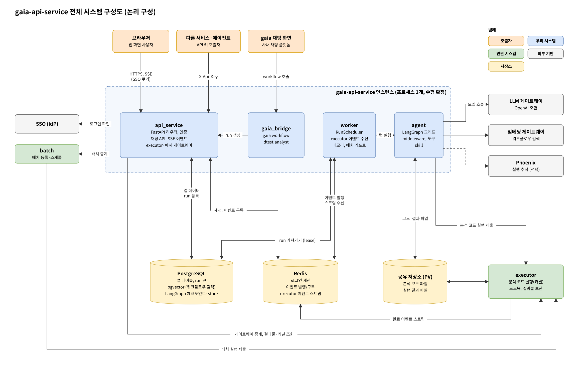
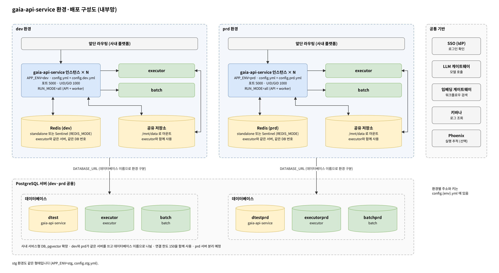

# 전체 시스템 구성도

| 항목 | 내용 |
| --- | --- |
| 시스템 | gaia-api-service (사내 데이터 분석 Agent 서비스) |
| 그림 원본 | `diagrams/01-system-architecture.drawio` (페이지 2장) |

주소, 계정, 키 같은 환경별 실제 값은 적지 않고 설정 키 이름으로 가리킵니다. 실제 값은 `config.{dev,stg,prd}.yml`에 있습니다.

## 1. 개요

gaia-api-service는 사용자, 프로젝트, 세션 계층을 가진 채팅 서비스입니다. 세션 안에서 사용자가 보낸 메시지를 데이터 분석 Agent가 처리합니다. Agent는 LangGraph와 LangChain으로 만들었고, 분석 코드는 직접 실행하지 않고 executor에 보내 실행합니다.

서비스 인스턴스 하나는 프로세스 하나이고, 그 안에서 API와 백그라운드 작업(worker)이 함께 돕니다. 같은 인스턴스를 여러 개 띄워 부하를 나눕니다.

## 2. 논리 구성도

### 2.1 구성 요소

| 구분 | 구성 요소 | 역할 |
| --- | --- | --- |
| 호출자 | 브라우저 | 웹 화면 사용자. SSO 쿠키로 로그인하고 채팅 API와 SSE를 씀 |
| 호출자 | 다른 서비스·에이전트 | `X-Api-Key`로 executor·배치 게이트웨이를 호출 |
| 호출자 | gaia 채팅 화면 | 사내 채팅 플랫폼. workflow `dtest.analyst`로 Agent를 호출 |
| 우리 시스템 | api_service | FastAPI 라우터, 인증, 채팅 API, SSE 이벤트, executor·배치 게이트웨이 |
| 우리 시스템 | gaia_bridge | gaia 메시지 하나를 우리 run 하나로 실행하고 결과를 돌려줌 |
| 우리 시스템 | worker | run 스케줄러, executor 이벤트 수신, 메모리 추출, 배치 리포트, 정리 작업 |
| 우리 시스템 | agent | LangGraph 그래프, middleware, 도구, 프롬프트, skill |
| 연관 시스템 | executor | 분석 코드 실행(커널), 노트북과 결과물 보관 |
| 연관 시스템 | batch | 배치 등록과 스케줄. 배치 실행은 executor에 직접 제출 |
| 외부 기반 | SSO (IdP) | 로그인 확인 |
| 외부 기반 | LLM 게이트웨이 | OpenAI 호환 모델 호출 |
| 외부 기반 | 임베딩 게이트웨이 | 워크플로우 검색용 임베딩 |
| 외부 기반 | Phoenix | 실행 추적 (선택) |
| 저장소 | PostgreSQL | 앱 테이블, run 큐, pgvector(워크플로우 검색), LangGraph 체크포인트와 store |
| 저장소 | Redis | 로그인 세션, 이벤트 발행/구독, executor 이벤트 스트림 |
| 저장소 | 공유 저장소 (PV) | executor와 주고받는 분석 코드 파일과 실행 결과 파일 |

### 2.2 연결

| 출발 | 도착 | 내용 | 끊기면 |
| --- | --- | --- | --- |
| 브라우저 | api_service | 채팅 API, SSE 실시간 이벤트 | |
| 다른 서비스·에이전트 | api_service | API 키로 executor·배치 게이트웨이 호출 | |
| gaia 채팅 화면 | gaia_bridge | gaia workflow `dtest.analyst` | |
| gaia_bridge | api_service | API와 같은 방식으로 run 생성 | |
| api_service | SSO | 로그인 확인 | 새 로그인 불가. 이미 로그인한 사용자는 계속 사용 |
| api_service, worker | PostgreSQL | 앱 데이터, run 등록과 가져가기, 체크포인트 | 모든 요청 실패. run 실행 중단 |
| api_service, worker | Redis | 로그인 세션, 실시간 이벤트, executor 이벤트 수신 | 로그인 확인 실패로 모든 요청 실패 |
| worker | agent | run 한 턴 실행 | |
| agent | LLM 게이트웨이 | 모델 호출 | run이 `failed`로 끝남. 그 외 화면은 정상 |
| agent | 임베딩 게이트웨이 | 워크플로우 검색 | 워크플로우 추천만 안 됨 |
| agent | executor | 분석 코드 실행 제출 | 분석 요청 실패. 일반 대화는 정상 |
| api_service | executor | 게이트웨이 중계, 결과물과 커널 조회 | 결과물 조회 502 |
| api_service | batch | 배치 등록과 조회 중계 | 배치 화면만 502 |
| agent, executor | 공유 저장소 | 코드 파일 쓰기, 결과 파일 읽기 | 분석 코드 제출과 결과 읽기 실패 |
| executor | Redis | 실행 완료 이벤트 스트림 | |
| batch | executor | 배치 실행 제출 | |
| agent | Phoenix | 실행 추적 (선택) | 영향 없음 |

### 2.3 동작 원리

- **사용자 턴 하나가 run 하나입니다.** API는 `runs` 테이블에 행을 넣고 바로 응답합니다. worker가 그 행을 가져가 실행합니다. PostgreSQL 테이블이 작업 큐입니다.
- **기다리는 동안 자원을 잡지 않습니다.** 사용자 확인이 필요하거나 executor가 코드를 실행하는 동안에는 그래프를 멈추고 상태를 체크포인트에 저장합니다. 답이나 결과가 오면 같은 지점부터 이어 갑니다.
- **어느 인스턴스든 이어 갈 수 있습니다.** 실행 권한은 lease(기본 60초)로 잡습니다. 인스턴스가 죽으면 lease가 만료되고 다른 인스턴스가 체크포인트에서 이어 갑니다.
- **화면에는 이벤트로 알립니다.** 진행 상황은 Redis 발행/구독으로 각 인스턴스에 퍼지고 브라우저는 SSE로 받습니다.

## 3. 환경·배포 구성도

### 3.1 환경

| 환경 | `APP_ENV` | 설정 파일 | SSO |
| --- | --- | --- | --- |
| 로컬 | 비움 | `config.yml` + 환경변수 | dev 어댑터(가짜 로그인) 가능 |
| dev | `dev` | `config.yml` + `config.dev.yml` | idp |
| stg | `stg` | `config.yml` + `config.stg.yml` | idp |
| prd | `prd` | `config.yml` + `config.prd.yml` | idp |

### 3.2 자원

| 자원 | 구성 |
| --- | --- |
| 서비스 인스턴스 | 프로세스 1개(uvicorn worker 1개). 포트 5000(사내 앱서버 정책). `RUN_MODE=all`로 API와 worker를 함께 실행. 실행 계정 UID 1000, GID 1000 |
| PostgreSQL | 사내 서비스형 DB. `vector` 확장 필요. dev와 prd가 같은 서버를 쓰고 데이터베이스 이름으로 나뉨(dev `dtest`, prd `dtestprd`). 같은 서버에 executor와 batch의 데이터베이스도 있음. 연결 한도 150을 함께 사용. prd 서버 분리 예정 |
| Redis | dev와 prd가 분리되어 있음. `REDIS_MODE`로 standalone과 Sentinel 중 선택. 그 환경의 executor와 같은 서버, 같은 DB 번호여야 함 |
| 공유 저장소 | executor와 같은 저장소를 `/mnt/data`에 마운트 |
| 앞단 라우팅, 컨테이너 배치, 자동 확장 | 사내 플랫폼이 담당 |
| 로그 | 키바나에서 조회 |

### 3.3 상태 확인 경로

| 용도 | 경로 |
| --- | --- |
| 준비 확인 | `GET /api/admin/appReady` |
| 생존 확인 | `GET /api/v1/healthz` (백그라운드 루프가 하나라도 죽으면 503) |

## 4. 그림 관리

- 원본은 `diagrams/01-system-architecture.drawio`입니다. Draw.io 앱이나 app.diagrams.net에서 열어 고칩니다.
- 문서에 들어가는 이미지는 `diagrams/export/`에 있습니다. 원본을 고친 뒤 다시 내보냅니다.
- 색 규칙: 주황은 호출자, 파랑은 우리 시스템, 초록은 연관 시스템, 회색은 외부 기반, 노랑은 저장소입니다.
