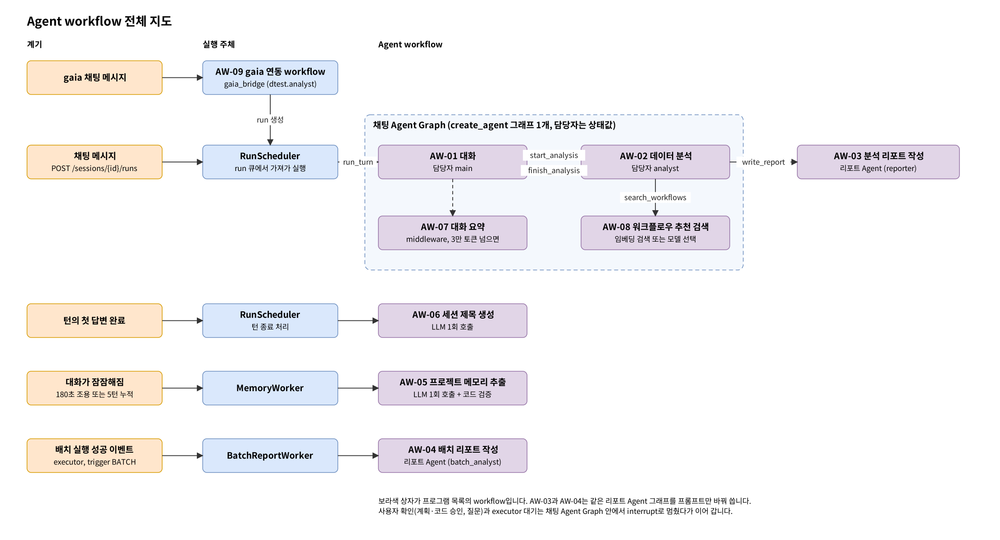
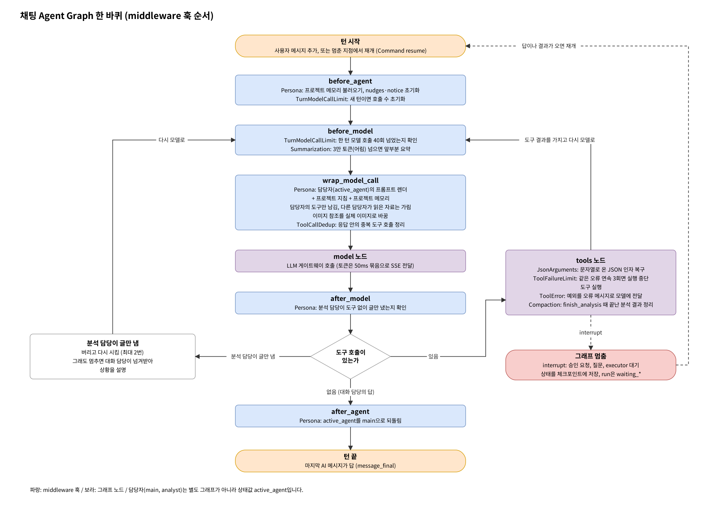
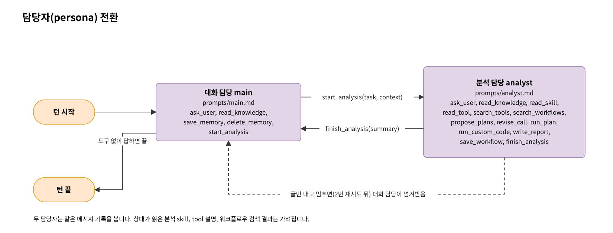
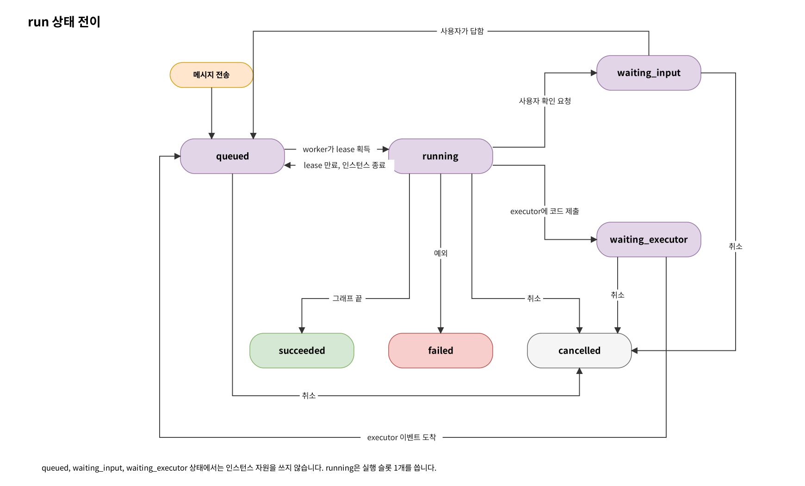
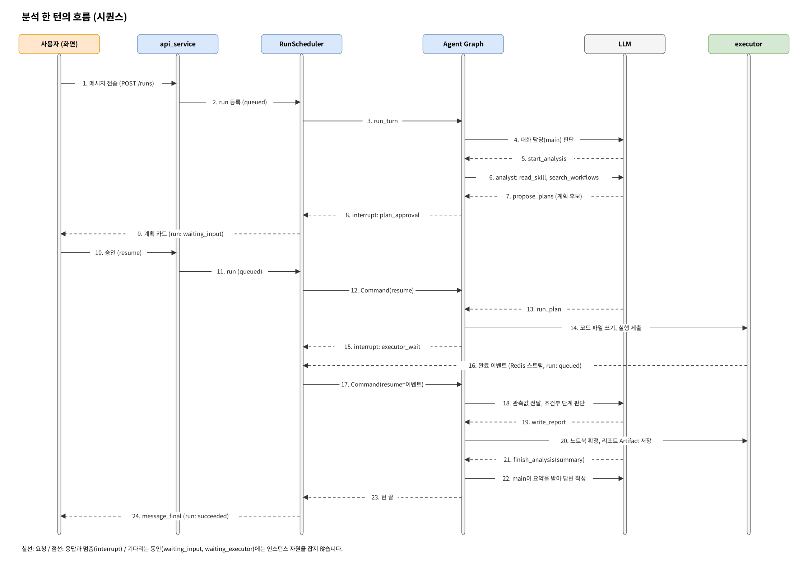
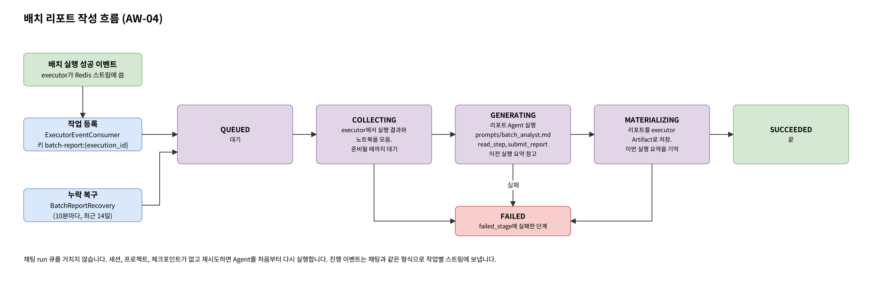
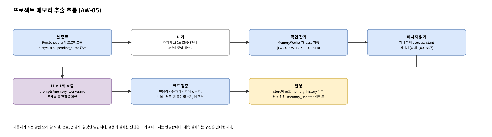

# 프로그램 명세서 (Agent Graph)

| 항목 | 내용 |
| --- | --- |
| 시스템 | pr-agentic-service (사내 데이터 분석 Agent 서비스) |
| 그림 원본 | `diagrams/02-agent-workflow.drawio`, `diagrams/03-agent-graph.drawio` (페이지 6장) |
| 관련 문서 | `02-program-list.xlsx` (프로그램 목록). 이 문서의 AW, G 번호는 그 목록의 ID입니다 |

소스 경로는 `src/dtest/` 아래입니다.

## 1. 개요

Agent는 LangGraph와 LangChain으로 구현했습니다. deepagents의 방식대로 그래프는 단순하게 두고 행동은 middleware를 조립해 만들며, 분석 방법은 skill 문서와 tool 함수로 바깥에 둡니다.

| ID | workflow | 그래프 | 시작 조건 |
| --- | --- | --- | --- |
| AW-01 | 대화 | G-01 채팅 Agent Graph (담당자 main) | 사용자가 세션에 메시지를 보냄 |
| AW-02 | 데이터 분석 | G-01 채팅 Agent Graph (담당자 analyst) | AW-01이 `start_analysis` 호출 |
| AW-03 | 분석 리포트 작성 | G-02 리포트 Agent Graph | AW-02가 `write_report` 호출 |
| AW-04 | 배치 리포트 작성 | G-02 리포트 Agent Graph | 배치 실행 성공 이벤트 |
| AW-05 | 프로젝트 메모리 추출 | 없음 (LLM 1회 호출) | 대화가 180초 조용하거나 5턴 누적 |
| AW-06 | 세션 제목 생성 | 없음 (LLM 1회 호출) | 세션의 첫 답변 완료 |
| AW-07 | 대화 요약 | G-01의 middleware | 대화 이력이 3만 토큰(어림) 초과 |
| AW-08 | 워크플로우 추천 검색 | 없음 (임베딩 검색 또는 LLM 1회 호출) | AW-02가 `search_workflows` 호출 |
| AW-09 | gaia 연동 workflow | G-03 gaia 연동 graph | gaia 채팅 메시지 |

공통 실행 원리는 다음과 같습니다.

- **사용자 턴 하나가 run 하나입니다.** API는 `runs` 테이블에 행을 넣고 끝납니다. `RunScheduler`가 그 행을 lease로 가져가 그래프를 실행합니다.
- **대화 상태는 체크포인트에 있습니다.** 세션 id가 LangGraph의 thread id입니다. 여러 턴에 걸친 대화는 이 상태를 이어 붙여서 됩니다.
- **기다림은 `interrupt`입니다.** 사용자 확인과 executor 대기는 그래프를 멈추고 상태를 저장합니다. 기다리는 동안 인스턴스 자원을 잡지 않고, 답이나 결과가 오면 `Command(resume=...)`로 같은 지점부터 이어 갑니다.

## 2. G-01 채팅 Agent Graph

### 2.1 구성

`agent/graph.py`의 `AgentGraphs.get()`이 모델 이름마다 그래프를 하나 만들어 캐시합니다. 모든 그래프가 같은 체크포인터와 store를 씁니다.

| 항목 | 내용 |
| --- | --- |
| 생성 | LangChain `create_agent(model, tools, middleware, state_schema, context_schema, checkpointer, store)` |
| 노드 | model 노드와 tools 노드의 반복. 모델 응답에 도구 호출이 없으면 끝남 |
| 모델 | LLM 게이트웨이(OpenAI 호환). `MODELS`에 적힌 모델만 사용 (`agent/llm.py`) |
| 도구 | 16개. 담당자에 따라 보이는 도구가 다름 (2.4절) |
| middleware | 8개 (2.3절) |
| 상태 | `AnalysisState` (2.2절). 체크포인트에 저장 |
| 실행 문맥 | `RunContext`. run마다 주입하고 저장하지 않음 |
| 체크포인터 | PostgreSQL (`AsyncPostgresSaver`). thread id는 세션 id |
| store | PostgreSQL (`AsyncPostgresStore`). 프로젝트 메모리, 도구 1회 실행 기록 |
| 실행 방식 | `graph.astream(stream_mode=["messages", "updates"], durability="async")`. 토큰은 50ms 단위로 묶어 이벤트로 발행 |
| 한도 | 한 턴 모델 호출 40회(`AGENT_MODEL_CALL_LIMIT`), 그래프 단계 200(`AGENT_RECURSION_LIMIT`) |

### 2.2 상태와 실행 문맥

`AnalysisState` (체크포인트에 남는 값)

| 필드 | 내용 |
| --- | --- |
| messages | 대화 메시지 이력 (사용자, AI, 도구 결과) |
| active_agent | 지금 대화를 이끄는 담당자. `main` 또는 `analyst` |
| plan | 승인된 Workflow 1.0 문서와 실행 바인딩 |
| execution | 세션의 살아 있는 executor 실행 (커널 하나, 노트북 하나) |
| nudges | 이번 그래프 실행에서 분석 담당의 글만 있는 답을 돌려보낸 횟수 |
| notice | 다음 모델 호출에만 덧붙이는 일회성 지시 |
| recommend | 이 run의 `search_workflows`가 찾은 유사도와 사용자의 추천 거절 여부 |

`RunContext` (run마다 주입하는 값)

| 필드 | 내용 |
| --- | --- |
| services | DB, 이벤트, executor 클라이언트, 카탈로그 같은 서비스 객체 |
| run_id, session_id, project_id, user_id | 실행 식별자 |
| model | 이 턴에 쓰는 모델 이름 |
| code_level | 코드 생성 레벨 (1~4) |
| project_prompt | 프로젝트 지시문 |
| user_text, user_content | 사용자 입력. 이미지가 있으면 content 블록 |

### 2.3 그래프 한 바퀴와 middleware

middleware는 아래 순서로 붙습니다.

| 순서 | middleware | 훅 | 역할 |
| --- | --- | --- | --- |
| 1 | `PersonaMiddleware` | before_agent, wrap_model_call, after_model, after_agent | 담당자 전환, 담당자별 프롬프트와 도구 고르기, 프로젝트 지침·메모리·이미지 주입, 분석 담당이 도구 없이 글만 내고 멈추는 것 방지 |
| 2 | `JsonArgumentsMiddleware` | wrap_tool_call | 문자열로 온 JSON 인자를 검증 전에 복구 |
| 3 | `ToolCallDedupMiddleware` | wrap_model_call | 한 응답 안의 같은 도구 호출은 한 번만 실행. 여러 `propose_plans` 호출은 하나로 합침 |
| 4 | `ToolFailureLimitMiddleware` | wrap_tool_call | 같은 도구가 같은 오류로 연속 3회(`AGENT_TOOL_FAILURE_LIMIT`), 어떤 도구든 연속 5회(`AGENT_TOOL_FAILURE_ANY_LIMIT`) 실패하면 더 실행하지 않고 사용자에게 설명하게 함 |
| 5 | `ToolErrorMiddleware` | wrap_tool_call | 도구 예외를 모델에게 메시지로 돌려줌. 문구는 `agent/tool_errors.py` |
| 6 | `TurnModelCallLimitMiddleware` | before_agent, before_model, after_model | 한 턴의 모델 호출을 40회로 제한. 멈췄다 이어져도 누적 |
| 7 | 끝난 분석 정리 (`ToolResultCompactionMiddleware`) | wrap_tool_call | `finish_analysis` 때 그 분석의 긴 도구 결과를 규칙대로 줄임 (`AGENT_COMPACT_FINISHED_ANALYSIS`) |
| 8 | `ReportingSummarizationMiddleware` | before_model | 대화가 3만 토큰(어림)을 넘으면 앞부분을 요약 (AW-07) |

### 2.4 담당자

담당자는 별도 Agent나 서브그래프가 아니라 상태값 `active_agent`입니다. `PersonaMiddleware`가 모델을 부를 때마다 그 담당자의 프롬프트와 도구만 보이게 바꿉니다.

| | 대화 담당 `main` | 분석 담당 `analyst` |
| --- | --- | --- |
| 프롬프트 | `prompts/main.md` | `prompts/analyst.md` |
| 읽는 자료 | 도메인 지식(knowledge) | 분석 skill, tool 설명, 도메인 지식 |
| 도구 | `ask_user`, `read_knowledge`, `save_memory`, `delete_memory`, `start_analysis` | `ask_user`, `read_knowledge`, `read_skill`, `read_tool`, `search_tools`, `search_workflows`, `propose_plans`, `revise_call`, `run_plan`, `run_custom_code`, `write_report`, `save_workflow`, `finish_analysis` |
| 하는 일 | 대화, 도메인 질문 답변, 메모리 관리, 분석 넘기기 | 계획, 승인 받기, executor 실행, 결과 판단, 리포트, 워크플로우 저장 |

- 전환은 도구가 상태를 바꾸는 것(`Command(update={"active_agent": ...})`)이라 다음 모델 호출부터 다른 프롬프트와 도구가 적용됩니다.
- 두 담당자는 같은 메시지 기록을 봅니다. 상대가 읽은 자료(`read_skill`, `read_tool`, `search_tools`, `search_workflows`의 결과)는 가립니다. 지식 skill은 함께 쓰므로 가리지 않습니다.
- 분석 담당이 도구 없이 글만 내면 그 답을 버리고 다시 시킵니다(최대 2번, `prompts/analyst_continue.md`). 그래도 멈추면 대화 담당이 넘겨받아 상황을 설명합니다(`prompts/main_fallback.md`).
- 턴이 끝나면 `active_agent`를 `main`으로 되돌립니다.

### 2.5 멈춤과 재개

| 멈춤 종류 | 부르는 도구 | run 상태 | 이어 가는 계기 |
| --- | --- | --- | --- |
| `question` | `ask_user` | `waiting_input` | 사용자의 답 |
| `plan_approval` | `propose_plans` | `waiting_input` | 사용자의 승인, 수정, 거절 |
| `code_approval` | `run_custom_code` | `waiting_input` | 사용자의 승인 또는 거절 |
| `workflow_save` | `save_workflow` | `waiting_input` | 사용자의 승인 또는 거절 |
| `executor_wait` | `run_plan`, `run_custom_code` | `waiting_executor` | executor 완료 이벤트 |

- 도구 안에서 `interrupt(payload)`를 부르면 LangGraph가 그 시점의 상태를 체크포인트에 저장하고 그래프를 끝냅니다. 스케줄러가 종류를 보고 run 상태를 바꾼 뒤 lease를 놓습니다.
- 이어 갈 때 LangGraph는 멈췄던 도구를 처음부터 다시 실행하고, `interrupt()`가 이번에는 받은 값을 돌려줍니다.
- 도구가 다시 실행돼도 executor에 두 번 보내지 않습니다. 도구 호출별 결과를 store에 기록하고, 모든 executor 요청에 `run_id:tool_call_id`로 만든 멱등 키를 쓰며, 코드 파일도 같은 경로에 한 번만 씁니다.
- 인스턴스가 죽으면 lease(기본 60초)가 만료되고 다른 인스턴스가 체크포인트에서 이어 갑니다.

| 상태 | 뜻 | 인스턴스 자원 |
| --- | --- | --- |
| `queued` | worker를 기다림 | 쓰지 않음 |
| `running` | 어느 인스턴스가 실행 중 | 실행 슬롯 1개 |
| `waiting_input` | 사용자 확인을 기다림 | 쓰지 않음 |
| `waiting_executor` | executor가 코드를 실행 중 | 쓰지 않음 |
| `succeeded`, `failed`, `cancelled` | 끝남 | 쓰지 않음 |

## 3. AW-01 대화

| 항목 | 내용 |
| --- | --- |
| 그래프 | G-01, 담당자 `main` |
| 시작 | `POST /api/v1/sessions/{id}/runs`. gaia에서는 AW-09가 같은 방식으로 run을 만듦 |
| 입력 | 사용자 메시지(이미지 포함 가능), 체크포인트의 대화 이력, 프로젝트 지시문, 프로젝트 메모리 |
| 프롬프트 | `prompts/main.md` + 프로젝트 지시문 + 프로젝트 메모리 |
| 처리 | 일반 대화와 도메인 질문은 직접 답합니다. 필요하면 `read_knowledge`로 지식 skill을 읽습니다. 사용자가 명시적으로 요청하면 `save_memory`, `delete_memory`로 프로젝트 메모리를 고칩니다. 데이터 분석이 필요하면 `start_analysis`로 AW-02에 넘깁니다 |
| 출력 | 마지막 AI 메시지가 답변입니다. `messages`와 `run_events`에 저장하고 `message_final` 이벤트로 보냅니다 |
| 오류 | 예외가 나면 run이 `failed`로 끝나고 `run_error` 이벤트를 보냅니다. 모델 호출 한도를 넘으면 턴을 끝냅니다 |

## 4. AW-02 데이터 분석

| 항목 | 내용 |
| --- | --- |
| 그래프 | G-01, 담당자 `analyst` |
| 시작 | AW-01의 `start_analysis(task, context)` |
| 입력 | 분석 과제, skill·tool 카탈로그, 승격된 워크플로우 템플릿, 코드 생성 레벨 |
| 프롬프트 | `prompts/analyst.md` (skill 목록, 코드 레벨, 계획 상태, 후보 수가 채워짐) |
| 출력 | 승인된 계획, executor 실행 결과와 노트북, 리포트 Artifact, 워크플로우 후보, 대화 담당에게 넘기는 요약 |

### 4.1 단계

1. **자료 읽기.** `read_skill`, `read_tool`, `search_tools`로 분석 방법과 tool을 확인하고, `search_workflows`로 비슷한 워크플로우 템플릿을 찾습니다(AW-08).
2. **계획 제안.** `propose_plans`로 후보를 최대 5개(`PLAN_CANDIDATES`) 냅니다. 모델은 평평한 호출 목록(`{"skill", "tool", "args"}`)만 쓰고, 서버가 Workflow 1.0 문서로 바꿔 검증합니다(`agent/plan_format.py`, `core/workflows/spec.py`). 추천 템플릿은 그대로 후보에 넣습니다.
3. **승인.** `plan_approval`로 멈춰 사용자에게 계획 카드를 보입니다. 후보가 템플릿 하나뿐이고 즉시 실행이 허용되며 필수 입력이 다 있고 유사도가 `WORKFLOW_AUTO_RUN_SIMILARITY`(0.77) 이상이면 카드 없이 승인합니다.
4. **실행.** `run_plan`이 승인된 계획에서 아직 안 한 호출을 조건부 호출 앞까지 묶어 executor에 한 번에 보냅니다. tool 코드와 호출 코드를 만들어 공유 저장소에 파일로 쓰고 `code_sources`에 기록한 뒤 `executor_wait`로 멈춥니다.
5. **결과 판단.** executor가 끝나면 단계별 관측값을 모델에게 줍니다. 조건부 호출은 모델이 `decisions`로 실행 여부를 정해 `run_plan`을 다시 부릅니다. 실패한 호출은 `revise_call`로 인자만 고칩니다.
6. **직접 쓴 코드.** 코드 레벨이 허락하면 `run_custom_code`로 모델이 쓴 코드를 `code_approval` 승인 뒤 실행합니다.
7. **리포트.** `write_report`가 노트북을 확정하고 AW-03으로 리포트를 써서 executor에 Artifact로 저장합니다.
8. **워크플로우 저장.** `save_workflow`로 승인된 계획을 워크플로우 후보로 저장하자고 제안합니다(`workflow_save`).
9. **마무리.** `finish_analysis(summary)`로 대화 담당에게 돌아가고, 대화 담당이 사용자에게 답합니다.

### 4.2 코드 생성 레벨

세션 설정이고 프로젝트 기본값을 따르며, 시스템 기본값은 3(`DEFAULT_CODE_LEVEL`)입니다.

| 레벨 | 이름 | Agent가 할 수 있는 것 |
| --- | --- | --- |
| 1 | tools_only | 등록된 tool 선택과 인자 결정만. `run_custom_code` 사용 불가 |
| 2 | tools_with_glue | 1 + tool 사이 짧은 연결 코드 |
| 3 | tools_first | 2 + 맞는 tool이 없거나 실패를 메울 때 새 함수 작성 |
| 4 | free_code | 계획 제안 없이 바로 코드를 작성해 분석 가능 |

Agent가 쓴 코드는 레벨과 무관하게 승인 화면에 전문을 보여 줍니다.

### 4.3 결과를 Agent가 읽는 방법

executor에 보내는 코드는 `agent/codegen.py`가 만듭니다. tool 셀은 "tool 함수 + 호출 + `_agentic_observe(변수)`" 형태입니다. `_agentic_observe`가 결과를 짧은 JSON으로 `AGENTIC_OBSERVATION ...` 한 줄 출력하고, 단계가 끝나면 그 줄만 골라 모델에게 관측값으로 줍니다. 데이터 자체는 커널 변수로 남고 모델에는 수 KB 요약만 갑니다.

### 4.4 skill과 tool

| 종류 | 위치 | 쓰는 방법 |
| --- | --- | --- |
| skill | `assets/skills/<분류>/<이름>.md` | 프롬프트에는 목록만 넣고, 필요한 것만 `read_skill`로 읽음 |
| tool | `assets/tools/<분류>/<이름>.py` | `read_tool`로 설명을 읽고 계획에 넣음. 실행은 executor에서 |
| knowledge | `assets/knowledge/<이름>.md` | `read_knowledge`로 읽음. 두 담당자가 함께 씀 |

파일이 바뀌면 다음 run부터 반영됩니다. `CATALOG_EXTENSIONS`로 카탈로그 폴더를 더 붙일 수 있습니다.

## 5. G-02 리포트 Agent Graph (AW-03, AW-04)

`agent/report_agent.py`의 `ReportAgent`가 분석 리포트와 배치 리포트를 모두 씁니다. 프롬프트와 한도만 다릅니다. 체크포인터가 없어 재시도하면 처음부터 다시 실행합니다.

| 항목 | AW-03 분석 리포트 | AW-04 배치 리포트 |
| --- | --- | --- |
| 시작 | 채팅 턴 안의 `write_report` | 배치 실행 성공 이벤트로 등록된 작업 |
| 실행 주체 | AW-02의 도구 | `BatchReportWorker` (채팅 run 큐를 거치지 않음) |
| 프롬프트 | `prompts/reporter.md` | `prompts/batch_analyst.md` |
| 모델 호출 한도 | 8 (`REPORT_MODEL_CALL_LIMIT`) | 20 (`BATCH_REPORT_MODEL_CALL_LIMIT`) |
| 도구 | `read_step` (근거를 줄였을 때만) | `read_step`, `submit_report` |
| 리포트 | Agent의 마지막 답변 | `submit_report(title, markdown, summary)`로 제출 |
| 이전 실행 참고 | 없음 | 같은 배치의 이전 실행 요약 최대 5건 (`BATCH_REPORT_MEMORY_RUNS`). store의 `("batch_memory", batch_id)`에 보관 |
| 이벤트 | 도구 호출만 채팅에 진행 상황으로 전달. 본문은 Artifact로 감 | 작업별 스트림에 채팅과 같은 형식으로 전달 |
| 저장 | executor Artifact | `batch_report_jobs`, executor Artifact |

- **근거 수집.** `agent/reporter.py`가 모든 단계의 코드, 관측값, 출력을 모읍니다. 전체가 6만 자(`REPORT_EVIDENCE_MAX_CHARS`) 안이면 자르지 않고 넣고, 이때는 `read_step`을 주지 않아 모델 호출 한 번으로 씁니다. 넘으면 줄인 단계와 뺀 단계에 표시를 남기고, Agent가 표시된 단계만 `read_step`으로 읽습니다.
- **수치 대조.** 작성 뒤 리포트의 수치를 근거와 대조해, 근거에서 찾지 못한 수치가 있을 때만 그 목록을 주고 한 번 고치게 합니다.

| 상태 | 하는 일 |
| --- | --- |
| `QUEUED` | 대기 |
| `COLLECTING` | executor에서 실행 결과와 노트북을 모음. 준비될 때까지 기다림(최대 `BATCH_REPORT_COLLECT_TIMEOUT_SECONDS`, 1,800초) |
| `GENERATING` | 리포트 Agent 실행 |
| `MATERIALIZING` | 리포트를 executor Artifact로 저장하고 이번 실행 요약을 기억 |
| `SUCCEEDED`, `FAILED` | 끝남. 실패하면 `failed_stage`에 단계가 남음 |

## 6. AW-05 프로젝트 메모리 추출

| 항목 | 내용 |
| --- | --- |
| 실행 주체 | `MemoryWorker` (`worker/memory.py`). `MEMORY_WORKER_ENABLED`로 켜고 끔 |
| 시작 | 턴이 끝나면 프로젝트를 dirty로 표시합니다. 그 프로젝트의 대화가 180초(`MEMORY_WORKER_QUIET_SECONDS`) 조용하거나 5턴(`MEMORY_WORKER_MAX_TURNS`)이 쌓이면 worker 하나가 lease로 잡습니다 |
| 입력 | 마지막 처리 위치 뒤의 user·assistant 메시지 한 묶음(최대 8,000 토큰, `MEMORY_WORKER_MAX_INPUT_TOKENS`), 메모리 주제의 id·제목·설명 |
| 프롬프트 | `prompts/memory_worker.md` |
| 처리 | 모델을 한 번 불러 주제별 줄 편집을 받습니다. 모델은 사용자가 직접 말한 오래 갈 사실, 선호, 관심사, 일정만 남길 수 있습니다 |
| 검증 | 코드가 확인합니다. 인용이 사용자 메시지에 있는지, URL·경로·제목이 없는지, id가 존재하는지 봅니다. 실패한 편집은 버리고 나머지는 반영합니다 |
| 출력 | store의 프로젝트 메모리, `memory_history` 이력, `memory_updated` 이벤트 |
| 오류 | 계속 실패하는 묶음은 정해진 횟수 뒤 건너뜁니다 |

프로젝트 메모리는 주제 목록과 주제별 본문(줄 단위)으로 이루어지고 LangGraph store에 있습니다. 임베딩 색인 없이 전체를 프롬프트에 넣습니다. 사용자가 "기억해 줘"처럼 명시적으로 요청한 것은 AW-01의 `save_memory`가 바로 반영합니다.

## 7. AW-06 세션 제목 생성

| 항목 | 내용 |
| --- | --- |
| 실행 주체 | `RunScheduler`의 턴 종료 처리 (`agent/titles.py`) |
| 시작 | 세션의 첫 답변이 끝남 |
| 입력 | 첫 질문(1,000자까지)과 답변(1,500자까지) |
| 처리 | 모델을 한 번 불러 한국어 명사구 하나(25자 이내)를 받습니다 |
| 출력 | `sessions.title`, `title_source = auto`, `session_titled` 이벤트 |

## 8. AW-07 대화 요약

| 항목 | 내용 |
| --- | --- |
| 실행 주체 | G-01의 `ReportingSummarizationMiddleware` (before_model 훅) |
| 시작 | 대화 이력이 `AGENT_SUMMARY_TRIGGER_TOKENS`(30,000, 어림 계산)를 넘음 |
| 처리 | 앞부분을 `prompts/summary.md` 틀로 요약(최대 6,000자, `AGENT_SUMMARY_MAX_CHARS`)하고, 최근 메시지는 기준의 절반만큼 남깁니다 |
| 출력 | 요약 메시지로 바뀐 대화 이력, 진행 이벤트 `activity`, 요약 위치를 남기는 `context_summarized` 이벤트 |

끝난 분석의 긴 도구 결과는 요약 전에 끝난 분석 정리 middleware가 먼저 줄입니다.

## 9. AW-08 워크플로우 추천 검색

| 항목 | 내용 |
| --- | --- |
| 실행 주체 | AW-02의 `search_workflows` 도구 (`core/workflows/service.py`) |
| 대상 | 삭제되지 않은 승격 템플릿(`lifecycle = template`) |
| 임베딩이 켜져 있을 때 | 요청 문장을 임베딩해 `workflow_query_vectors`에서 코사인 유사도로 찾습니다. `WORKFLOW_SIMILARITY`(0.70) 이상만 후보입니다 |
| 임베딩이 꺼져 있을 때 | 모델이 템플릿의 이름, 원래 요청, 예시 질문을 읽고 맞는 것을 고릅니다(`core/workflows/pick.py`, 최근 40개까지). 이때는 유사도가 없어 바로 실행하지 않습니다 |
| 출력 | 추천 워크플로우와 유사도. 상태 `recommend`에 기록해 `propose_plans`가 씁니다 |

## 10. AW-09 gaia 연동 workflow

| 항목 | 내용 |
| --- | --- |
| 그래프 | G-03. `src/workflows/dtest/analyst.py`가 내보내고 구현은 `gaia_bridge/`에 있음 |
| 구성 | LangGraph `StateGraph`. 노드 하나(`answer`) |
| 입력 | `query`, `user_id`(사번), `session_id`(gaia 세션 id), `trace_id` |
| 처리 | gaia 메시지 하나를 우리 채팅의 한 턴으로 실행합니다. API와 같은 방식으로 run을 만들고 worker가 실행합니다. 다리는 세션 이벤트를 따라가며 글을 gaia로 흘리고, run이 끝나면 답을 돌려줍니다 |
| 세션 대응 | gaia 세션 id마다 사용자의 기본 프로젝트에 우리 세션 하나를 만듭니다(`gaia_sessions`). 같은 대화가 우리 화면에도 보입니다 |
| 사용자 확인 | gaia의 HITL은 쓰지 않습니다. 계획 승인은 첫 후보로 자동 승인하고(필수 입력값이 비면 그 값을 물음), 코드 승인은 승인, 메모리 변경과 워크플로우 저장 제안은 거절합니다. Agent의 질문은 그 질문을 답으로 보내 턴을 끝내고, 다음 gaia 메시지가 그 답이 됩니다 |
| 출력 | `answer`, `urls`(리포트, 노트북 링크) |

## 11. 이벤트

화면에는 이벤트로 알립니다. 진행 상황은 Redis 발행/구독으로 각 인스턴스에 퍼지고 브라우저는 SSE(`GET /api/v1/sessions/{id}/events`)로 받습니다. 저장이 필요한 이벤트는 `run_events`에도 남겨, 끊겼다 다시 붙으면 이어 받습니다. 토큰 단위 스트리밍과 executor 진행 이벤트는 저장하지 않습니다.

이벤트 종류의 정의는 `core/contracts/events.py`, 사용자 확인 요청의 형식은 `core/contracts/hitl.py`에 있습니다.

## 12. 주요 설정

| 설정 | 기본값 | 내용 |
| --- | --- | --- |
| `DEFAULT_CODE_LEVEL` | 3 | 코드 생성 레벨 기본값 |
| `PLAN_CANDIDATES` | 5 | 계획 후보 최대 개수 |
| `PLAN_RECOMMEND_MODE` | mixed | 추천 워크플로우와 새 계획을 섞을지(`mixed`), 추천을 먼저 낼지(`recommend_first`) |
| `AGENT_RECURSION_LIMIT` | 200 | 한 턴의 그래프 단계 상한 |
| `AGENT_MODEL_CALL_LIMIT` | 40 | 한 턴의 모델 호출 상한 |
| `AGENT_TOOL_FAILURE_LIMIT` | 3 | 같은 도구의 같은 오류 연속 허용 횟수 |
| `AGENT_TOOL_FAILURE_ANY_LIMIT` | 5 | 어떤 도구든 연속 실패 허용 횟수 |
| `AGENT_COMPACT_FINISHED_ANALYSIS` | true | 끝난 분석의 도구 결과 정리 |
| `AGENT_SUMMARY_TRIGGER_TOKENS` | 30000 | 대화 요약 시작 기준 |
| `AGENT_SUMMARY_MAX_CHARS` | 6000 | 요약 최대 길이 |
| `REPORT_MODEL_CALL_LIMIT` | 8 | 분석 리포트의 모델 호출 상한 |
| `REPORT_EVIDENCE_MAX_CHARS` | 60000 | 리포트 근거 최대 길이 |
| `BATCH_REPORT_MODEL_CALL_LIMIT` | 20 | 배치 리포트의 모델 호출 상한 |
| `BATCH_REPORT_MEMORY_RUNS` | 5 | 배치 리포트가 참고하는 이전 실행 수 |
| `BATCH_REPORT_CONCURRENCY` | 4 | 배치 리포트 worker 수 |
| `MEMORY_WORKER_QUIET_SECONDS` | 180 | 메모리 추출을 시작하는 조용한 시간 |
| `MEMORY_WORKER_MAX_TURNS` | 5 | 메모리 추출을 시작하는 누적 턴 수 |
| `WORKFLOW_SIMILARITY` | 0.70 | 템플릿을 추천 후보로 올리는 최소 유사도 |
| `WORKFLOW_AUTO_RUN_SIMILARITY` | 0.77 | 승인 카드 없이 실행하는 최소 유사도 |
| `RUN_CONCURRENCY` | 16 | 인스턴스당 동시 실행 run 수 |
| `RUN_USER_CONCURRENCY` | 4 | 사용자당 동시 실행 run 수 |
| `RUN_LEASE_SECONDS` | 60 | run 실행 권한 유지 시간 |
| `RUN_MAX_ATTEMPTS` | 5 | 결과 없이 반복 실행을 허용하는 횟수 |

## 13. 소스 파일

| 파일 | 역할 |
| --- | --- |
| `agent/graph.py` | 그래프 조립, `run_turn`(시작, 재개, 스트리밍) |
| `agent/context.py` | `RunContext`, `AnalysisState`, 리포트 Agent의 문맥과 상태 |
| `agent/llm.py` | LLM 게이트웨이 클라이언트 |
| `agent/middleware/` | middleware 8종 |
| `agent/tools/main.py`, `common.py`, `analysis.py`, `batch.py` | Agent 도구 |
| `agent/plan_format.py` | 모델이 쓰는 호출 목록과 Workflow 1.0 문서 사이의 변환 |
| `agent/codegen.py` | executor로 보낼 코드 생성, 관측값 파싱 |
| `agent/reporter.py`, `report_agent.py`, `batch.py` | 리포트 근거 수집, 리포트 Agent, 배치 리포트 실행 |
| `agent/titles.py` | 세션 제목 생성 |
| `agent/activity.py`, `tool_errors.py`, `tool_labels.py` | 진행 이벤트, 도구 오류 문구, 화면에 보일 도구 이름 |
| `agent/prompts/*.md` | 프롬프트 8종 |
| `worker/scheduler.py` | run 가져가기, lease 갱신, interrupt 처리, 완료 기록, 취소 |
| `worker/executor_events.py` | executor 이벤트 소비와 복구 |
| `worker/batch_reports.py`, `worker/memory.py` | 배치 리포트 작업, 메모리 추출 |
| `core/workflows/` | Workflow 1.0 형식, 저장, 검색 |
| `gaia_bridge/` | gaia 연동 |
