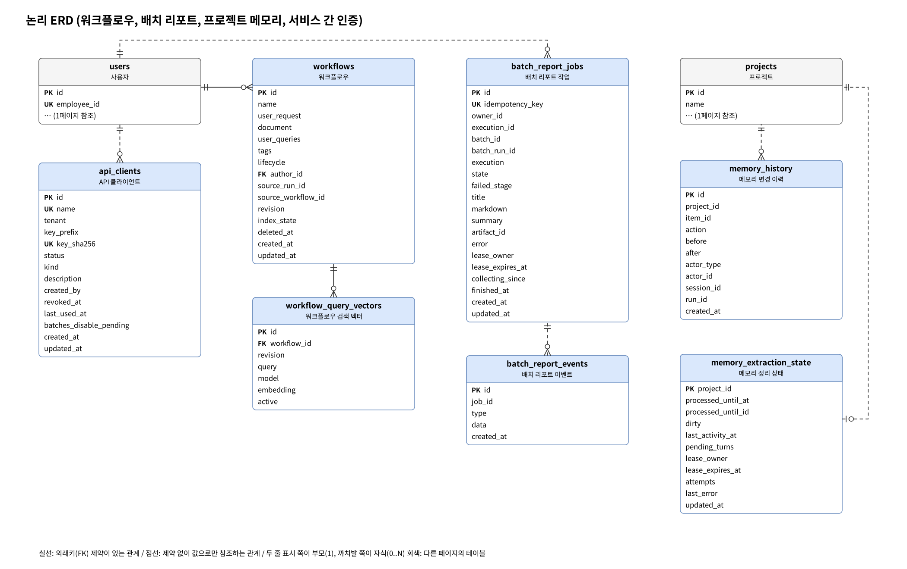

# 논리 ERD

| 항목 | 내용 |
| --- | --- |
| 시스템 | pr-agentic-service (사내 데이터 분석 Agent 서비스) |
| 기준 | internal/gaia 브랜치, 마이그레이션 0008, 2026-11-25 |
| 그림 원본 | `diagrams/04-erd-logical.drawio` (페이지 3장) |
| 모델 정의 | `src/dtest/core/models.py`, `src/dtest/gaia_bridge/models.py` |

컬럼 단위 정의는 `06-table-definition.xlsx`(Table 정의서)에 있습니다.

## 1. 개요

이 서비스의 데이터는 세 곳에 나뉘어 있습니다.

| 저장소 | 담는 것 | 사라지면 |
| --- | --- | --- |
| PostgreSQL 앱 테이블 19개 | 사용자, 프로젝트, 대화, 실행(run), 이벤트, 워크플로우, 배치 리포트, API 키 | 서비스 데이터 손실. 백업 대상 |
| PostgreSQL LangGraph 테이블 | Agent의 대화 상태(체크포인트)와 프로젝트 메모리 본문(store) | 진행 중이던 대화를 이어 갈 수 없고 프로젝트 메모리가 사라짐. 백업 대상 |
| Redis | 로그인 세션, 실시간 이벤트 전달, executor 이벤트 스트림, run 깨우기 신호 | 사용자가 다시 로그인해야 함. 놓친 executor 이벤트는 복구 절차가 채움. 영구 데이터 없음 |

분석 코드의 실행 기록, 노트북, 리포트 파일은 이 서비스가 아니라 executor가 가지고 있습니다. 우리 DB에는 그 식별자(`execution_id`, `artifact_id`)만 남습니다.

공통 규칙은 다음과 같습니다.

- 기본키는 UUID 문자열(36자)입니다. 이벤트와 이력처럼 순서가 필요한 테이블만 자동 증가 정수입니다.
- 시각은 모두 시간대가 있는 UTC입니다.
- 사용자에게 보이는 데이터(프로젝트, 세션, 워크플로우)는 지우지 않고 `deleted_at`에 시각을 적습니다(논리 삭제).
- 외래키 제약은 핵심 계층(사용자, 프로젝트, 세션, 메시지, run, 워크플로우)에만 걸려 있습니다. 이벤트, 이력, 코드 파일 같은 부속 테이블은 값으로만 참조하고 제약은 없습니다. 대량 삭제와 보존 정리를 빠르게 하기 위해서입니다.

## 2. 데이터 영역

| 영역 | 엔티티 | 설명 |
| --- | --- | --- |
| 사용자와 프로젝트 | users, projects, project_members | SSO 사용자, 프로젝트, 프로젝트 소유 관계 |
| 대화 | sessions, messages, images | 채팅 세션, 화면에 보이는 메시지, 첨부 이미지 |
| 실행 | runs, run_requests, run_events | Agent 실행 한 턴, 중복 요청 방지 키, 화면에 흘리는 이벤트 |
| executor 연동 | executor_inbox, code_sources | executor가 보낸 이벤트 보관함, executor로 보낸 코드 파일 기록 |
| 프로젝트 메모리 | memory_history, memory_extraction_state | 메모리 변경 이력, 백그라운드 정리 작업의 진행 위치 |
| 워크플로우 | workflows, workflow_query_vectors | 저장한 분석 절차, 검색용 임베딩 |
| 배치 리포트 | batch_report_jobs, batch_report_events | 배치 실행 결과 리포트 작업, 그 진행 이벤트 |
| 서비스 간 인증 | api_clients | 다른 서비스에 발급한 API 키 |
| gaia 연동 | gaia_sessions | gaia 채팅 세션과 우리 세션의 대응 |

## 3. ERD

### 3.1 전체

실선은 외래키 제약이 있는 관계, 점선은 값으로만 참조하는 관계입니다. 두 줄 표시 쪽이 부모(1), 까치발 쪽이 자식(0..N)입니다.

### 3.2 사용자, 프로젝트, 대화, 실행

### 3.3 워크플로우, 배치 리포트, 메모리, 인증

## 4. 엔티티 정의

### 4.1 사용자와 프로젝트

**users (사용자)**
SSO로 처음 로그인할 때 만들어집니다. `employee_id`(사번)가 사람을 구분하는 값이고 중복될 수 없습니다. `role`은 `user` 또는 `admin`입니다. `is_active`가 거짓이면 로그인과 API 호출이 모두 막히고, 진행 중이던 run과 executor 커널이 취소됩니다. `batches_disable_pending`은 비활성화된 사용자의 배치를 pr-batch에서 아직 끄지 못했다는 표시이고, worker가 성공할 때까지 다시 시도합니다.

**projects (프로젝트)**
대화를 묶는 단위입니다. `system_prompt`는 그 프로젝트의 모든 대화에 들어가는 지시문, `code_level`은 코드 생성 수준의 기본값입니다. 사용자마다 첫 로그인 때 기본 프로젝트(`is_default`)가 하나 만들어집니다.

**project_members (프로젝트 구성원)**
프로젝트와 사용자의 다대다 관계입니다. 현재는 만든 사람이 `owner`로 한 줄 들어가는 것이 전부이고, 프로젝트 공유 기능을 나중에 붙일 수 있게 테이블만 준비되어 있습니다. 프로젝트 접근 권한은 이 테이블로 판단합니다.

### 4.2 대화

**sessions (채팅 세션)**
프로젝트 안의 대화 하나입니다. `active_run_id`는 지금 진행 중인 run이고, 값이 있는 동안에는 새 턴을 시작할 수 없습니다(세션당 한 턴 규칙). `title_source`는 제목이 어떻게 정해졌는지입니다. 첫 메시지에서 딴 것은 `initial`, 첫 답변 뒤 LLM이 요약한 것은 `auto`, 사용자가 바꾼 것은 `user`입니다. 세션 id는 LangGraph 체크포인트의 thread id로도 쓰입니다.

**messages (메시지)**
화면에 보이는 대화 내용입니다. Agent가 실제로 참고하는 대화 이력은 체크포인트에 따로 있으므로, 이 테이블을 고쳐도 Agent의 기억은 바뀌지 않습니다. `attachments`에는 이미지 참조와 결과물 링크가 들어갑니다.

**images (이미지)**
사용자가 메시지에 붙인 이미지의 메타 정보입니다. 파일 자체는 공유 저장소(`STORAGE_ROOT`) 아래 `path`에 있습니다.

### 4.3 실행

**runs (실행)**
사용자 메시지 한 건에 대한 Agent 실행 한 턴입니다. 작업 큐 역할도 합니다. worker는 `status`와 `lease_expires_at`을 보고 가져갈 run을 고릅니다.

- `input`: 사용자 메시지와 선택한 옵션.
- `waiting`: 멈춰 있는 이유. 사용자 확인을 기다리면 그 질문, executor를 기다리면 `execution_id`.
- `resume`: 멈춘 run을 이어 갈 때 넘겨줄 값(사용자의 답, executor 결과).
- `lease_owner`, `lease_expires_at`: 어느 인스턴스가 언제까지 실행 권한을 가졌는지. 만료되면 다른 인스턴스가 가져갑니다.
- `cancel_requested`: 사용자가 취소를 눌렀다는 표시.
- `recovery_checked_at`: 놓친 executor 이벤트를 마지막으로 확인한 시각.

**run_requests (실행 요청 키)**
`POST /sessions/{id}/runs`의 `Idempotency-Key`를 하루 동안 기억합니다. 같은 키로 같은 요청이 다시 오면 새 run을 만들지 않고 처음 만든 run을 돌려줍니다.

**run_events (실행 이벤트)**
화면에 실시간으로 보내는 이벤트 중 저장하는 것들입니다(상태 변경, 도구 호출, 계획 카드, 최종 답변 등). 브라우저가 끊겼다 다시 붙으면 마지막으로 받은 id 다음부터 이 테이블에서 다시 읽어 줍니다. 토큰 단위 스트리밍과 executor 진행 이벤트는 저장하지 않습니다.

### 4.4 executor 연동

**executor_inbox (executor 이벤트 보관함)**
executor가 Redis 스트림으로 보낸 이벤트를 중복 없이 보관합니다. `event_id`가 기본키라 같은 이벤트가 두 번 와도 한 줄만 남습니다. executor를 기다리던 run은 이 테이블의 이벤트를 근거로 다시 시작됩니다.

**code_sources (코드 파일 기록)**
Agent가 executor로 보낸 코드 파일 하나하나의 기록입니다. 어떤 run의 어떤 도구 호출에서 만들어졌는지, 어떤 skill과 tool인지, 사용자가 승인하거나 고쳤는지, executor의 어느 실행 단계가 되었는지를 잇습니다. 파일은 전달 수단일 뿐이고, 실제 실행 기록은 executor가 제출 시점에 뜬 사본과 노트북입니다. 그래서 파일은 7일 뒤 지우고(`file_deleted_at`) 이 행만 남깁니다.

### 4.5 프로젝트 메모리

프로젝트 메모리의 본문(주제 목록과 주제별 내용)은 앱 테이블이 아니라 LangGraph store에 있습니다. 앱 테이블에는 이력과 작업 상태만 있습니다.

**memory_history (메모리 변경 이력)**
메모리가 바뀔 때마다 바뀌기 전과 후를 남깁니다. `actor_type`으로 사용자가 고쳤는지 Agent가 고쳤는지 구분합니다. 화면에서 이전 상태로 되돌릴 때 씁니다.

**memory_extraction_state (메모리 정리 상태)**
프로젝트마다 한 줄입니다. 대화가 끝나면 `dirty`가 켜지고 `pending_turns`가 올라갑니다. 대화가 잠잠해지면 worker가 lease를 잡고, `processed_until_*` 위치 다음의 메시지를 읽어 기억할 내용을 정리합니다.

### 4.6 워크플로우

**workflows (워크플로우)**
저장된 분석 절차입니다. `document`가 Workflow 1.0 형식의 본문이고, `user_queries`는 이 워크플로우를 찾을 때 쓸 질문 예시입니다. `lifecycle`은 개인이 저장한 `candidate`와 관리자가 승격한 `template` 두 가지입니다. 내용을 고치면 `revision`이 올라갑니다. `index_state`는 검색 색인 상태(`not_indexed`, `ready`, `failed`)입니다.

**workflow_query_vectors (워크플로우 검색 벡터)**
`user_queries`의 질문마다 임베딩 한 줄입니다. 워크플로우를 고치면 이전 벡터의 `active`를 끄고 새 revision의 벡터를 만듭니다. 삭제되지 않은 `template`의 벡터만 `active`이고, 검색은 `active`인 행만 봅니다. `model`에는 `모델이름:차원` 형태의 값이 들어가 임베딩 모델이 바뀐 것을 구분합니다.

### 4.7 배치 리포트

**batch_report_jobs (배치 리포트 작업)**
pr-batch의 배치 실행이 성공하면 그 결과를 분석해 리포트를 쓰는 작업입니다. 실행 한 건에 작업 하나이고 `idempotency_key`(`batch-report:{execution_id}`)로 중복을 막습니다. `owner_id`는 배치를 만든 사용자이고 그 사용자만 리포트를 봅니다. `markdown`은 리포트 본문, `summary`는 같은 배치의 다음 실행이 비교용으로 읽는 요약입니다.

**batch_report_events (배치 리포트 이벤트)**
리포트 작업의 진행 이벤트입니다. 채팅 이벤트와 같은 형식이라 화면이 같은 컴포넌트로 그립니다.

### 4.8 서비스 간 인증

**api_clients (API 클라이언트)**
다른 서비스와 에이전트에 발급한 API 키입니다. 키 원문은 저장하지 않고 SHA-256(`key_sha256`)과 앞부분(`key_prefix`)만 남깁니다. `tenant`는 이 키로 만든 실행과 배치가 속할 executor tenant입니다. `kind`가 `standard`이면 `X-User-Id` 사용자의 것만 조회하고, `master`이면 tenant 전체를 조회합니다. `batches_disable_pending`은 tenant의 키가 모두 폐기된 뒤 pr-batch에서 그 tenant의 배치를 아직 끄지 못했다는 표시입니다.

### 4.9 gaia 연동

**gaia_sessions (gaia 세션 대응)**
gaia 채팅 화면의 세션 하나가 우리 세션 하나에 대응합니다. 기본키가 (사용자, gaia 세션 id)라서 다른 사용자가 같은 gaia 세션 id를 보내도 남의 세션에 닿지 않습니다.

## 5. 관계와 카디널리티

| 부모 | 자식 | 관계 | 제약 | 비고 |
| --- | --- | --- | --- | --- |
| users | projects | 1:N | FK `created_by` | |
| users, projects | project_members | N:M | FK 2개 | 현재는 프로젝트당 owner 1명 |
| projects | sessions | 1:N | FK | |
| users | sessions | 1:N | FK | |
| sessions | messages | 1:N | FK | |
| sessions | runs | 1:N | FK | 동시에 진행 중인 run은 세션당 1개 |
| runs | messages | 1:N | 없음 | 한 턴의 사용자 메시지와 답변 |
| runs | run_events | 1:N | 없음 | |
| sessions | run_requests | 1:N | 없음 | |
| sessions | images | 1:N | 없음 | |
| runs | code_sources | 1:N | 없음 | |
| runs | executor_inbox | 1:N | 없음 | `runs.waiting.execution_id` = `executor_inbox.execution_id` |
| projects | memory_history | 1:N | 없음 | |
| projects | memory_extraction_state | 1:1 | 없음 | |
| users | workflows | 1:N | FK `author_id` | |
| workflows | workflow_query_vectors | 1:N | FK | |
| users | batch_report_jobs | 1:N | 없음 | `owner_id` = `users.id` |
| batch_report_jobs | batch_report_events | 1:N | 없음 | |
| users, sessions | gaia_sessions | 1:N | FK 2개 | |
| users | api_clients | 1:N | 없음 | `created_by` = 발급한 관리자의 `users.id` |

## 6. 상태 전이

### 6.1 run

| 이전 상태 | 다음 상태 | 계기 |
| --- | --- | --- |
| (시작) | `queued:` |  |
| `queued` | `running:` |  |
| `running` | `waiting_input:` |  |
| `running` | `waiting_executor:` |  |
| `waiting_input` | `queued:` |  |
| `waiting_executor` | `queued:` |  |
| `running` | `queued:` |  |
| `running` | `succeeded` |  |
| `running` | `failed` |  |
| `running` | `cancelled` |  |
| `waiting_input` | `cancelled` |  |
| `waiting_executor` | `cancelled` |  |
| `queued` | `cancelled` |  |

상태 전이 그림은 프로그램 명세서(Agent Graph)에 있습니다.

| 상태 | 뜻 | 인스턴스 자원 |
| --- | --- | --- |
| `queued` | worker를 기다림 | 쓰지 않음 |
| `running` | 어느 인스턴스가 실행 중. `lease_owner`가 그 인스턴스 | 실행 슬롯 1개 |
| `waiting_input` | 사용자 확인(계획 승인 등)을 기다림 | 쓰지 않음 |
| `waiting_executor` | executor가 코드를 실행 중 | 쓰지 않음 |
| `succeeded`, `failed`, `cancelled` | 끝남. `finished_at`이 채워짐 | 쓰지 않음 |

기다리는 상태에서는 며칠이 지나도 인스턴스 자원을 잡지 않습니다. 실행 중인 인스턴스가 죽으면 lease가 만료되어(기본 60초) 다른 인스턴스가 체크포인트에서 이어 갑니다.

### 6.2 배치 리포트 작업

`QUEUED → COLLECTING → GENERATING → MATERIALIZING → SUCCEEDED` 순서로 진행합니다. 어느 단계에서든 실패하면 `FAILED`가 되고 `failed_stage`에 그 단계가 남습니다.

| 상태 | 하는 일 |
| --- | --- |
| `QUEUED` | 대기 |
| `COLLECTING` | executor에서 실행 결과와 노트북을 모음. 노트북이 준비될 때까지 기다림 |
| `GENERATING` | LLM으로 리포트 작성 |
| `MATERIALIZING` | 리포트를 executor Artifact로 저장 |
| `SUCCEEDED`, `FAILED` | 끝남 |

### 6.3 API 키

발급하면 바로 `active`이고, 폐기하면 `revoked`입니다. 되돌리는 전이는 없습니다. 재발급은 같은 행의 키 해시를 새 값으로 바꾸는 것입니다. 2026-11-01 전에 있던 `pending` 상태는 없어졌고, 남아 있던 행은 마이그레이션 0006이 `active`로 바꿨습니다.

### 6.4 워크플로우

`lifecycle`은 `candidate`에서 `template`으로 관리자가 승격합니다. `index_state`는 저장 직후 `not_indexed`, 임베딩이 끝나면 `ready`, 임베딩 호출이 실패하면 `failed`입니다. 임베딩 설정이 없는 환경에서는 계속 `not_indexed`이고 검색 추천만 동작하지 않습니다.

## 7. 앱 테이블 밖의 데이터

### 7.1 LangGraph 체크포인트와 store (같은 PostgreSQL)

| 데이터 | 테이블 | 키 | 내용 |
| --- | --- | --- | --- |
| 대화 상태 | checkpoints, checkpoint_writes, checkpoint_blobs | thread_id = 세션 id | Agent가 보는 메시지 이력, 분석 계획, 진행 위치. run이 멈췄다 이어 갈 때 읽음 |
| 프로젝트 메모리 | store | namespace에 프로젝트 id | 주제 목록과 주제별 본문 |

이 테이블들은 LangGraph 라이브러리가 만들고 관리합니다. 구조를 직접 바꾸지 않습니다.

### 7.2 Redis

| 용도 | 키 또는 채널 | 방식 | 비고 |
| --- | --- | --- | --- |
| 로그인 세션, 로그인 진행 상태 | `{REDIS_NAMESPACE}:{종류}:{해시}` | 문자열 키, 만료 시간 있음 | 지워지면 다시 로그인 |
| 세션 이벤트 전달 | `{REDIS_NAMESPACE}:session:{세션 id}` | 발행/구독 | 저장되지 않음. 저장분은 run_events |
| 배치 리포트 이벤트 전달 | `{REDIS_NAMESPACE}:batch-report:{작업 id}` | 발행/구독 | |
| run 깨우기 | `{REDIS_NAMESPACE}:runs:wake` | 발행/구독 | 놓쳐도 5초 폴링이 처리 |
| executor 이벤트 | `{EXECUTOR_EVENT_STREAM}.{tenant}` | 스트림, 소비자 그룹 | executor가 쓰고 우리가 읽음. 같은 Redis, 같은 DB 번호여야 함 |

`REDIS_NAMESPACE`의 기본값은 `agentic`입니다. 두 환경이 같은 Redis를 쓰면 이 값이 달라야 로그인 세션과 이벤트가 섞이지 않습니다.

### 7.3 executor와 공유 저장소

| 데이터 | 위치 | 우리 DB의 참조 |
| --- | --- | --- |
| 실행, 단계, 결과, 노트북, 리포트 Artifact | executor의 DB와 저장소 | `runs.waiting.execution_id`, `code_sources.execution_id`, `batch_report_jobs.execution_id`, `batch_report_jobs.artifact_id` |
| 코드 파일, 첨부 이미지 | 공유 저장소(`STORAGE_ROOT`) | `code_sources.path`, `images.path` |
| 배치 정의와 배치 실행 | pr-batch의 DB | `batch_report_jobs.batch_id`, `batch_run_id` |

## 8. 삭제와 보존 규칙

| 대상 | 규칙 | 설정(기본값) |
| --- | --- | --- |
| 프로젝트, 세션, 워크플로우 | 논리 삭제. 행은 남고 `deleted_at`만 채움 | |
| run_events, batch_report_events | 만든 지 30일 지나면 삭제 | `RUN_EVENT_RETENTION_DAYS` (30) |
| executor_inbox | 받은 지 7일 지나면 삭제 | `EXECUTOR_INBOX_RETENTION_DAYS` (7) |
| run_requests | 1일 지나면 삭제 | `RUN_REQUEST_RETENTION_DAYS` (1) |
| images | 세션을 삭제하고 7일 지나면 파일과 행 삭제 | `IMAGE_RETENTION_DAYS` (7) |
| code_sources의 파일 | 7일 지나면 파일만 삭제, 행은 유지 | `CODE_SOURCE_RETENTION_DAYS` (7) |
| 체크포인트 | 진행 중인 run이 없는 세션은 최신 1개만 남김 | |
| messages, runs, memory_history, batch_report_jobs | 자동 삭제 없음 | |

정리는 worker의 보존 작업(`src/dtest/worker/maintenance.py`)이 1시간마다 5,000행씩 나눠 지웁니다. 배치 리포트 작업에 보존 기간을 새로 두려면 복구 조회 기간(`BATCH_REPORT_RECOVERY_LOOKBACK_DAYS`, 14일)보다 길어야 합니다. 짧으면 지운 리포트를 복구 작업이 다시 씁니다.
