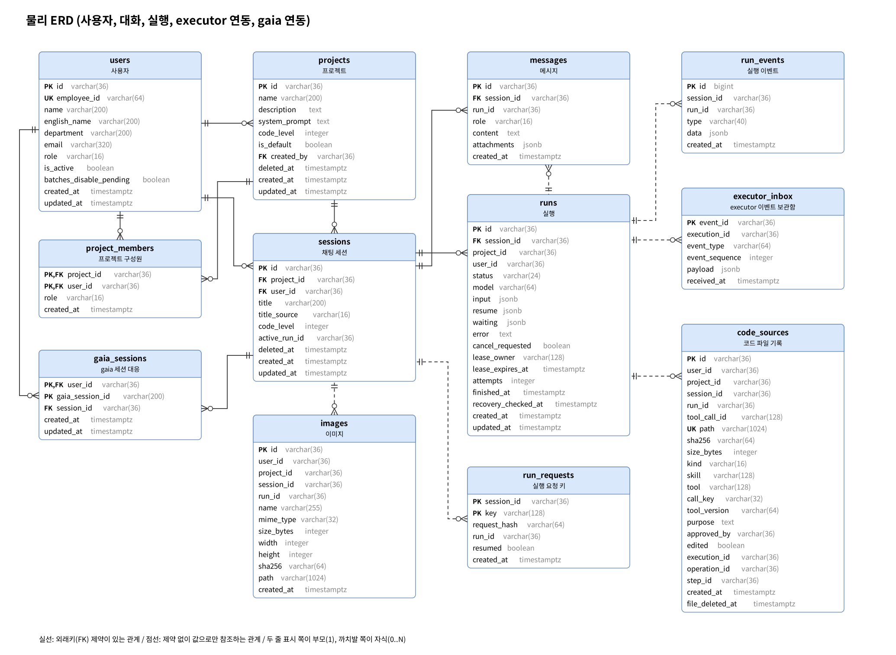
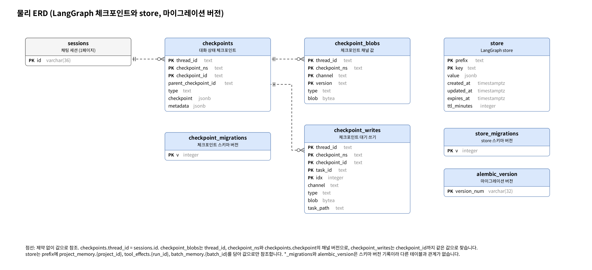

# 물리 ERD

| 항목 | 내용 |
| --- | --- |
| 시스템 | gaia-api-service (사내 데이터 분석 Agent 서비스) |
| 스키마 버전 | 마이그레이션 0008 |
| 그림 원본 | `diagrams/05-erd-physical.drawio` (페이지 3장) |
| 모델 정의 | `src/dtest/core/models.py`, `src/dtest/gaia_bridge/models.py` |

모든 테이블의 모든 컬럼은 6절, 테이블 사이의 모든 참조와 조인 조건은 7절에 있습니다. 컬럼 설명까지 담은 정의는 `06-table-definition.md`, `06-table-definition.xlsx`(Table 정의서)에 있습니다. 연결 풀, 용량, 백업은 운영자 메뉴얼에서 다룹니다.

## 1. DB 구성

| 항목 | 값 |
| --- | --- |
| DBMS | PostgreSQL (로컬 검증은 16). `vector` 확장(pgvector)이 필요합니다 |
| 데이터베이스 이름 | dev는 `dtest`, prd는 `dtestprd` (`DATABASE_URL`의 마지막 부분). 로컬 개발 환경은 `agentic` |
| 스키마 | `public` |
| 접속 설정 | `DATABASE_URL` (`postgresql+psycopg://사용자:비밀번호@호스트:5432/데이터베이스이름`) |
| 드라이버 | psycopg 3. 앱 테이블은 SQLAlchemy 비동기, LangGraph는 psycopg 풀 |
| 문자 집합, 시간대 | UTF-8, 모든 시각 컬럼은 `timestamptz`이고 UTC로 저장 |
| 같은 서버를 쓰는 서비스 | executor, batch (각자 자기 데이터베이스) |
| 같은 서버의 데이터베이스 | dev: `dtest`, `executor`, `batch`. prd: `dtestprd`, `executorprd`, `batchprd` |
| 서버 연결 한도 | `max_connections` 150 |
| 계정 | 마스터 계정 하나를 서비스와 운영자가 함께 씀 |
| 관리 주체 | 사내 서비스형 DB. 서버 설정, 백업, 버전은 우리가 바꿀 수 없음 |

dev와 prd의 DB 사용 현황은 다음과 같습니다.

- dev와 prd가 같은 DB 서버(같은 주소)를 쓰고, 데이터베이스 이름으로 나뉩니다. 테이블과 데이터는 환경별로 따로입니다.
- 서버를 같이 쓰므로 연결 한도 150은 여섯 데이터베이스가 함께 나눠 씁니다.
- 곧 prd를 다른 DB 서버로 분리할 예정입니다. 분리할 때 할 일은 5.4절에 있습니다.

기동 계정에 필요한 권한은 다음과 같습니다.

- 자기 데이터베이스(`dtest`, `dtestprd`)에 대한 테이블 생성, 변경, 인덱스 생성 권한 (마이그레이션을 인스턴스가 직접 실행하므로). 마스터 계정을 쓰므로 현재는 충족됩니다.
- `CREATE EXTENSION IF NOT EXISTS vector` 실행 권한. 권한을 줄 수 없으면 DBA가 확장을 먼저 만들어 둡니다. 이미 있으면 이 문장은 아무 일도 하지 않습니다.

## 2. 물리 ERD

실선은 외래키 제약이 있는 관계, 점선은 값으로만 참조하는 관계입니다. 두 줄 표시 쪽이 부모(1), 까치발 쪽이 자식(0..N)입니다. 컬럼 앞의 PK는 기본키, FK는 외래키 제약, UK는 UNIQUE 제약입니다.

### 2.1 사용자, 대화, 실행, executor 연동, gaia 연동



### 2.2 워크플로우, 배치 리포트, 프로젝트 메모리, 서비스 간 인증

회색 테이블(users, projects)은 2.1의 테이블을 모든 컬럼과 함께 다시 그린 것입니다.


### 2.3 LangGraph 체크포인트와 store, 마이그레이션 버전

LangGraph 라이브러리와 Alembic이 만드는 테이블입니다. 회색 sessions는 2.1의 테이블입니다.



## 3. 테이블 목록

| # | 테이블 | 기본키 | 행 증가 | 자동 정리 |
| --- | --- | --- | --- | --- |
| 1 | users | id | 사용자 수 | 없음 |
| 2 | projects | id | 적음 | 없음 (논리 삭제) |
| 3 | project_members | (project_id, user_id) | 적음 | 없음 |
| 4 | sessions | id | 대화 수 | 없음 (논리 삭제) |
| 5 | messages | id | 턴당 2행 안팎 | 없음 |
| 6 | runs | id | 턴당 1행 | 없음 |
| 7 | run_events | id (bigint) | 턴당 수십 행. 가장 빨리 큼 | 30일 |
| 8 | run_requests | (session_id, key) | 턴당 1행 | 1일 |
| 9 | executor_inbox | event_id | 분석 1건당 수 행~수십 행 | 7일 |
| 10 | code_sources | id | 분석 단계당 1행 | 파일만 7일, 행은 유지 |
| 11 | images | id | 첨부 이미지 수 | 세션 삭제 7일 뒤 |
| 12 | memory_history | id (bigint) | 메모리 변경 수 | 없음 |
| 13 | memory_extraction_state | project_id | 프로젝트당 1행 | 없음 |
| 14 | workflows | id | 적음 | 없음 (논리 삭제) |
| 15 | workflow_query_vectors | id (bigint) | 워크플로우 수정 횟수 × 질문 수 | 없음 |
| 16 | batch_report_jobs | id | 배치 실행 성공 1건당 1행 | 없음 |
| 17 | batch_report_events | id (bigint) | 리포트 1건당 수십 행 | 30일 |
| 18 | api_clients | id | 적음 | 없음 |
| 19 | gaia_sessions | (user_id, gaia_session_id) | gaia 대화 수 | 없음 |
| - | alembic_version | version_num | 1행 | Alembic 관리 |
| - | checkpoints, checkpoint_writes, checkpoint_blobs, checkpoint_migrations | LangGraph 정의 | 턴의 그래프 단계마다 | 쉬는 세션은 최신 1개만 남김 |
| - | store, store_migrations | LangGraph 정의 | 프로젝트 메모리 주제 수 | 없음 |

## 4. 인덱스

기본키와 UNIQUE 제약이 만드는 인덱스는 6절 표의 PK, UK 컬럼에 있습니다. 아래는 그 밖의 인덱스 전부입니다.

| 테이블 | 인덱스 | 컬럼 | 받치는 조회 |
| --- | --- | --- | --- |
| sessions | ix_sessions_project_id | project_id | 프로젝트의 세션 목록 |
| messages | ix_messages_session_created | (session_id, created_at) | 대화 내용 조회 |
| runs | ix_runs_session_id | session_id | 세션의 run 조회 |
| runs | ix_runs_status | status | 상태별 조회 |
| runs | ix_runs_claim | (status, lease_expires_at) | worker가 가져갈 run 고르기 |
| runs | ix_runs_waiting_execution | waiting ->> 'execution_id', 조건 status = 'waiting_executor' | executor 이벤트가 왔을 때 기다리는 run 찾기 |
| run_events | ix_run_events_session_id_id | (session_id, id) | SSE 재접속 시 이어 받기 |
| run_events | ix_run_events_run_id_id | (run_id, id) | run 단위 이벤트 조회 (0005에서 추가) |
| run_events | ix_run_events_created_at | created_at | 보존 정리 |
| run_requests | ix_run_requests_created_at | created_at | 보존 정리 |
| executor_inbox | ix_executor_inbox_execution_id | execution_id | 실행별 이벤트 조회 |
| executor_inbox | ix_executor_inbox_received_at | received_at | 보존 정리 |
| code_sources | ix_code_sources_session_id | session_id | 대화별 코드 조회 |
| code_sources | ix_code_sources_run_id | run_id | run별 코드 조회 |
| code_sources | ix_code_sources_execution_id | execution_id | 실행별 코드 조회 |
| code_sources | ix_code_sources_created_at | created_at | 보존 정리 |
| images | ix_images_session_id | session_id | 세션의 이미지 |
| memory_history | ix_memory_history_project_id | project_id | 프로젝트의 메모리 이력 |
| memory_extraction_state | ix_memory_extraction_claim | last_activity_at, 조건 dirty | 정리할 프로젝트 고르기 |
| workflows | ix_workflows_author_id | author_id | 내 워크플로우 목록 |
| workflow_query_vectors | ix_workflow_query_vectors_workflow_id | workflow_id | 워크플로우의 벡터 |
| workflow_query_vectors | ix_wqv_hnsw_{차원} | embedding::vector(차원) 코사인 HNSW, 조건 active | 워크플로우 유사도 검색 |
| batch_report_jobs | ix_batch_report_jobs_owner_id | owner_id | 내 리포트 목록 |
| batch_report_jobs | ix_batch_report_jobs_execution_id | execution_id | 실행별 리포트 찾기 |
| batch_report_jobs | ix_batch_report_jobs_batch_id | batch_id | 배치별 리포트 목록 |
| batch_report_jobs | ix_batch_report_jobs_state | state | 처리할 작업 고르기 |
| batch_report_events | ix_batch_report_events_job_id | job_id | 작업의 이벤트 |
| batch_report_events | ix_batch_report_events_created_at | created_at | 보존 정리 |
| checkpoints | checkpoints_thread_id_idx | thread_id | 세션별 체크포인트 조회 |
| checkpoint_blobs | checkpoint_blobs_thread_id_idx | thread_id | 세션별 채널 값 조회 |
| checkpoint_writes | checkpoint_writes_thread_id_idx | thread_id | 세션별 대기 쓰기 조회 |
| store | store_prefix_idx | prefix text_pattern_ops | 이름공간 앞부분으로 찾기 |
| store | idx_store_expires_at | expires_at (expires_at IS NOT NULL) | TTL 정리 (이 서비스는 쓰지 않음) |

### 4.1 벡터 인덱스 주의

- `ix_wqv_hnsw_{차원}`은 Alembic이 아니라 기동 시 `WorkflowService.ensure_index()`가 `CREATE INDEX IF NOT EXISTS`로 만듭니다. 이름에 `EMBEDDING_DIMS` 값이 들어갑니다(예: `ix_wqv_hnsw_1024`).
- HNSW 인덱스는 2,000차원 이하만 됩니다. `EMBEDDING_DIMS`는 임베딩 모델의 실제 출력 차원과 같아야 합니다.
- `EMBEDDING_DIMS`나 임베딩 모델을 바꾸면 새 차원의 인덱스가 하나 더 생기고, 예전 벡터는 `model` 값이 달라 검색에서 빠집니다. 기존 워크플로우는 다시 색인해야 검색되고, 예전 인덱스는 직접 지워야 합니다.
- `EMBEDDING_PROVIDER`가 `none`이면 인덱스를 만들지 않고 검색 추천만 꺼집니다.

## 5. 마이그레이션

### 5.1 적용 방식

인스턴스가 시작할 때 `AUTO_MIGRATE`가 true(기본)이면 아래를 순서대로 한 번 실행합니다(`src/dtest/core/bootstrap.py`의 `migrate`).

1. `pg_advisory_lock(7340001)`을 잡습니다. 여러 인스턴스가 동시에 떠도 한 인스턴스만 진행하고 나머지는 기다립니다.
2. `CREATE EXTENSION IF NOT EXISTS vector`
3. Alembic `upgrade head` (앱 테이블)
4. LangGraph checkpointer와 store의 `setup()` (LangGraph 테이블)
5. 예전 항목형 프로젝트 메모리를 기본 주제로 옮김 (이미 옮겼으면 아무 일도 하지 않음)
6. 워크플로우 벡터 인덱스 생성
7. 잠금 해제

`AUTO_MIGRATE`를 false로 두면 인스턴스는 스키마를 건드리지 않습니다. 이때는 배포 전에 배포할 버전의 코드와 같은 설정으로 `python scripts/migrate.py`를 한 번 실행합니다. 실패하면 0이 아닌 코드로 끝납니다.

### 5.2 이력

| 번호 | 내용 |
| --- | --- |
| 0001 | 기준 스키마. 테이블 16개와 인덱스 |
| 0002 | memory_extraction_state 테이블과 `ix_memory_extraction_claim` |
| 0003 | api_clients 테이블, users에 `batches_disable_pending` 컬럼 |
| 0004 | gaia_sessions 테이블. 이미 있으면 건너뜀 |
| 0005 | `ix_run_events_run_id_id` 인덱스 |
| 0006 | api_clients의 `pending` 상태를 `active`로 변경 (데이터만) |
| 0007 | api_clients에 `batches_disable_pending` 컬럼 |
| 0008 | api_clients에 `kind` 컬럼 (기본값 `standard`) |

0004의 내력: gaia_sessions는 처음에 0002번으로 만들었다가 다른 마이그레이션과 번호가 겹쳐 0004로 옮겼습니다. 예전 0002(gaia_sessions)로 올린 DB가 남아 있다면 테이블은 있지만 지금의 0002, 0003이 빠진 상태입니다. 그런 DB는 아래를 실행한 뒤 다시 올리면 기존 테이블은 그대로 두고 나머지가 적용됩니다.

```sql
UPDATE alembic_version SET version_num = '0001';
```

### 5.3 새 마이그레이션 작성 규칙

- 파일은 `src/dtest/migrations/versions/`에 `NNNN_설명.py`로 만들고 `down_revision`을 직전 번호로 둡니다.
- 이전 버전 코드가 계속 동작하는 변경만 합니다. 컬럼 추가는 NULL 허용이거나 DB 기본값(`server_default`)을 둡니다. 인덱스는 추가만 합니다. 배포 중에는 새 스키마 위에서 옛 버전이 잠시 함께 돌기 때문입니다.
- 컬럼 삭제나 이름 변경은 두 번에 나눕니다. 먼저 코드가 그 컬럼을 쓰지 않게 배포하고, 다음 배포에서 지웁니다.
- 큰 테이블(run_events)의 인덱스 추가는 테이블 잠금 시간을 확인합니다. Alembic 기본은 `CREATE INDEX`라 쓰기가 잠깁니다.
- 모델(`models.py`)과 마이그레이션을 같이 고칩니다. 로컬에서 빈 DB에 처음부터 올려 보고, 직전 버전 DB에서도 올려 봅니다.
- 번호는 master 기준으로 하나씩 늘립니다. feature 브랜치를 master에 머지하기 전에 master의 최신 번호와 겹치지 않는지 확인합니다. stg와 prd에는 master의 것이 그대로 올라갑니다.

### 5.4 주의

- 마이그레이션이 실패하면 `AUTO_MIGRATE`가 켜진 모든 인스턴스가 시작에 실패합니다. 교체 배포로 옛 인스턴스가 이미 내려갔다면 서비스가 멈춥니다. 운영은 `AUTO_MIGRATE: false`와 사전 실행을 권장합니다.

- 환경의 구분은 `DATABASE_URL`의 데이터베이스 이름뿐입니다. 서버 주소와 계정이 같으므로, dev 설정에 `dtestprd`를 적는 실수를 하면 오류 없이 prd 데이터에 붙습니다. 그러면 dev의 worker가 prd의 run을 가져가 dev 코드로 실행하고, dev의 마이그레이션이 prd 스키마를 바꿉니다. `config.dev.yml`과 `config.prd.yml`의 `DATABASE_URL`을 고칠 때는 데이터베이스 이름을 다시 확인합니다. `scripts/set_user_role.py`처럼 DB에 직접 붙는 스크립트는 접속할 DB를 먼저 출력하므로 그 줄을 확인하고 진행합니다.

#### prd를 다른 DB 서버로 분리할 때

1. 새 서버에 데이터베이스를 만들고 `vector` 확장을 쓸 수 있는지 확인합니다.
2. 기존 데이터를 가져갈지 정합니다.
   - 가져가지 않으면: `config.prd.yml`의 `DATABASE_URL`만 새 서버로 바꿉니다. 첫 기동 때 `AUTO_MIGRATE`(또는 `python scripts/migrate.py`)가 테이블을 모두 만듭니다. 데이터가 비어 있으므로 사용자는 첫 로그인 때 새로 만들어지고, 관리자는 `ADMIN_EMPLOYEE_IDS`로 다시 지정되며, API 키는 다시 발급합니다.
   - 가져가면: 서비스를 내린 상태에서 데이터베이스 전체를 옮깁니다. 앱 테이블과 LangGraph 테이블(checkpoints 계열, store)을 같은 시점으로 함께 옮겨야 합니다. 옮긴 뒤 `alembic_version` 값이 그대로인지 확인합니다.
3. executor와 batch의 prd 데이터베이스도 함께 옮기는지 확인합니다. 우리 DB의 `execution_id`는 그 환경의 executor에 있는 실행을 가리켜야 하므로, 우리만 빈 DB로 시작하고 executor는 기존 데이터를 유지해도 문제는 없지만, 반대로 우리 데이터는 유지하고 executor가 빈 DB로 시작하면 기다리던 run과 결과물 링크가 깨집니다.
4. 분리 뒤에는 연결 한도를 서버별로 다시 계산합니다.

## 6. 테이블별 컬럼

모든 테이블의 모든 컬럼입니다. NULL이 N이면 NOT NULL, 기본값의 (앱)은 DB가 아니라 애플리케이션이 넣는 값입니다. 참조의 (FK)는 외래키 제약이 있는 것, (값만)은 제약 없이 값으로만 가리키는 것, DB 밖은 다른 시스템의 값입니다. 조인 조건은 7절에 있습니다. 설명까지 담은 정의는 `06-table-definition.md`에 있습니다.

### 6.1 users (사용자)

기본키 id. 행 증가: 사용자 수. 자동 정리: 없음.

| No | 컬럼 | 데이터 타입 | NULL | 키 | 기본값 | 참조 |
| --- | --- | --- | --- | --- | --- | --- |
| 1 | `id` | varchar(36) | N | PK | (앱) UUID |  |
| 2 | `employee_id` | varchar(64) | N | UK |  |  |
| 3 | `name` | varchar(200) | N |  |  |  |
| 4 | `english_name` | varchar(200) | Y |  |  |  |
| 5 | `department` | varchar(200) | Y |  |  |  |
| 6 | `email` | varchar(320) | Y |  |  |  |
| 7 | `role` | varchar(16) | N |  | (앱) user |  |
| 8 | `is_active` | boolean | N |  | (앱) true |  |
| 9 | `batches_disable_pending` | boolean | N |  | false |  |
| 10 | `created_at` | timestamptz | N |  | (앱) |  |
| 11 | `updated_at` | timestamptz | N |  | (앱) |  |

### 6.2 projects (프로젝트)

기본키 id. 행 증가: 적음. 자동 정리: 없음 (논리 삭제).

| No | 컬럼 | 데이터 타입 | NULL | 키 | 기본값 | 참조 |
| --- | --- | --- | --- | --- | --- | --- |
| 1 | `id` | varchar(36) | N | PK | (앱) UUID |  |
| 2 | `name` | varchar(200) | N |  |  |  |
| 3 | `description` | text | N |  | (앱) 빈 문자열 |  |
| 4 | `system_prompt` | text | N |  | (앱) 빈 문자열 |  |
| 5 | `code_level` | integer | Y |  |  |  |
| 6 | `is_default` | boolean | N |  | (앱) false |  |
| 7 | `created_by` | varchar(36) | N | FK |  | users.id (FK) |
| 8 | `deleted_at` | timestamptz | Y |  |  |  |
| 9 | `created_at` | timestamptz | N |  | (앱) |  |
| 10 | `updated_at` | timestamptz | N |  | (앱) |  |

### 6.3 project_members (프로젝트 구성원)

기본키 (project_id, user_id). 행 증가: 적음. 자동 정리: 없음.

| No | 컬럼 | 데이터 타입 | NULL | 키 | 기본값 | 참조 |
| --- | --- | --- | --- | --- | --- | --- |
| 1 | `project_id` | varchar(36) | N | PK,FK |  | projects.id (FK) |
| 2 | `user_id` | varchar(36) | N | PK,FK |  | users.id (FK) |
| 3 | `role` | varchar(16) | N |  | (앱) owner |  |
| 4 | `created_at` | timestamptz | N |  | (앱) |  |

### 6.4 sessions (채팅 세션)

기본키 id. 행 증가: 대화 수. 자동 정리: 없음 (논리 삭제).

| No | 컬럼 | 데이터 타입 | NULL | 키 | 기본값 | 참조 |
| --- | --- | --- | --- | --- | --- | --- |
| 1 | `id` | varchar(36) | N | PK | (앱) UUID |  |
| 2 | `project_id` | varchar(36) | N | FK |  | projects.id (FK) |
| 3 | `user_id` | varchar(36) | N | FK |  | users.id (FK) |
| 4 | `title` | varchar(200) | N |  | (앱) 새 대화 |  |
| 5 | `title_source` | varchar(16) | N |  | initial |  |
| 6 | `code_level` | integer | Y |  |  |  |
| 7 | `active_run_id` | varchar(36) | Y |  |  | runs.id (값만) |
| 8 | `deleted_at` | timestamptz | Y |  |  |  |
| 9 | `created_at` | timestamptz | N |  | (앱) |  |
| 10 | `updated_at` | timestamptz | N |  | (앱) |  |

### 6.5 messages (메시지)

기본키 id. 행 증가: 턴당 2행 안팎. 자동 정리: 없음.

| No | 컬럼 | 데이터 타입 | NULL | 키 | 기본값 | 참조 |
| --- | --- | --- | --- | --- | --- | --- |
| 1 | `id` | varchar(36) | N | PK | (앱) UUID |  |
| 2 | `session_id` | varchar(36) | N | FK |  | sessions.id (FK) |
| 3 | `run_id` | varchar(36) | Y |  |  | runs.id (값만) |
| 4 | `role` | varchar(16) | N |  |  |  |
| 5 | `content` | text | N |  |  |  |
| 6 | `attachments` | jsonb | N |  | (앱) [] |  |
| 7 | `created_at` | timestamptz | N |  | (앱) |  |

### 6.6 runs (실행)

기본키 id. 행 증가: 턴당 1행. 자동 정리: 없음.

| No | 컬럼 | 데이터 타입 | NULL | 키 | 기본값 | 참조 |
| --- | --- | --- | --- | --- | --- | --- |
| 1 | `id` | varchar(36) | N | PK | (앱) UUID |  |
| 2 | `session_id` | varchar(36) | N | FK |  | sessions.id (FK) |
| 3 | `project_id` | varchar(36) | N |  |  | projects.id (값만) |
| 4 | `user_id` | varchar(36) | N |  |  | users.id (값만) |
| 5 | `status` | varchar(24) | N |  |  |  |
| 6 | `model` | varchar(64) | N |  |  |  |
| 7 | `input` | jsonb | N |  |  |  |
| 8 | `resume` | jsonb | Y |  |  |  |
| 9 | `waiting` | jsonb | Y |  |  | executor_inbox.execution_id (값만, waiting->>'execution_id') |
| 10 | `error` | text | Y |  |  |  |
| 11 | `cancel_requested` | boolean | N |  | (앱) false |  |
| 12 | `lease_owner` | varchar(128) | Y |  |  |  |
| 13 | `lease_expires_at` | timestamptz | Y |  |  |  |
| 14 | `attempts` | integer | N |  | (앱) 0 |  |
| 15 | `finished_at` | timestamptz | Y |  |  |  |
| 16 | `recovery_checked_at` | timestamptz | Y |  |  |  |
| 17 | `created_at` | timestamptz | N |  | (앱) |  |
| 18 | `updated_at` | timestamptz | N |  | (앱) |  |

### 6.7 run_events (실행 이벤트)

기본키 id (bigint). 행 증가: 턴당 수십 행. 가장 빨리 큼. 자동 정리: 30일.

| No | 컬럼 | 데이터 타입 | NULL | 키 | 기본값 | 참조 |
| --- | --- | --- | --- | --- | --- | --- |
| 1 | `id` | bigint | N | PK | 자동 증가 |  |
| 2 | `session_id` | varchar(36) | N |  |  | sessions.id (값만) |
| 3 | `run_id` | varchar(36) | N |  |  | runs.id (값만) |
| 4 | `type` | varchar(40) | N |  |  |  |
| 5 | `data` | jsonb | N |  |  |  |
| 6 | `created_at` | timestamptz | N |  | (앱) |  |

### 6.8 run_requests (실행 요청 키)

기본키 (session_id, key). 행 증가: 턴당 1행. 자동 정리: 1일.

| No | 컬럼 | 데이터 타입 | NULL | 키 | 기본값 | 참조 |
| --- | --- | --- | --- | --- | --- | --- |
| 1 | `session_id` | varchar(36) | N | PK |  | sessions.id (값만) |
| 2 | `key` | varchar(128) | N | PK |  |  |
| 3 | `request_hash` | varchar(64) | N |  |  |  |
| 4 | `run_id` | varchar(36) | N |  |  | runs.id (값만) |
| 5 | `resumed` | boolean | N |  |  |  |
| 6 | `created_at` | timestamptz | N |  | (앱) |  |

### 6.9 executor_inbox (executor 이벤트 보관함)

기본키 event_id. 행 증가: 분석 1건당 수 행~수십 행. 자동 정리: 7일.

| No | 컬럼 | 데이터 타입 | NULL | 키 | 기본값 | 참조 |
| --- | --- | --- | --- | --- | --- | --- |
| 1 | `event_id` | varchar(36) | N | PK |  | DB 밖: executor가 보낸 이벤트 id와 실행 안 순번 |
| 2 | `execution_id` | varchar(36) | N |  |  | DB 밖: executor의 실행 id |
| 3 | `event_type` | varchar(64) | N |  |  |  |
| 4 | `event_sequence` | integer | N |  |  | DB 밖: executor가 보낸 이벤트 id와 실행 안 순번 |
| 5 | `payload` | jsonb | N |  |  |  |
| 6 | `received_at` | timestamptz | N |  | (앱) |  |

### 6.10 code_sources (코드 파일 기록)

기본키 id. 행 증가: 분석 단계당 1행. 자동 정리: 파일만 7일, 행은 유지.

| No | 컬럼 | 데이터 타입 | NULL | 키 | 기본값 | 참조 |
| --- | --- | --- | --- | --- | --- | --- |
| 1 | `id` | varchar(36) | N | PK | (앱) UUID |  |
| 2 | `user_id` | varchar(36) | N |  |  | users.id (값만) |
| 3 | `project_id` | varchar(36) | N |  |  | projects.id (값만) |
| 4 | `session_id` | varchar(36) | N |  |  | sessions.id (값만) |
| 5 | `run_id` | varchar(36) | N |  |  | runs.id (값만) |
| 6 | `tool_call_id` | varchar(128) | N |  |  | DB 밖: Agent 대화 안의 도구 호출 id (체크포인트의 메시지에 있음) |
| 7 | `path` | varchar(1024) | N | UK |  |  |
| 8 | `sha256` | varchar(64) | N |  |  |  |
| 9 | `size_bytes` | integer | N |  |  |  |
| 10 | `kind` | varchar(16) | N |  |  |  |
| 11 | `skill` | varchar(128) | Y |  |  |  |
| 12 | `tool` | varchar(128) | Y |  |  |  |
| 13 | `call_key` | varchar(32) | Y |  |  |  |
| 14 | `tool_version` | varchar(64) | Y |  |  |  |
| 15 | `purpose` | text | Y |  |  |  |
| 16 | `approved_by` | varchar(36) | Y |  |  | users.id (값만) |
| 17 | `edited` | boolean | Y |  |  |  |
| 18 | `execution_id` | varchar(36) | Y |  |  | DB 밖: executor의 실행 id |
| 19 | `operation_id` | varchar(36) | Y |  |  | DB 밖: executor의 작업(operation)과 단계(step) id |
| 20 | `step_id` | varchar(36) | Y |  |  | DB 밖: executor의 작업(operation)과 단계(step) id |
| 21 | `created_at` | timestamptz | N |  | (앱) |  |
| 22 | `file_deleted_at` | timestamptz | Y |  |  |  |

### 6.11 images (이미지)

기본키 id. 행 증가: 첨부 이미지 수. 자동 정리: 세션 삭제 7일 뒤.

| No | 컬럼 | 데이터 타입 | NULL | 키 | 기본값 | 참조 |
| --- | --- | --- | --- | --- | --- | --- |
| 1 | `id` | varchar(36) | N | PK | (앱) UUID |  |
| 2 | `user_id` | varchar(36) | N |  |  | users.id (값만) |
| 3 | `project_id` | varchar(36) | N |  |  | projects.id (값만) |
| 4 | `session_id` | varchar(36) | N |  |  | sessions.id (값만) |
| 5 | `run_id` | varchar(36) | Y |  |  | runs.id (값만) |
| 6 | `name` | varchar(255) | Y |  |  |  |
| 7 | `mime_type` | varchar(32) | N |  |  |  |
| 8 | `size_bytes` | integer | N |  |  |  |
| 9 | `width` | integer | N |  |  |  |
| 10 | `height` | integer | N |  |  |  |
| 11 | `sha256` | varchar(64) | N |  |  |  |
| 12 | `path` | varchar(1024) | N |  |  |  |
| 13 | `created_at` | timestamptz | N |  | (앱) |  |

### 6.12 memory_history (메모리 변경 이력)

기본키 id (bigint). 행 증가: 메모리 변경 수. 자동 정리: 없음.

| No | 컬럼 | 데이터 타입 | NULL | 키 | 기본값 | 참조 |
| --- | --- | --- | --- | --- | --- | --- |
| 1 | `id` | bigint | N | PK | 자동 증가 |  |
| 2 | `project_id` | varchar(36) | N |  |  | projects.id (값만) |
| 3 | `item_id` | varchar(64) | N |  |  |  |
| 4 | `action` | varchar(16) | N |  |  |  |
| 5 | `before` | jsonb | Y |  |  |  |
| 6 | `after` | jsonb | Y |  |  |  |
| 7 | `actor_type` | varchar(16) | N |  |  |  |
| 8 | `actor_id` | varchar(64) | N |  |  | users.id 또는 runs.id (값만, actor_type에 따라) |
| 9 | `session_id` | varchar(36) | Y |  |  | sessions.id (값만) |
| 10 | `run_id` | varchar(36) | Y |  |  | runs.id (값만) |
| 11 | `created_at` | timestamptz | N |  | (앱) |  |

### 6.13 memory_extraction_state (메모리 정리 상태)

기본키 project_id. 행 증가: 프로젝트당 1행. 자동 정리: 없음.

| No | 컬럼 | 데이터 타입 | NULL | 키 | 기본값 | 참조 |
| --- | --- | --- | --- | --- | --- | --- |
| 1 | `project_id` | varchar(36) | N | PK |  | projects.id (값만) |
| 2 | `processed_until_at` | timestamptz | Y |  |  |  |
| 3 | `processed_until_id` | varchar(36) | N |  | 빈 문자열 | messages.id (값만) |
| 4 | `dirty` | boolean | N |  | false |  |
| 5 | `last_activity_at` | timestamptz | N |  | (앱) |  |
| 6 | `pending_turns` | integer | N |  | 0 |  |
| 7 | `lease_owner` | varchar(128) | Y |  |  |  |
| 8 | `lease_expires_at` | timestamptz | Y |  |  |  |
| 9 | `attempts` | integer | N |  | 0 |  |
| 10 | `last_error` | text | Y |  |  |  |
| 11 | `updated_at` | timestamptz | N |  | (앱) |  |

### 6.14 workflows (워크플로우)

기본키 id. 행 증가: 적음. 자동 정리: 없음 (논리 삭제).

| No | 컬럼 | 데이터 타입 | NULL | 키 | 기본값 | 참조 |
| --- | --- | --- | --- | --- | --- | --- |
| 1 | `id` | varchar(36) | N | PK | (앱) UUID |  |
| 2 | `name` | varchar(200) | N |  |  |  |
| 3 | `user_request` | text | N |  |  |  |
| 4 | `document` | jsonb | N |  |  |  |
| 5 | `user_queries` | jsonb | N |  | (앱) [] |  |
| 6 | `tags` | jsonb | N |  | (앱) [] |  |
| 7 | `lifecycle` | varchar(16) | N |  | (앱) candidate |  |
| 8 | `author_id` | varchar(36) | N | FK |  | users.id (FK) |
| 9 | `source_run_id` | varchar(36) | Y |  |  | runs.id (값만) |
| 10 | `source_workflow_id` | varchar(36) | Y |  |  | workflows.id (값만) |
| 11 | `revision` | integer | N |  | (앱) 1 |  |
| 12 | `index_state` | varchar(16) | N |  | (앱) not_indexed |  |
| 13 | `deleted_at` | timestamptz | Y |  |  |  |
| 14 | `created_at` | timestamptz | N |  | (앱) |  |
| 15 | `updated_at` | timestamptz | N |  | (앱) |  |

### 6.15 workflow_query_vectors (워크플로우 검색 벡터)

기본키 id (bigint). 행 증가: 워크플로우 수정 횟수 × 질문 수. 자동 정리: 없음.

| No | 컬럼 | 데이터 타입 | NULL | 키 | 기본값 | 참조 |
| --- | --- | --- | --- | --- | --- | --- |
| 1 | `id` | bigint | N | PK | 자동 증가 |  |
| 2 | `workflow_id` | varchar(36) | N | FK |  | workflows.id (FK) |
| 3 | `revision` | integer | N |  |  |  |
| 4 | `query` | text | N |  |  |  |
| 5 | `model` | varchar(200) | N |  |  |  |
| 6 | `embedding` | vector | N |  |  |  |
| 7 | `active` | boolean | N |  | (앱) false |  |

### 6.16 batch_report_jobs (배치 리포트 작업)

기본키 id. 행 증가: 배치 실행 성공 1건당 1행. 자동 정리: 없음.

| No | 컬럼 | 데이터 타입 | NULL | 키 | 기본값 | 참조 |
| --- | --- | --- | --- | --- | --- | --- |
| 1 | `id` | varchar(36) | N | PK | (앱) UUID |  |
| 2 | `idempotency_key` | varchar(200) | N | UK |  |  |
| 3 | `owner_id` | varchar(64) | N |  |  | users.id (값만) |
| 4 | `execution_id` | varchar(36) | N |  |  | DB 밖: executor의 실행 id |
| 5 | `batch_id` | varchar(64) | Y |  |  | DB 밖: batch 서비스의 배치 id와 배치 실행 id |
| 6 | `batch_run_id` | varchar(64) | Y |  |  | DB 밖: batch 서비스의 배치 id와 배치 실행 id |
| 7 | `execution` | jsonb | N |  |  |  |
| 8 | `state` | varchar(16) | N |  | (앱) QUEUED |  |
| 9 | `failed_stage` | varchar(16) | Y |  |  |  |
| 10 | `title` | varchar(200) | Y |  |  |  |
| 11 | `markdown` | text | Y |  |  |  |
| 12 | `summary` | text | Y |  |  |  |
| 13 | `artifact_id` | varchar(36) | Y |  |  | DB 밖: executor에 저장된 리포트 Artifact id |
| 14 | `error` | text | Y |  |  |  |
| 15 | `lease_owner` | varchar(128) | Y |  |  |  |
| 16 | `lease_expires_at` | timestamptz | Y |  |  |  |
| 17 | `collecting_since` | timestamptz | Y |  |  |  |
| 18 | `finished_at` | timestamptz | Y |  |  |  |
| 19 | `created_at` | timestamptz | N |  | (앱) |  |
| 20 | `updated_at` | timestamptz | N |  | (앱) |  |

### 6.17 batch_report_events (배치 리포트 이벤트)

기본키 id (bigint). 행 증가: 리포트 1건당 수십 행. 자동 정리: 30일.

| No | 컬럼 | 데이터 타입 | NULL | 키 | 기본값 | 참조 |
| --- | --- | --- | --- | --- | --- | --- |
| 1 | `id` | bigint | N | PK | 자동 증가 |  |
| 2 | `job_id` | varchar(36) | N |  |  | batch_report_jobs.id (값만) |
| 3 | `type` | varchar(40) | N |  |  |  |
| 4 | `data` | jsonb | N |  |  |  |
| 5 | `created_at` | timestamptz | N |  | (앱) |  |

### 6.18 api_clients (API 클라이언트)

기본키 id. 행 증가: 적음. 자동 정리: 없음.

| No | 컬럼 | 데이터 타입 | NULL | 키 | 기본값 | 참조 |
| --- | --- | --- | --- | --- | --- | --- |
| 1 | `id` | varchar(36) | N | PK | (앱) UUID |  |
| 2 | `name` | varchar(64) | N | UK |  |  |
| 3 | `tenant` | varchar(64) | N |  |  | DB 밖: executor tenant 이름 |
| 4 | `key_prefix` | varchar(32) | N |  |  |  |
| 5 | `key_sha256` | varchar(64) | N | UK |  |  |
| 6 | `status` | varchar(16) | N |  | (앱) active |  |
| 7 | `kind` | varchar(16) | N |  | standard |  |
| 8 | `description` | text | Y |  |  |  |
| 9 | `created_by` | varchar(36) | N |  |  | users.id (값만) |
| 10 | `revoked_at` | timestamptz | Y |  |  |  |
| 11 | `last_used_at` | timestamptz | Y |  |  |  |
| 12 | `batches_disable_pending` | boolean | N |  | false |  |
| 13 | `created_at` | timestamptz | N |  | (앱) |  |
| 14 | `updated_at` | timestamptz | N |  | (앱) |  |

### 6.19 gaia_sessions (gaia 세션 대응)

기본키 (user_id, gaia_session_id). 행 증가: gaia 대화 수. 자동 정리: 없음.

| No | 컬럼 | 데이터 타입 | NULL | 키 | 기본값 | 참조 |
| --- | --- | --- | --- | --- | --- | --- |
| 1 | `user_id` | varchar(36) | N | PK,FK |  | users.id (FK) |
| 2 | `gaia_session_id` | varchar(200) | N | PK |  | DB 밖: gaia 채팅 화면의 세션 id |
| 3 | `session_id` | varchar(36) | N | FK |  | sessions.id (FK) |
| 4 | `created_at` | timestamptz | N |  | (앱) |  |
| 5 | `updated_at` | timestamptz | N |  | (앱) |  |

### 6.20 alembic_version (마이그레이션 버전)

기본키 version_num. 행 증가: 1행. 자동 정리: Alembic 관리.

| No | 컬럼 | 데이터 타입 | NULL | 키 | 기본값 | 참조 |
| --- | --- | --- | --- | --- | --- | --- |
| 1 | `version_num` | varchar(32) | N | PK |  |  |

### 6.21 checkpoint_migrations (체크포인트 스키마 버전)

기본키 v. 행 증가: 적용한 마이그레이션 수. 자동 정리: LangGraph 관리.

| No | 컬럼 | 데이터 타입 | NULL | 키 | 기본값 | 참조 |
| --- | --- | --- | --- | --- | --- | --- |
| 1 | `v` | integer | N | PK |  |  |

### 6.22 checkpoints (대화 상태 체크포인트)

기본키 (thread_id, checkpoint_ns, checkpoint_id). 행 증가: 턴의 그래프 단계마다. 자동 정리: 쉬는 세션은 최신 1개만 남김.

| No | 컬럼 | 데이터 타입 | NULL | 키 | 기본값 | 참조 |
| --- | --- | --- | --- | --- | --- | --- |
| 1 | `thread_id` | text | N | PK |  | sessions.id (값만) |
| 2 | `checkpoint_ns` | text | N | PK | '' |  |
| 3 | `checkpoint_id` | text | N | PK |  |  |
| 4 | `parent_checkpoint_id` | text | Y |  |  | checkpoints.checkpoint_id (값만) |
| 5 | `type` | text | Y |  |  |  |
| 6 | `checkpoint` | jsonb | N |  |  |  |
| 7 | `metadata` | jsonb | N |  | '{}' |  |

### 6.23 checkpoint_blobs (체크포인트 채널 값)

기본키 (thread_id, checkpoint_ns, channel, version). 행 증가: 채널 값이 바뀔 때마다. 자동 정리: 쉬는 세션은 최신 체크포인트가 쓰는 것만 남김.

| No | 컬럼 | 데이터 타입 | NULL | 키 | 기본값 | 참조 |
| --- | --- | --- | --- | --- | --- | --- |
| 1 | `thread_id` | text | N | PK |  | sessions.id (값만) |
| 2 | `checkpoint_ns` | text | N | PK | '' |  |
| 3 | `channel` | text | N | PK |  |  |
| 4 | `version` | text | N | PK |  |  |
| 5 | `type` | text | N |  |  |  |
| 6 | `blob` | bytea | Y |  |  |  |

### 6.24 checkpoint_writes (체크포인트 대기 쓰기)

기본키 (thread_id, checkpoint_ns, checkpoint_id, task_id, idx). 행 증가: 단계 안의 노드 실행마다. 자동 정리: 쉬는 세션은 최신 체크포인트 것만 남김.

| No | 컬럼 | 데이터 타입 | NULL | 키 | 기본값 | 참조 |
| --- | --- | --- | --- | --- | --- | --- |
| 1 | `thread_id` | text | N | PK |  | sessions.id (값만) |
| 2 | `checkpoint_ns` | text | N | PK | '' |  |
| 3 | `checkpoint_id` | text | N | PK |  | checkpoints.checkpoint_id (값만) |
| 4 | `task_id` | text | N | PK |  |  |
| 5 | `idx` | integer | N | PK |  |  |
| 6 | `channel` | text | N |  |  |  |
| 7 | `type` | text | Y |  |  |  |
| 8 | `blob` | bytea | N |  |  |  |
| 9 | `task_path` | text | N |  | '' |  |

### 6.25 store_migrations (store 스키마 버전)

기본키 v. 행 증가: 적용한 마이그레이션 수. 자동 정리: LangGraph 관리.

| No | 컬럼 | 데이터 타입 | NULL | 키 | 기본값 | 참조 |
| --- | --- | --- | --- | --- | --- | --- |
| 1 | `v` | integer | N | PK |  |  |

### 6.26 store (LangGraph store)

기본키 (prefix, key). 행 증가: 메모리 주제 수 + 도구 실행 수 + 배치 실행 수. 자동 정리: 없음 (TTL 쓰지 않음).

| No | 컬럼 | 데이터 타입 | NULL | 키 | 기본값 | 참조 |
| --- | --- | --- | --- | --- | --- | --- |
| 1 | `prefix` | text | N | PK |  | 접두어 + projects.id, runs.id, batch_id (값만) |
| 2 | `key` | text | N | PK |  |  |
| 3 | `value` | jsonb | N |  |  |  |
| 4 | `created_at` | timestamptz | Y |  | CURRENT_TIMESTAMP |  |
| 5 | `updated_at` | timestamptz | Y |  | CURRENT_TIMESTAMP |  |
| 6 | `expires_at` | timestamptz | Y |  |  |  |
| 7 | `ttl_minutes` | integer | Y |  |  |  |

## 7. 참조 관계와 조인 조건

테이블 사이의 모든 참조를 한 줄에 하나씩 적었습니다. 조인 조건은 그대로 SQL에 쓸 수 있는 형태입니다. FK 제약이 없음인 관계는 DB가 값을 검사하지 않으므로, 부모 행이 지워졌거나 값이 비어 있을 수 있습니다(LEFT JOIN 권장). FK 제약은 모두 ON DELETE 지정이 없어(NO ACTION) 부모 행을 지우기 전에 자식 행을 먼저 지워야 합니다. 다만 프로젝트, 세션, 워크플로우는 실제로 지우지 않고 deleted_at만 적습니다.

| 부모 | 자식 | 관계 | 조인 조건 | FK 제약 | 비고 |
| --- | --- | --- | --- | --- | --- |
| users | projects | 1:N | `projects.created_by = users.id` | 있음 | 프로젝트를 만든 사용자 |
| projects | project_members | 1:N | `project_members.project_id = projects.id` | 있음 | users와 projects의 N:M 연결 테이블. 현재는 프로젝트당 owner 1명 |
| users | project_members | 1:N | `project_members.user_id = users.id` | 있음 |  |
| projects | sessions | 1:N | `sessions.project_id = projects.id` | 있음 |  |
| users | sessions | 1:N | `sessions.user_id = users.id` | 있음 |  |
| sessions | messages | 1:N | `messages.session_id = sessions.id` | 있음 |  |
| sessions | runs | 1:N | `runs.session_id = sessions.id` | 있음 |  |
| runs | sessions | 1:0..1 | `sessions.active_run_id = runs.id` | 없음 | 지금 진행 중인 run. 세션당 1개, 없으면 NULL |
| projects | runs | 1:N | `runs.project_id = projects.id` | 없음 | 조회용 사본. runs.session_id로 찾은 세션의 project_id와 같음 |
| users | runs | 1:N | `runs.user_id = users.id` | 없음 | 조회용 사본 |
| runs | messages | 1:N | `messages.run_id = runs.id` | 없음 | 한 턴의 사용자 메시지와 답변. 비어 있을 수 있음 |
| runs | run_events | 1:N | `run_events.run_id = runs.id` | 없음 |  |
| sessions | run_events | 1:N | `run_events.session_id = sessions.id` | 없음 |  |
| sessions | run_requests | 1:N | `run_requests.session_id = sessions.id` | 없음 | 기본키 (session_id, key)의 앞부분 |
| runs | run_requests | 1:N | `run_requests.run_id = runs.id` | 없음 | 그 요청 키로 처음 만든 run |
| runs | executor_inbox | 1:N | `runs.waiting->>'execution_id' = executor_inbox.execution_id` | 없음 | executor를 기다리는 run만. runs.waiting은 jsonb |
| runs | code_sources | 1:N | `code_sources.run_id = runs.id` | 없음 |  |
| sessions | code_sources | 1:N | `code_sources.session_id = sessions.id` | 없음 |  |
| projects | code_sources | 1:N | `code_sources.project_id = projects.id` | 없음 |  |
| users | code_sources | 1:N | `code_sources.user_id = users.id` | 없음 | 코드를 만든 사용자 |
| users | code_sources | 1:N | `code_sources.approved_by = users.id` | 없음 | 승인한 사용자. 승인 전에는 NULL |
| sessions | images | 1:N | `images.session_id = sessions.id` | 없음 |  |
| projects | images | 1:N | `images.project_id = projects.id` | 없음 |  |
| users | images | 1:N | `images.user_id = users.id` | 없음 |  |
| runs | images | 1:N | `images.run_id = runs.id` | 없음 | 이미지를 처음 쓴 run. 비어 있을 수 있음 |
| projects | memory_history | 1:N | `memory_history.project_id = projects.id` | 없음 |  |
| sessions | memory_history | 1:N | `memory_history.session_id = sessions.id` | 없음 | Agent가 바꾼 경우만 |
| runs | memory_history | 1:N | `memory_history.run_id = runs.id` | 없음 | Agent가 바꾼 경우만 |
| users | memory_history | 1:N | `memory_history.actor_id = users.id (actor_type = 'user')` | 없음 | actor_type이 agent이면 actor_id는 run id |
| projects | memory_extraction_state | 1:1 | `memory_extraction_state.project_id = projects.id` | 없음 | 기본키가 project_id |
| messages | memory_extraction_state | 1:N | `memory_extraction_state.processed_until_id = messages.id` | 없음 | 정리를 마친 마지막 메시지. 처음에는 빈 문자열 |
| users | workflows | 1:N | `workflows.author_id = users.id` | 있음 |  |
| runs | workflows | 1:N | `workflows.source_run_id = runs.id` | 없음 | 워크플로우를 만든 대화의 run |
| workflows | workflows | 1:N | `workflows.source_workflow_id = workflows.id` | 없음 | 복사해 온 원본 워크플로우 |
| workflows | workflow_query_vectors | 1:N | `workflow_query_vectors.workflow_id = workflows.id` | 있음 |  |
| users | batch_report_jobs | 1:N | `batch_report_jobs.owner_id = users.id` | 없음 | 배치를 만든 사용자. 그 사용자만 리포트를 봄 |
| batch_report_jobs | batch_report_events | 1:N | `batch_report_events.job_id = batch_report_jobs.id` | 없음 |  |
| users | gaia_sessions | 1:N | `gaia_sessions.user_id = users.id` | 있음 |  |
| sessions | gaia_sessions | 1:N | `gaia_sessions.session_id = sessions.id` | 있음 |  |
| users | api_clients | 1:N | `api_clients.created_by = users.id` | 없음 | 키를 발급한 관리자 |
| sessions | checkpoints | 1:N | `checkpoints.thread_id = sessions.id` | 없음 | LangGraph 테이블 |
| checkpoints | checkpoints | 1:N | `checkpoints.parent_checkpoint_id = checkpoints.checkpoint_id (같은 thread_id, checkpoint_ns)` | 없음 | 바로 앞 체크포인트 |
| checkpoints | checkpoint_blobs | 1:N | `checkpoint_blobs.(thread_id, checkpoint_ns) = checkpoints.(thread_id, checkpoint_ns), channel과 version은 checkpoints.checkpoint의 channel_versions 값` | 없음 | 같은 버전의 값은 여러 체크포인트가 함께 참조 |
| checkpoints | checkpoint_writes | 1:N | `checkpoint_writes.(thread_id, checkpoint_ns, checkpoint_id) = checkpoints.(thread_id, checkpoint_ns, checkpoint_id)` | 없음 |  |
| projects | store | 1:N | `store.prefix = CONCAT('project_memory.', projects.id)` | 없음 | 프로젝트 메모리 본문 |
| runs | store | 1:N | `store.prefix = CONCAT('tool_effects.', runs.id)` | 없음 | 도구 실행 결과 |
| batch_report_jobs | store | 1:N | `store.prefix = CONCAT('batch_memory.', batch_report_jobs.batch_id)` | 없음 | 배치 리포트 요약. batch_id는 batch 서비스의 배치 id |

### 7.1 DB 밖을 가리키는 식별자

아래 컬럼은 우리 DB의 다른 테이블이 아니라 다른 시스템의 값을 담습니다. 우리 DB 안에서는 조인 대상이 없습니다.

| 컬럼 | 가리키는 것 |
| --- | --- |
| `executor_inbox.execution_id, code_sources.execution_id, batch_report_jobs.execution_id, runs.waiting->>'execution_id'` | executor의 실행 id |
| `executor_inbox.event_id, executor_inbox.event_sequence` | executor가 보낸 이벤트 id와 실행 안 순번 |
| `code_sources.operation_id, code_sources.step_id` | executor의 작업(operation)과 단계(step) id |
| `batch_report_jobs.artifact_id` | executor에 저장된 리포트 Artifact id |
| `batch_report_jobs.batch_id, batch_report_jobs.batch_run_id` | batch 서비스의 배치 id와 배치 실행 id |
| `gaia_sessions.gaia_session_id` | gaia 채팅 화면의 세션 id |
| `code_sources.tool_call_id` | Agent 대화 안의 도구 호출 id (체크포인트의 메시지에 있음) |
| `api_clients.tenant` | executor tenant 이름 |
