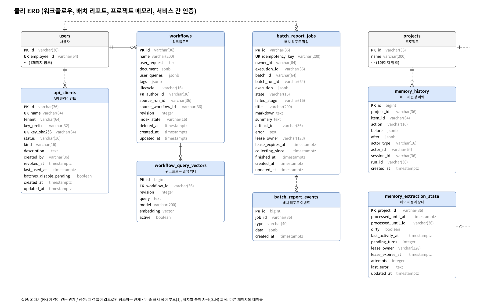

# 물리 ERD

| 항목 | 내용 |
| --- | --- |
| 시스템 | pr-agentic-service (사내 데이터 분석 Agent 서비스) |
| 기준 | internal/gaia 브랜치, 마이그레이션 0008, 2026-11-25 |
| 그림 원본 | `diagrams/05-erd-physical.drawio` (페이지 2장) |
| 모델 정의 | `src/dtest/core/models.py`, `src/dtest/gaia_bridge/models.py` |

컬럼의 NULL 여부, 기본값, 설명은 `06-table-definition.xlsx`(Table 정의서)에 있습니다. 연결 풀, 용량, 백업은 운영자 메뉴얼에서 다룹니다.

## 1. DB 구성

| 항목 | 값 |
| --- | --- |
| DBMS | PostgreSQL (로컬 검증은 16). `vector` 확장(pgvector)이 필요합니다 |
| 데이터베이스 이름 | dev는 `dtest`, prd는 `dtestprd` (`DATABASE_URL`의 마지막 부분). 사외 로컬은 `agentic` |
| 스키마 | `public` |
| 접속 설정 | `DATABASE_URL` (`postgresql+psycopg://사용자:비밀번호@호스트:5432/데이터베이스이름`) |
| 드라이버 | psycopg 3. 앱 테이블은 SQLAlchemy 비동기, LangGraph는 psycopg 풀 |
| 문자 집합, 시간대 | UTF-8, 모든 시각 컬럼은 `timestamptz`이고 UTC로 저장 |
| 같은 서버를 쓰는 서비스 | executor, pr-batch (각자 자기 데이터베이스) |
| 같은 서버의 데이터베이스 | dev: `dtest`, `executor`, `batch`. prd: `dtestprd`, `executorprd`, `batchprd` |
| 서버 연결 한도 | `max_connections` 150 |
| 계정 | 마스터 계정 하나를 서비스와 운영자가 함께 씀 |
| 관리 주체 | 사내 서비스형 DB. 서버 설정, 백업, 버전은 우리가 바꿀 수 없음 |

dev와 prd의 DB 사용 현황(2026-11-22 기준)은 다음과 같습니다.

- dev와 prd가 같은 DB 서버(같은 주소)를 쓰고, 데이터베이스 이름으로 나뉩니다. 테이블과 데이터는 환경별로 따로입니다.
- 서버를 같이 쓰므로 연결 한도 150은 여섯 데이터베이스가 함께 나눠 씁니다.
- 곧 prd를 다른 DB 서버로 분리할 예정입니다. 분리할 때 할 일은 5.4절에 있습니다.

기동 계정에 필요한 권한은 다음과 같습니다.

- 자기 데이터베이스(`dtest`, `dtestprd`)에 대한 테이블 생성, 변경, 인덱스 생성 권한 (마이그레이션을 인스턴스가 직접 실행하므로). 마스터 계정을 쓰므로 현재는 충족됩니다.
- `CREATE EXTENSION IF NOT EXISTS vector` 실행 권한. 권한을 줄 수 없으면 DBA가 확장을 먼저 만들어 둡니다. 이미 있으면 이 문장은 아무 일도 하지 않습니다.

## 2. 물리 ERD

실선은 외래키 제약이 있는 관계, 점선은 값으로만 참조하는 관계입니다. 두 줄 표시 쪽이 부모(1), 까치발 쪽이 자식(0..N)입니다. 컬럼 앞의 PK는 기본키, FK는 외래키 제약, UK는 UNIQUE 제약입니다.

### 2.1 사용자, 대화, 실행, executor 연동, gaia 연동


### 2.2 워크플로우, 배치 리포트, 프로젝트 메모리, 서비스 간 인증

회색 테이블(users, projects)은 2.1의 테이블을 다시 그린 것입니다.



## 3. 테이블 목록

| # | 테이블 | 기본키 | 행 증가 | 자동 정리 |
| --- | --- | --- | --- | --- |
| 1 | users | id | 사용자 수 | 없음 |
| 2 | projects | id | 적음 | 없음 (논리 삭제) |
| 3 | project_members | (project_id, user_id) | 적음 | 없음 |
| 4 | sessions | id | 대화 수 | 없음 (논리 삭제) |
| 5 | messages | id | 턴당 2행 안팎 | 없음 |
| 6 | runs | id | 턴당 1행 | 없음 |
| 7 | run_events | id (bigint) | 턴당 수십 행. 가장 빨리 큼 | 30일 |
| 8 | run_requests | (session_id, key) | 턴당 1행 | 1일 |
| 9 | executor_inbox | event_id | 분석 1건당 수 행~수십 행 | 7일 |
| 10 | code_sources | id | 분석 단계당 1행 | 파일만 7일, 행은 유지 |
| 11 | images | id | 첨부 이미지 수 | 세션 삭제 7일 뒤 |
| 12 | memory_history | id (bigint) | 메모리 변경 수 | 없음 |
| 13 | memory_extraction_state | project_id | 프로젝트당 1행 | 없음 |
| 14 | workflows | id | 적음 | 없음 (논리 삭제) |
| 15 | workflow_query_vectors | id (bigint) | 워크플로우 수정 횟수 × 질문 수 | 없음 |
| 16 | batch_report_jobs | id | 배치 실행 성공 1건당 1행 | 없음 |
| 17 | batch_report_events | id (bigint) | 리포트 1건당 수십 행 | 30일 |
| 18 | api_clients | id | 적음 | 없음 |
| 19 | gaia_sessions | (user_id, gaia_session_id) | gaia 대화 수 | 없음 |
| - | alembic_version | version_num | 1행 | Alembic 관리 |
| - | checkpoints, checkpoint_writes, checkpoint_blobs, checkpoint_migrations | LangGraph 정의 | 턴의 그래프 단계마다 | 쉬는 세션은 최신 1개만 남김 |
| - | store, store_migrations | LangGraph 정의 | 프로젝트 메모리 주제 수 | 없음 |

## 4. 인덱스

기본키와 UNIQUE 제약의 인덱스는 생략했습니다.

| 테이블 | 인덱스 | 컬럼 | 받치는 조회 |
| --- | --- | --- | --- |
| sessions | ix_sessions_project_id | project_id | 프로젝트의 세션 목록 |
| messages | ix_messages_session_created | (session_id, created_at) | 대화 내용 조회 |
| runs | ix_runs_session_id | session_id | 세션의 run 조회 |
| runs | ix_runs_status | status | 상태별 조회 |
| runs | ix_runs_claim | (status, lease_expires_at) | worker가 가져갈 run 고르기 |
| runs | ix_runs_waiting_execution | `waiting ->> 'execution_id'`, 조건 `status = 'waiting_executor'` | executor 이벤트가 왔을 때 기다리는 run 찾기 |
| run_events | ix_run_events_session_id_id | (session_id, id) | SSE 재접속 시 이어 받기 |
| run_events | ix_run_events_run_id_id | (run_id, id) | run 단위 이벤트 조회 (0005에서 추가) |
| run_events | ix_run_events_created_at | created_at | 보존 정리 |
| run_requests | ix_run_requests_created_at | created_at | 보존 정리 |
| executor_inbox | ix_executor_inbox_execution_id | execution_id | 실행별 이벤트 조회 |
| executor_inbox | ix_executor_inbox_received_at | received_at | 보존 정리 |
| code_sources | ix_code_sources_session_id, _run_id, _execution_id, _created_at | 각 컬럼 | 대화, run, 실행별 조회와 보존 정리 |
| images | ix_images_session_id | session_id | 세션의 이미지 |
| memory_history | ix_memory_history_project_id | project_id | 프로젝트의 메모리 이력 |
| memory_extraction_state | ix_memory_extraction_claim | last_activity_at, 조건 `dirty` | 정리할 프로젝트 고르기 |
| workflows | ix_workflows_author_id | author_id | 내 워크플로우 목록 |
| workflow_query_vectors | ix_workflow_query_vectors_workflow_id | workflow_id | 워크플로우의 벡터 |
| workflow_query_vectors | ix_wqv_hnsw_{차원} | `embedding::vector(차원)` 코사인 HNSW, 조건 `active` | 워크플로우 유사도 검색 |
| batch_report_jobs | ix_batch_report_jobs_owner_id, _execution_id, _batch_id, _state | 각 컬럼 | 내 리포트 목록, 실행·배치별 조회, 처리할 작업 고르기 |
| batch_report_events | ix_batch_report_events_job_id, _created_at | 각 컬럼 | 작업의 이벤트, 보존 정리 |

### 4.1 벡터 인덱스 주의

- `ix_wqv_hnsw_{차원}`은 Alembic이 아니라 기동 시 `WorkflowService.ensure_index()`가 `CREATE INDEX IF NOT EXISTS`로 만듭니다. 이름에 `EMBEDDING_DIMS` 값이 들어갑니다(예: `ix_wqv_hnsw_1024`).
- HNSW 인덱스는 2,000차원 이하만 됩니다. `EMBEDDING_DIMS`는 임베딩 모델의 실제 출력 차원과 같아야 합니다.
- `EMBEDDING_DIMS`나 임베딩 모델을 바꾸면 새 차원의 인덱스가 하나 더 생기고, 예전 벡터는 `model` 값이 달라 검색에서 빠집니다. 기존 워크플로우는 다시 색인해야 검색되고, 예전 인덱스는 직접 지워야 합니다.
- `EMBEDDING_PROVIDER`가 `none`이면 인덱스를 만들지 않고 검색 추천만 꺼집니다.

## 5. 마이그레이션

### 5.1 적용 방식

인스턴스가 시작할 때 `AUTO_MIGRATE`가 true(기본)이면 아래를 순서대로 한 번 실행합니다(`src/dtest/core/bootstrap.py`의 `migrate`).

1. `pg_advisory_lock(7340001)`을 잡습니다. 여러 인스턴스가 동시에 떠도 한 인스턴스만 진행하고 나머지는 기다립니다.
2. `CREATE EXTENSION IF NOT EXISTS vector`
3. Alembic `upgrade head` (앱 테이블)
4. LangGraph checkpointer와 store의 `setup()` (LangGraph 테이블)
5. 예전 항목형 프로젝트 메모리를 기본 주제로 옮김 (이미 옮겼으면 아무 일도 하지 않음)
6. 워크플로우 벡터 인덱스 생성
7. 잠금 해제

`AUTO_MIGRATE`를 false로 두면 인스턴스는 스키마를 건드리지 않습니다. 이때는 배포 전에 배포할 버전의 코드와 같은 설정으로 `python scripts/migrate.py`를 한 번 실행합니다. 실패하면 0이 아닌 코드로 끝납니다.

### 5.2 이력

| 번호 | 내용 |
| --- | --- |
| 0001 | 기준 스키마. 테이블 16개와 인덱스 |
| 0002 | memory_extraction_state 테이블과 `ix_memory_extraction_claim` |
| 0003 | api_clients 테이블, users에 `batches_disable_pending` 컬럼 |
| 0004 | gaia_sessions 테이블. 이미 있으면 건너뜀 |
| 0005 | `ix_run_events_run_id_id` 인덱스 |
| 0006 | api_clients의 `pending` 상태를 `active`로 변경 (데이터만) |
| 0007 | api_clients에 `batches_disable_pending` 컬럼 |
| 0008 | api_clients에 `kind` 컬럼 (기본값 `standard`) |

0004의 내력: gaia_sessions는 원래 internal/gaia에서 0002번이었습니다. main의 0002, 0003과 번호가 겹쳐 0004로 옮겼습니다. 예전 0002(gaia_sessions)로 올린 DB가 남아 있다면 테이블은 있지만 지금의 0002, 0003이 빠진 상태입니다. 그런 DB는 아래를 실행한 뒤 다시 올리면 기존 테이블은 그대로 두고 나머지가 적용됩니다.

```sql
UPDATE alembic_version SET version_num = '0001';
```

### 5.3 새 마이그레이션 작성 규칙

- 파일은 `src/dtest/migrations/versions/`에 `NNNN_설명.py`로 만들고 `down_revision`을 직전 번호로 둡니다.
- 이전 버전 코드가 계속 동작하는 변경만 합니다. 컬럼 추가는 NULL 허용이거나 DB 기본값(`server_default`)을 둡니다. 인덱스는 추가만 합니다. 배포 중에는 새 스키마 위에서 옛 버전이 잠시 함께 돌기 때문입니다.
- 컬럼 삭제나 이름 변경은 두 번에 나눕니다. 먼저 코드가 그 컬럼을 쓰지 않게 배포하고, 다음 배포에서 지웁니다.
- 큰 테이블(run_events)의 인덱스 추가는 테이블 잠금 시간을 확인합니다. Alembic 기본은 `CREATE INDEX`라 쓰기가 잠깁니다.
- 모델(`models.py`)과 마이그레이션을 같이 고칩니다. 로컬에서 빈 DB에 처음부터 올려 보고, 직전 버전 DB에서도 올려 봅니다.
- main과 internal/gaia 양쪽에 같은 번호로 들어가야 합니다. 한쪽에만 번호를 쓰면 0004와 같은 충돌이 다시 생깁니다.

### 5.4 주의

- 마이그레이션이 실패하면 `AUTO_MIGRATE`가 켜진 모든 인스턴스가 시작에 실패합니다. 교체 배포로 옛 인스턴스가 이미 내려갔다면 서비스가 멈춥니다. 운영은 `AUTO_MIGRATE: false`와 사전 실행을 권장합니다.

- 환경의 구분은 `DATABASE_URL`의 데이터베이스 이름뿐입니다. 서버 주소와 계정이 같으므로, dev 설정에 `dtestprd`를 적는 실수를 하면 오류 없이 prd 데이터에 붙습니다. 그러면 dev의 worker가 prd의 run을 가져가 dev 코드로 실행하고, dev의 마이그레이션이 prd 스키마를 바꿉니다. `config.dev.yml`과 `config.prd.yml`의 `DATABASE_URL`을 고칠 때는 데이터베이스 이름을 다시 확인합니다. `scripts/set_user_role.py`처럼 DB에 직접 붙는 스크립트는 접속할 DB를 먼저 출력하므로 그 줄을 확인하고 진행합니다.

#### prd를 다른 DB 서버로 분리할 때

1. 새 서버에 데이터베이스를 만들고 `vector` 확장을 쓸 수 있는지 확인합니다.
2. 기존 데이터를 가져갈지 정합니다.
   - 가져가지 않으면: `config.prd.yml`의 `DATABASE_URL`만 새 서버로 바꿉니다. 첫 기동 때 `AUTO_MIGRATE`(또는 `python scripts/migrate.py`)가 테이블을 모두 만듭니다. 데이터가 비어 있으므로 사용자는 첫 로그인 때 새로 만들어지고, 관리자는 `ADMIN_EMPLOYEE_IDS`로 다시 지정되며, API 키는 다시 발급합니다.
   - 가져가면: 서비스를 내린 상태에서 데이터베이스 전체를 옮깁니다. 앱 테이블과 LangGraph 테이블(checkpoints 계열, store)을 같은 시점으로 함께 옮겨야 합니다. 옮긴 뒤 `alembic_version` 값이 그대로인지 확인합니다.
3. executor와 pr-batch의 prd 데이터베이스도 함께 옮기는지 확인합니다. 우리 DB의 `execution_id`는 그 환경의 executor에 있는 실행을 가리켜야 하므로, 우리만 빈 DB로 시작하고 executor는 기존 데이터를 유지해도 문제는 없지만, 반대로 우리 데이터는 유지하고 executor가 빈 DB로 시작하면 기다리던 run과 결과물 링크가 깨집니다.
4. 분리 뒤에는 연결 한도를 서버별로 다시 계산합니다.

