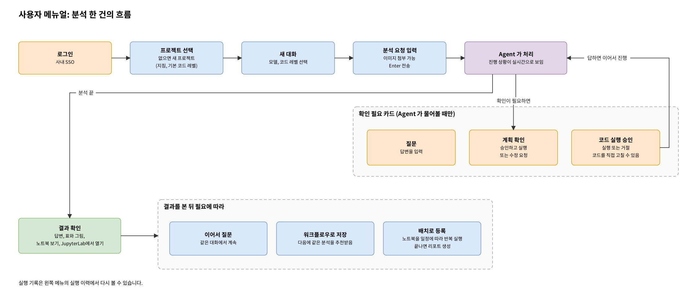

# 사용자 메뉴얼

| 항목 | 내용 |
| --- | --- |
| 시스템 | pr-agentic-service (사내 데이터 분석 Agent 서비스) |
| 대상 | 웹 화면에서 데이터 분석을 요청하는 사용자 |
| 화면 | 서비스가 제공하는 웹 화면(Analysis Agent) |
| 그림 원본 | `diagrams/07-user-flow.drawio` |

접속 주소는 환경마다 다르므로 이 문서에 적지 않습니다. 운영 담당자에게 받은 주소로 접속합니다.

화면 그림 자리는 `[화면 그림 n]`으로 표시해 두었습니다. 실제 화면을 찍어 넣을 자리입니다.

## 1. 시작하기

### 1.1 이 서비스로 할 수 있는 일

Analysis Agent는 채팅으로 데이터 분석을 요청하는 서비스입니다. 분석하고 싶은 내용을 글로 적으면 Agent가 계획을 세우고, 분석 코드를 실행하고, 결과를 표와 그림, 노트북으로 돌려줍니다.

| 할 수 있는 일 | 설명 | 절 |
| --- | --- | --- |
| 대화와 분석 | 질문에 답하고, 데이터 분석을 계획부터 결과까지 수행 | 3, 4 |
| 결과 다시 보기 | 노트북, 산출물, 실행 기록을 다시 열어 봄 | 5 |
| 워크플로우 | 자주 하는 분석 절차를 저장해 다음에 추천받음 | 6 |
| 배치 | 노트북을 일정에 따라 반복 실행하고 리포트를 받음 | 7 |
| 프로젝트 메모리 | 프로젝트에서 Agent가 기억할 내용을 관리 | 8 |

### 1.2 분석 한 건의 흐름

### 1.3 로그인

1. 브라우저로 서비스 주소에 접속합니다.
2. 로그인되어 있지 않으면 사내 SSO 로그인 화면으로 넘어갑니다. 사번 계정으로 로그인합니다.
3. 로그인이 끝나면 채팅 화면으로 돌아옵니다. 처음 로그인한 사용자는 자동으로 등록됩니다.

30분 동안 사용하지 않거나 로그인한 지 12시간이 지나면 로그인이 풀립니다. 이때 화면이 다시 SSO 로그인으로 넘어갑니다.

### 1.4 화면 구성

`[화면 그림 1: 전체 화면. 왼쪽 메뉴와 가운데 채팅 영역]`

| 위치 | 항목 | 설명 |
| --- | --- | --- |
| 왼쪽 위 | 대화 검색 | 지난 대화를 찾음 |
| 왼쪽 메뉴 | 새 대화 | 현재 프로젝트에서 새 대화를 시작 |
| 왼쪽 메뉴 | 프로젝트 | 프로젝트 목록. 프로젝트를 만들고 바꿈 |
| 왼쪽 메뉴 | 워크플로우 | 저장된 분석 절차 목록 |
| 왼쪽 메뉴 | 실행 이력 | 분석 코드 실행 기록 |
| 왼쪽 메뉴 | 배치 | 반복 실행과 리포트 |
| 왼쪽 메뉴 | 시스템 | 관리자에게만 보임. 운영자 메뉴얼 참고 |
| 왼쪽 가운데 | 프로젝트 이름과 대화 목록 | 현재 프로젝트의 대화. 누르면 그 대화가 열림 |
| 왼쪽 아래 | 사용자 메뉴 | 내 이름. 로그아웃 |
| 가운데 | 채팅 영역 | 대화 내용과 입력창 |

## 2. 프로젝트

프로젝트는 대화를 묶는 단위입니다. 같은 프로젝트의 대화는 프로젝트 지침과 공유 메모리를 함께 씁니다. 업무나 주제별로 프로젝트를 나누어 쓰면 Agent가 그 업무의 맥락을 유지합니다.

### 2.1 프로젝트 만들기

1. 왼쪽 메뉴의 "프로젝트"를 누르고 "새 프로젝트"를 누릅니다.
2. 기본 정보를 넣습니다.

| 항목 | 설명 |
| --- | --- |
| 이름 | 프로젝트 이름 |
| 설명 | 무엇을 하는 프로젝트인지 |
| 프로젝트 지침 | 이 프로젝트의 모든 대화에서 Agent가 따를 지시. 예: 사용할 데이터, 용어, 답변 형식 |
| 기본 코드 레벨 | 새 대화의 코드 레벨 기본값(3.3절). 비우면 서비스 기본값 |

3. 저장하면 그 프로젝트가 현재 프로젝트가 됩니다.

### 2.2 프로젝트 설정 바꾸기와 삭제

왼쪽의 프로젝트 이름 옆 "프로젝트 설정"에서 기본 정보와 공유 메모리(8절)를 고칩니다. 프로젝트를 삭제하면 그 프로젝트의 대화가 목록에서 사라지고, 열려 있는 코드 실행도 취소되므로 주의합니다.

## 3. 대화하기

### 3.1 새 대화 시작

1. 왼쪽 메뉴의 "새 대화"를 누릅니다.
2. 입력창에 분석하고 싶은 내용을 적습니다.
3. Enter로 보냅니다. 줄을 바꾸려면 Shift+Enter를 누릅니다.

`[화면 그림 2: 입력창. 이미지 첨부, 모델 선택, 코드 레벨, 전송 버튼]`

대화 제목은 첫 메시지를 보고 자동으로 붙습니다. 화면 위의 제목을 눌러 바꿀 수 있습니다.

### 3.2 입력창의 기능

| 기능 | 설명 |
| --- | --- |
| 이미지 첨부 | png, jpeg, webp 이미지를 함께 보냄. 한 번에 보내는 요청은 32MB까지 |
| 모델 선택 | 답변에 쓸 모델. "텍스트+이미지" 모델만 이미지를 받음 |
| 코드 레벨 | Agent가 직접 코드를 작성할 수 있는 범위(3.3절) |
| 전송 | 메시지를 보냄. Agent가 작업하는 동안에는 "중지"로 바뀜 |

글만 받는 모델을 고른 상태에서 이미지를 붙이면 보낼 수 없습니다. 텍스트+이미지 모델로 바꿉니다.

### 3.3 코드 레벨

Agent가 분석할 때 등록된 도구만 쓸지, 코드를 직접 작성해도 되는지를 정합니다. 숫자가 클수록 Agent가 자유롭게 코드를 씁니다.

| 레벨 | 이름 | 뜻 |
| --- | --- | --- |
| 1 | tool만 | 등록된 tool만 사용 |
| 2 | 연결 코드 | tool을 쓰고, tool 사이를 잇는 코드만 작성 |
| 3 | tool 우선 | tool을 먼저 쓰고, 필요하면 새 함수를 작성 |
| 4 | 자유 코드 | 코드를 자유롭게 작성 |
| 기본 | | 프로젝트의 기본 코드 레벨, 없으면 서비스 기본값 |

Agent가 직접 작성한 코드는 실행 전에 승인을 요청할 수 있습니다(4.3절).

### 3.4 진행 상황 보기

메시지를 보내면 답변 자리에 진행 상황이 실시간으로 나옵니다.

| 표시 | 뜻 |
| --- | --- |
| 실행 대기 중 | 요청이 접수되어 차례를 기다림 |
| 생각하는 중 | Agent가 답을 만들거나 다음 행동을 정함 |
| 도구 이름 | 그 도구를 실행하는 중 |
| 분석 담당이 이어서 진행 | 일반 대화에서 데이터 분석으로 넘어감 |
| 대화 담당으로 복귀 | 분석을 마치고 일반 대화로 돌아옴 |
| 확인을 기다리는 중 | 사용자의 답이 필요함(4절) |

### 3.5 중지와 이어 하기

- Agent가 작업하는 동안 "중지"를 누르면 작업이 멈춥니다. 실행 중이던 분석 코드도 함께 취소됩니다.
- 작업 중에는 같은 대화에 새 메시지를 보낼 수 없습니다. 다른 작업은 새 대화에서 합니다.
- 브라우저를 닫아도 작업은 계속됩니다. 다시 그 대화를 열면 진행 상황과 결과가 이어서 보입니다.
- 필요 없는 대화는 대화 목록에서 삭제할 수 있습니다. 작업 중인 대화를 삭제하면 작업도 중지됩니다.
- 작업이 끝난 뒤에는 같은 대화에서 이어서 질문할 수 있습니다. 앞의 분석 내용을 기억한 채로 답합니다.

## 4. Agent가 확인을 요청할 때

Agent는 진행에 사용자의 판단이 필요하면 "확인 필요" 카드를 띄우고 기다립니다. 카드에 답해야 다음으로 넘어갑니다. 카드 대신 입력창에 글을 적어 보내면 그 내용으로 답한 것이 됩니다.

`[화면 그림 3: 확인 필요 카드(실행 계획 확인)]`

### 4.1 질문

Agent가 진행에 필요한 정보를 묻습니다. 보기가 있으면 고르고, 없거나 맞는 보기가 없으면 직접 답변을 입력합니다.

### 4.2 실행 계획 확인

분석을 시작하기 전에 Agent가 세운 계획을 보여 줍니다. 비슷한 워크플로우가 있으면 "추천 워크플로우"가 후보로 함께 나오고, 없으면 "새 계획"만 나옵니다.

1. 후보가 여러 개면 쓸 후보를 고릅니다.
2. 파라미터를 확인합니다. "입력 필요"로 표시된 값은 채워야 하고, Agent가 정한 값도 고칠 수 있습니다. 선택 입력은 비워 두면 기본값을 씁니다.
3. 아래 중 하나를 누릅니다.

| 버튼 | 동작 |
| --- | --- |
| 승인하고 실행 | 이 계획대로 분석을 시작 |
| 수정 요청 | 바꿀 내용을 적어 보냄. 예: 표본을 500개로, 상관분석도 추가. Agent가 계획을 고쳐 다시 보여 줌 |
| 추천 말고 새로 만들기 | 추천 워크플로우를 쓰지 않고 Agent가 계획을 새로 세움 |

등록된 워크플로우와 질문이 아주 비슷하면 이 카드 없이 바로 실행합니다. 이때 진행 상황에 "승인 없이 바로 실행"과 워크플로우 이름, 유사도가 표시됩니다.

### 4.3 코드 실행 승인

Agent가 직접 작성한 코드를 실행하기 전에 코드와 목적을 보여 줍니다. 코드는 카드에서 바로 고칠 수 있고, 고친 내용으로 실행됩니다.

| 버튼 | 동작 |
| --- | --- |
| 실행 | 코드를 실행 |
| 거절 | 실행하지 않음. 거절 사유를 적으면 Agent가 그에 맞춰 다시 시도 |

### 4.4 워크플로우 저장

분석이 끝나면 Agent가 이 분석을 워크플로우로 저장할지 물을 수 있습니다. 저장하면 다음에 비슷한 요청을 할 때 계획 후보로 추천됩니다.

- 이름과 예시 질문을 확인합니다. 예시 질문은 줄마다 하나씩 적고, 나중에 검색할 때 이 질문들과 비교해 추천합니다.
- Agent가 직접 작성한 코드 단계는 저장에서 제외됩니다.
- 필요 없으면 "저장 안 함"을 누릅니다.

## 5. 결과 보기

### 5.1 답변과 결과물

분석이 끝나면 답변에 요약과 함께 결과물이 붙습니다.

| 항목 | 설명 |
| --- | --- |
| 답변 | 분석 결과 요약과 해석 |
| 표, 그림 | 답변 안에 바로 보임 |
| 보기 | 노트북이나 산출물을 새 탭에서 열어 봄 |
| JupyterLab에서 열기 | 분석 노트북을 JupyterLab에서 열어 직접 이어서 작업 |

`[화면 그림 4: 분석 결과 답변. 그림과 "보기", "JupyterLab에서 열기"]`

### 5.2 실행 이력

왼쪽 메뉴의 "실행 이력"에서 내가 요청한 분석 코드 실행 기록을 봅니다. 프로젝트, 대화, 상태, 실행 종류(채팅 분석, 배치)로 걸러 볼 수 있습니다. 실행을 누르면 상세가 열립니다.

| 탭 | 내용 |
| --- | --- |
| 개요 | 상태, 시작과 종료 시각, 실행 환경 |
| 커널·자원 | 실행이 쓰는 커널과 메모리, CPU 사용량 |
| 단계 | 단계별 진행과 결과 |
| 이벤트 | 실행 중 발생한 이벤트 |
| 결과 | 최종 결과 |
| 노트북 | 실행된 노트북. "노트북 전체 보기"로 새 탭에서 열림 |
| 산출물 | 실행이 만든 파일 목록 |
| 진단 | 실패했을 때의 원인 정보 |
| 시도 | 재시도 기록 |

### 5.3 대화 찾기

왼쪽 위 "대화 검색"에 단어를 넣으면 지난 대화를 찾을 수 있습니다. 왼쪽의 대화 목록은 현재 프로젝트의 대화만 보여 줍니다.

## 6. 워크플로우

워크플로우는 분석 절차를 skill(분석 단계)과 tool(실행되는 함수)의 순서로 저장한 것입니다. 비슷한 질문을 하면 Agent가 저장된 워크플로우를 계획 후보로 추천합니다(4.2절).

`[화면 그림 5: 워크플로우 목록]`

### 6.1 목록과 카드 읽는 법

왼쪽 메뉴의 "워크플로우"를 누르면 목록이 나옵니다. 위의 필터로 전체, 공개, 후보를 나누어 봅니다. 카드 오른쪽 위의 "?"를 누르면 카드 읽는 법이 나옵니다.

| 표시 | 뜻 |
| --- | --- |
| 번호가 붙은 이름 | skill. 분석 단계이고 번호는 단계 순서 |
| 칩 | tool. 실제로 실행되는 함수이고 항상 실행됨 |
| 색이 다른 칩 | 조건부 tool. 앞 결과를 보고 Agent가 실행 여부를 정함 |
| 화살표 | 실행 순서 |
| 공개 | 비슷한 질문에 계획 후보로 추천됨 |
| 내 후보 | 나만 보임 |

### 6.2 만들기와 고치기

| 작업 | 방법 |
| --- | --- |
| 대화에서 저장 | 분석이 끝난 뒤 나오는 "워크플로우 저장" 카드에서 저장(4.4절). 가장 쉬운 방법 |
| 직접 만들기 | 목록의 "워크플로우 만들기"에서 skill과 tool을 골라 순서를 정함 |
| 수정 | 카드를 열어 "수정" |
| 복제 | 카드를 열어 "복제". 공개 워크플로우를 내 것으로 복사해 고칠 때 씀 |
| 추천 확인 | 질문을 넣어 어떤 워크플로우가 추천되는지 시험. 공개된 것만 추천 대상 |
| 공개 | 내 후보를 모든 사용자에게 추천되도록 올림 |

## 7. 배치

배치는 노트북을 정해진 일정에 따라 반복 실행하는 기능입니다. 성공한 실행마다 Agent가 결과를 분석해 리포트를 쓰고, 같은 배치의 이전 실행과 비교합니다.

`[화면 그림 6: 배치 화면. 배치, 스크립트, 리포트 탭]`

### 7.1 스크립트 등록

배치로 돌릴 노트북을 먼저 스크립트로 등록합니다. "배치" 화면의 "스크립트" 탭에서 등록하며 방법은 두 가지입니다.

- `.ipynb` 파일을 올립니다.
- 대화에서 만든 분석 노트북의 artifact ID를 넣습니다. ID는 채팅 결과의 노트북 "보기" 링크에 있습니다. 채팅으로 분석을 만들어 본 뒤 그 노트북을 그대로 배치로 돌릴 때 씁니다.

스크립트를 고쳐 다시 등록하면 새 버전이 됩니다.

### 7.2 배치 만들기

"배치" 탭에서 "새 배치"를 누르고 아래를 넣습니다.

| 항목 | 설명 |
| --- | --- |
| 이름 | 배치 이름. 예: 주간 수율 점검 |
| 프로젝트 | 배치가 속할 프로젝트 |
| 스크립트, 버전 | 실행할 스크립트와 버전 |
| 런타임 | 실행 환경 |
| 일정 | 수동, 간격(분), 매일 시각, Cron 중 하나 |
| 시작·종료 시각 | 일정이 유효한 기간. 선택 |

시간대는 Asia/Seoul입니다. 배치는 만든 직후에는 꺼져 있습니다. 목록에서 "켜기"를 눌러야 일정대로 실행됩니다.

### 7.3 실행과 확인

| 작업 | 방법 |
| --- | --- |
| 지금 실행 | 일정과 관계없이 바로 한 번 실행 |
| 켜기, 끄기 | 일정 실행을 켜거나 끔 |
| 실행 이력 | 배치를 눌러 실행별 상태와 노트북을 확인. 실행을 누르면 상세(5.2절)가 열림 |
| 건너뛴 일정 | 실행되지 못하고 지나간 일정을 확인 |
| 리포트 | "리포트" 탭에서 실행별 리포트를 읽음 |

리포트는 실행이 성공으로 끝난 뒤 만들어지며 몇 분 걸릴 수 있습니다.

배치가 "꺼짐 · 사용자 비활성화"로 표시되면 계정이 비활성화되면서 꺼진 것입니다. 계정이 다시 활성화되어도 자동으로 켜지지 않으므로 직접 다시 켭니다.

## 8. 프로젝트 메모리

공유 메모리는 프로젝트의 모든 대화에서 Agent가 참고하는 내용입니다. 주제별로 나뉘어 있고, 왼쪽의 "프로젝트 설정"에서 "공유 메모리"를 열어 관리합니다.

- 대화가 끝나면 Agent가 사용자가 말한 사실과 선호를 자동으로 정리해 넣습니다.
- 대화에서 "기억해줘"라고 하면 바로 저장합니다.
- 직접 고칠 수도 있습니다. 주제를 추가하고, 내용을 Markdown으로 적어 저장합니다. 주제의 설명은 Agent가 어떤 내용을 어느 주제에 넣을지 정하는 기준이 됩니다.
- 바뀐 내용은 "기록"에서 이전 상태를 보고 되돌릴 수 있습니다.

프로젝트 지침(2.1절)은 사용자가 정한 고정 지시이고, 공유 메모리는 쓰면서 쌓이는 내용이라는 점이 다릅니다.

## 9. 자주 겪는 상황

| 상황 | 원인과 해결 |
| --- | --- |
| 갑자기 로그인 화면으로 넘어감 | 30분 무활동 또는 12시간 경과로 로그인이 풀림. 다시 로그인하면 됨. 진행 중이던 작업은 계속되고 있음 |
| 메시지를 보냈는데 "실행 대기 중"이 오래 감 | 동시에 처리 중인 요청이 많아 차례를 기다리는 중. 계속되면 운영 담당자에게 문의 |
| 입력창이 막혀 있음 | 그 대화에서 Agent가 작업 중이거나 확인 카드의 답을 기다리는 중. 카드에 답하거나 "중지"를 누르거나 새 대화를 씀 |
| 이미지를 보낼 수 없음 | 글만 받는 모델이 선택됨. 텍스트+이미지 모델로 바꿈 |
| "요청이 너무 큽니다" | 한 번에 32MB까지. 이미지 수나 크기를 줄임 |
| 분석이 실패로 끝남 | 답변 자리의 오류 메시지를 확인하고 같은 메시지를 다시 보냄. 반복되면 문의 |
| 분석이 오래 끝나지 않음 | 데이터가 크면 오래 걸릴 수 있음. 실행 이력에서 그 실행의 상태를 확인. 멈추려면 "중지" |
| 화면이 실시간으로 갱신되지 않음 | 새로 고침하면 최신 상태가 보임. 반복되면 문의 |
| 배치가 일정에 실행되지 않음 | 배치가 켜져 있는지, 시작·종료 시각 안인지 확인. "건너뛴 일정"에서 사유 확인 |
| 워크플로우가 추천되지 않음 | 공개되지 않았거나 예시 질문이 실제 질문과 많이 다르면 추천되지 않음. 예시 질문을 보강하고 "추천 확인"으로 시험 |

### 문의할 때

오류 메시지 옆에 "요청 ID"가 함께 나옵니다. 누르면 복사됩니다. 운영 담당자에게 문의할 때 아래를 함께 전달하면 원인을 빨리 찾을 수 있습니다.

- 요청 ID 또는 오류 메시지에 나온 오류 ID
- 문제가 난 시각과 대화 제목
- 무엇을 하다가 생겼는지
