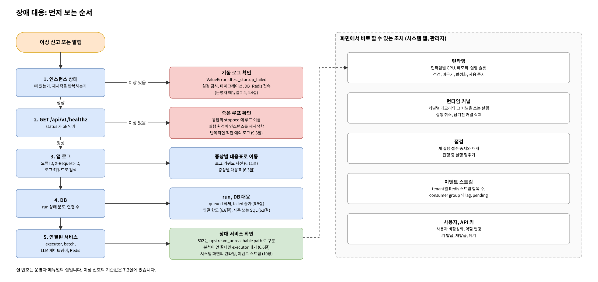
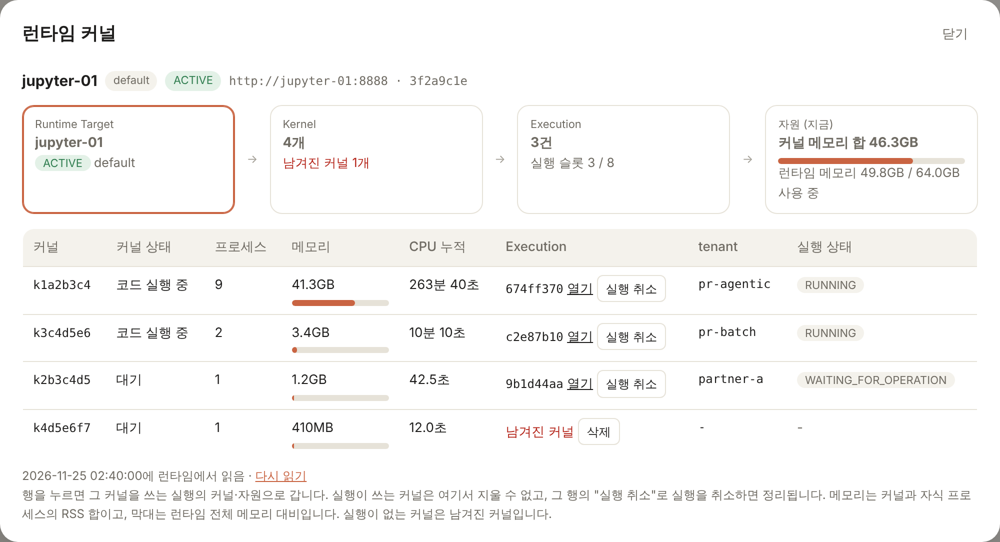
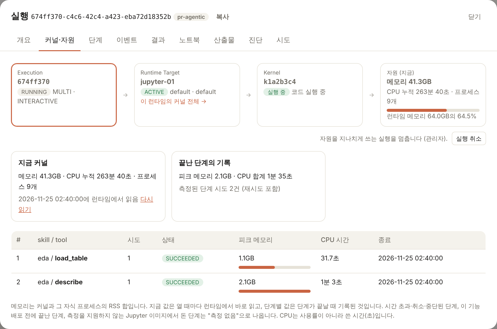
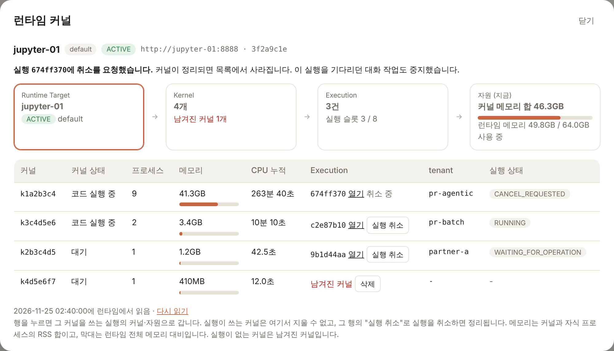
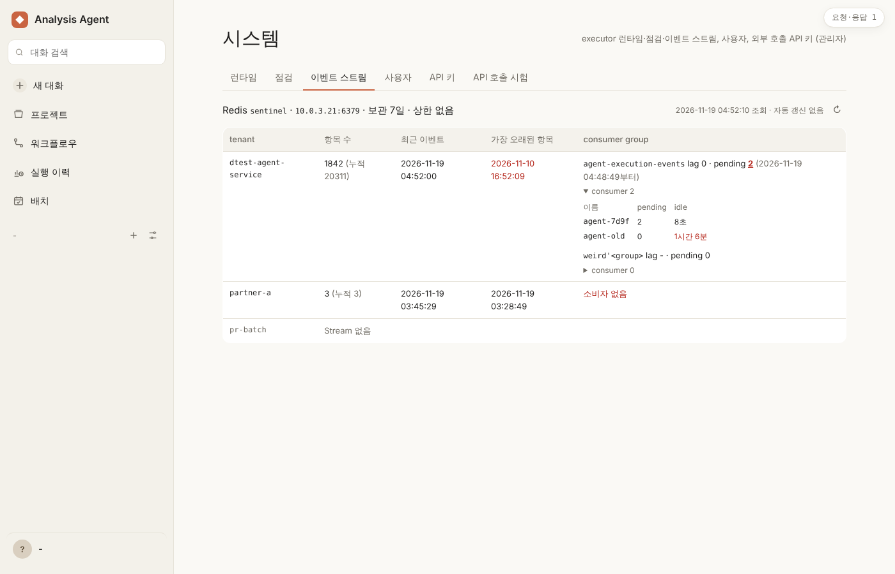

# 운영자 메뉴얼

| 항목 | 내용 |
| --- | --- |
| 시스템 | gaia-api-service (사내 데이터 분석 Agent 서비스) |
| 대상 | 시스템을 운영하는 담당자 |
| 소스 경로 | `src/dtest/` 아래 |
| 그림 원본 | `diagrams/08-ops-flow.drawio` |

주소, 계정, 키 같은 환경별 실제 값은 적지 않고 서비스 이름과 설정 키 이름으로 가리킵니다. 실제 값은 `config.{dev,stg,prd}.yml`에 있습니다.

| 장 | 내용 |
| --- | --- |
| 1 | 서비스 구성 |
| 2 | 배포 |
| 3 | 일상 운영 |
| 4 | 운영 시 주의할 점 |
| 5 | 부하를 받는 포인트 |
| 6 | 장애 대응 |
| 7 | 모니터링과 로그 |
| 8 | 정기 점검 |
| 9 | 부록 (설정 키, 운영 스크립트, 백그라운드 루프, DB 서버 분리) |
| 10 | 관리자 화면 (시스템 탭) |

## 1. 서비스 구성

### 1.1 무엇이 어디에 연결되나

gaia-api-service는 사내 데이터 분석 Agent의 채팅 API이자 Agent 실행 서비스입니다. 서비스 인스턴스 하나는 프로세스 하나(uvicorn worker 1개)이고, 그 안에서 API와 백그라운드 작업(worker)이 함께 돕니다. 같은 인스턴스를 여러 개 띄워 부하를 나눕니다. 이 문서에서 "인스턴스"는 그 프로세스 하나를 뜻합니다.

컨테이너 배치, 자동 확장, 앞단 라우팅 같은 실행 인프라는 사내 플랫폼이 맡으므로 이 문서에서 다루지 않습니다. 서비스가 인프라에 기대하는 조건만 1.3절에 적었습니다.

| 연결 대상 | 방향 | 용도 | 끊기면 |
| --- | --- | --- | --- |
| 브라우저(프론트) | 들어옴 | 채팅 API, SSE 실시간 이벤트 | |
| 다른 서비스, 에이전트 | 들어옴 | API 키로 executor·배치 게이트웨이 호출 | |
| gaia 채팅 화면 | 들어옴 | gaia workflow `dtest.analyst` | |
| SSO(IdP) | 나감 | 로그인 확인 | 새 로그인 불가. 이미 로그인한 사용자는 계속 사용 |
| PostgreSQL | 나감 | 앱 데이터, LangGraph 체크포인트 | 모든 요청 실패. run 실행 중단 |
| Redis | 나감 | 로그인 세션, 실시간 이벤트, executor 이벤트 수신 | 로그인 확인 실패로 모든 요청 실패 |
| LLM 게이트웨이 | 나감 | 모델 호출 | run이 `failed`로 끝남. 그 외 화면은 정상 |
| 임베딩 게이트웨이 | 나감 | 워크플로우 검색 | 워크플로우 추천만 안 됨 |
| executor | 나감 | 분석 코드 실행, 노트북, 결과물 | 분석 요청 실패, 결과물 조회 502. 일반 대화는 정상 |
| batch | 나감 | 배치 등록과 조회 중계 | 배치 화면만 502 |
| 공유 저장소(PV) | 마운트 | executor와 코드·결과 파일 주고받기 | 분석 코드 제출과 결과 읽기 실패 |
| Phoenix | 나감 | 실행 추적(선택) | 영향 없음 |

### 1.2 환경

| 환경 | `APP_ENV` | 설정 파일 | SSO |
| --- | --- | --- | --- |
| 로컬 | 비움 | `config.yml` + 환경변수 | dev 어댑터(가짜 로그인) 가능 |
| dev | `dev` | `config.yml` + `config.dev.yml` | idp |
| stg | `stg` | `config.yml` + `config.stg.yml` | idp |
| prd | `prd` | `config.yml` + `config.prd.yml` | idp |

환경별 인프라 현황(2026-11-22 기준)은 다음과 같습니다.

| 자원 | 현황 |
| --- | --- |
| PostgreSQL | 사내 서비스형 DB. 마스터 계정 하나를 씀. 연결 한도 150. dev와 prd가 같은 서버를 쓰고 데이터베이스 이름으로 나뉨(dev `dtest`, prd `dtestprd`). 곧 서버를 분리할 예정(9.4절) |
| Redis | dev와 prd가 분리되어 있음. 환경에 따라 standalone 방식과 Sentinel 방식이 섞여 있음(1.4절) |
| 로그 | 키바나에서 조회. 보관 기간은 사내 정책 |
| 지표 대시보드 | 없음. 상태는 헬스체크, 로그, DB 조회로 확인(7장) |
| 설정과 키 | `config.{env}.yml`에 적어 깃랩에 올리고 배포(사내 폐쇄망 정책) |

### 1.3 서비스가 실행 환경에 기대하는 조건

| 항목 | 내용 |
| --- | --- |
| 실행 명령 | `python app.py`. gaia 템플릿이 uvicorn worker 1개를 띄움. worker 수를 늘리지 않음(4.7절) |
| 포트 | 5000. 사내 정책상 앱서버는 모두 5000번으로 뜸(`PORT` 설정) |
| 준비 확인 | `GET /api/admin/appReady` (gaia 제공). 우리 쪽 시작이 끝나야 응답함 |
| 생존 확인 | `GET /api/v1/healthz`. 백그라운드 루프가 하나라도 죽으면 503. 이때 인스턴스를 재시작해야 함 |
| 종료 대기 | 종료 신호 뒤 정리에 최대 약 45초(2.7절). 그 전에 강제 종료하지 않아야 함 |
| 실행 계정 | UID 1000, GID 1000. executor와 같아야 공유 저장소를 같이 읽고 씀 |
| 공유 저장소 | executor와 같은 저장소를 `/mnt/data`에 마운트 |
| 요청 크기와 연결 | 요청 본문 32MB까지, SSE 연결은 길게 유지(4.8절) |
| 자원 | 인스턴스 하나가 CPU 약 1코어를 씀. 배포 예시의 메모리 한도는 2Gi |

배포 예시는 `deploy/kubernetes/deployment.yml`에 있습니다.

### 1.4 Redis 접속 방식

Redis는 환경마다 standalone 또는 Sentinel 구성입니다. 접속 방식은 `REDIS_MODE`로 고르고, 그 환경의 Redis 구성과 반드시 맞아야 합니다. 어느 방식이든 그 환경의 executor가 쓰는 Redis와 같은 서버, 같은 DB 번호여야 합니다(4.1절).

| | standalone | Sentinel |
| --- | --- | --- |
| `REDIS_MODE` | `standalone` (기본값) | `sentinel` |
| 읽는 설정 | `REDIS_URL` | `REDIS_SENTINEL_HOST`, `REDIS_SENTINEL_PORT`, `REDIS_SENTINEL_MASTER_NAME`, `REDIS_SENTINEL_USERNAME`, `REDIS_SENTINEL_AUTH` |
| 접속 대상 | `REDIS_URL`의 주소. DB 번호는 URL 끝의 숫자 | Sentinel이 알려 주는 현재 마스터. DB 0번 고정 |
| 비밀번호 | `REDIS_URL` 안에 적음 | `REDIS_SENTINEL_AUTH`에 사내 가이드대로 AES로 암호화한 값을 적음. 사내 `hcp` 라이브러리로 복호화 |
| 계정 | URL에 적은 계정 | 계정 하나로 Sentinel과 Redis에 모두 로그인 |
| 쓰지 않는 설정 | `REDIS_SENTINEL_*`는 무시됨 | `REDIS_URL`은 무시됨 |
| Redis 서버가 재시작되면 | 다시 연결. 로그인 세션이 사라졌으면 사용자가 다시 로그인 | 같음 |
| Redis 서버가 죽으면 | 살아날 때까지 로그인 확인이 실패해 모든 요청이 실패 | Sentinel이 레플리카를 마스터로 올리면 5~31초 안에 자동 복구(6.10절). 재시작 불필요 |
| 기동 검사 | 없음 | Sentinel 설정 세 값이 비어 있거나 `hcp` 라이브러리가 없으면 기동 실패 |
| 접속 확인 | 서비스 기동 로그, `/api/v1/users/me` 호출 | `scripts/check_redis_sentinel.py` |

설정 예시입니다. 값은 자리 표시입니다.

```yaml
# standalone
REDIS_MODE: standalone
REDIS_URL: redis://<계정>:<비밀번호>@<redis 주소>:6379/0

# Sentinel
REDIS_MODE: sentinel
REDIS_SENTINEL_HOST: <sentinel 주소>      # 여러 개면 쉼표로
REDIS_SENTINEL_PORT: 26379
REDIS_SENTINEL_MASTER_NAME: <마스터 이름>
REDIS_SENTINEL_USERNAME: <계정>
REDIS_SENTINEL_AUTH: <AES로 암호화한 비밀번호>
```

방식을 고를 때 지킬 것은 다음과 같습니다.

- Sentinel 구성의 Redis에 `standalone`으로 붙지 않습니다. 노드 하나를 `REDIS_URL`로 직접 가리키면 처음에는 동작하지만, 그 노드가 마스터가 아니게 되는 순간 모든 명령이 `READONLY` 오류로 실패합니다(4.2절).
- `REDIS_SENTINEL_*` 값은 그 환경 executor의 같은 이름 설정과 같은 값을 넣습니다.
- 두 방식 모두 Redis 6.2 이상이어야 합니다(`XAUTOCLAIM` 사용).
- 환경의 Redis 구성이 바뀌면(standalone에서 Sentinel로) `REDIS_MODE`와 설정을 함께 바꿔 배포합니다. 로그인 세션은 새 Redis에 없으므로 사용자가 다시 로그인합니다.

## 2. 배포

### 2.1 설정 읽는 순서

우선순위는 환경변수 > `.env` > `config.{APP_ENV}.yml` > `config.yml`입니다.

- `config.yml`: 모든 환경 공통값. 모든 설정 키가 기본값과 함께 적혀 있습니다.
- `config.{APP_ENV}.yml`: 환경마다 다른 값만 있습니다. `DATABASE_URL`, `REDIS_*`, `PUBLIC_API_ORIGIN`, `FRONTEND_ORIGIN`, `CORS_ORIGINS`, `COOKIE_SECURE`, `ADMIN_EMPLOYEE_IDS`, `LLM_API_KEY`, `MODELS`, `EXECUTOR_BASE_URL`, `BATCH_BASE_URL`, 서비스 키.
- `config.example.yml`: 서비스가 읽지 않는 설명용 파일. 모든 키의 의미와 예시가 주석으로 있습니다. 설정 키의 뜻을 찾을 때 이 파일을 봅니다.
- 네 파일은 모두 빌드 결과물에 들어가고, 환경변수 `APP_ENV` 값이 어느 파일을 쓸지 정합니다.
- 사내 폐쇄망 정책에 따라 키 값(`EXECUTOR_API_KEY`, `BATCH_API_KEY`, `LLM_API_KEY`, DB와 Redis 비밀번호)도 `config.{APP_ENV}.yml`에 적어 깃랩에 올리고 배포합니다. 한 값만 바꿀 때는 같은 이름의 환경변수로 넣으면 파일보다 우선합니다.
- 설정을 바꾸는 것은 곧 배포입니다. 실행 중인 인스턴스는 설정 파일을 다시 읽지 않습니다.

### 2.2 빌드할 때 지킬 것

- 내부망은 Python 3.11입니다. 3.12 전용 문법이 들어가면 실행에서 깨집니다.
- `pyproject.toml`에는 HCP 라이브러리와 gaia 기본 의존성이 들어 있어야 합니다. FastAPI는 0.137 미만으로 묶여 있습니다. 0.137부터는 gaia의 prometheus 계측기가 요청마다 `AttributeError`를 냅니다.
- `langgraph-checkpoint-postgres`는 3.1.3으로 고정되어 있습니다. 올리면 체크포인트 저장이 한 줄로 서는 문제가 돌아올 수 있고, 그때는 `tests/test_checkpoint_saver.py`가 실패합니다.
- 의존성을 바꾸면 `uv lock`으로 `uv.lock`을 갱신합니다.

### 2.3 배포 순서

기준 브랜치는 `master`(dev 배포), `stg`, `prd`입니다.

1. master에서 feature 브랜치를 따서 작업하고 테스트를 돌립니다. `uv run pytest`
2. feature 브랜치를 master에 머지합니다. master가 dev에 배포됩니다.
3. dev에서 확인한 뒤 stg에서 `git merge --ff-only master`로 올립니다. stg에 배포됩니다.
4. stg에서 확인한 뒤 prd에서 `git merge --ff-only stg`로 올립니다. prd에 배포됩니다.
5. 환경마다 기동 로그와 헬스체크를 확인합니다(2.5절).

마이그레이션은 `AUTO_MIGRATE: true`(기본값, 세 환경 공통)라서 새 버전의 인스턴스가 시작하면서 자동으로 실행합니다. 여러 인스턴스가 동시에 떠도 한 인스턴스만 실행합니다. 마이그레이션이 실패하면 새 인스턴스가 뜨지 못하므로(4.4절) dev와 stg에서 먼저 확인된 것만 prd로 올립니다.

마이그레이션을 배포와 따로 실행하고 싶으면 `AUTO_MIGRATE: false`로 두고 배포할 버전의 코드와 같은 설정으로 `python scripts/migrate.py`를 실행합니다.

배포 도구와 절차 자체는 사내 플랫폼을 따릅니다.

### 2.4 기동을 거부하는 조건

설정이 잘못되면 인스턴스가 시작하지 않고 로그에 `ValueError`와 이유를 남깁니다. 일부러 넣은 검사입니다.

| 조건 | 메시지 요지 |
| --- | --- |
| `APP_ENV`가 있는데 `config.{APP_ENV}.yml`이 없음 | `APP_ENV=... needs ...` |
| 서버 환경인데 `APP_ENV`가 비어 있음 | `APP_ENV is not set for this pod` |
| dev·stg·prd에서 `SSO_ADAPTER=dev` | `SSO_ADAPTER=dev is only allowed locally` |
| stg·prd에서 `COOKIE_SECURE`가 false | `COOKIE_SECURE must be true` |
| dev·stg·prd에서 `EXECUTOR_API_KEY`나 `BATCH_API_KEY`가 비어 있음 | `EXECUTOR_API_KEY and BATCH_API_KEY are required` |
| 설정 어디든 `<...>` 모양의 템플릿 값이 남아 있음 | `config values still hold a template placeholder: 키 이름` |
| `SSO_ADAPTER=idp`인데 `SSO_ALLOWED_ORIGINS`가 비어 있음 | `SSO_ALLOWED_ORIGINS is empty` |
| `REDIS_MODE=sentinel`인데 Sentinel 값이 비어 있음 | `REDIS_MODE=sentinel needs ...` |
| `REDIS_MODE=sentinel`인데 사내 `hcp` 라이브러리가 없음 | 비밀번호 복호화 실패 |
| stg·prd에서 `EXECUTOR_IO_MODE=api` | `EXECUTOR_IO_MODE=api is for test environments` |
| `MODELS`에 `default: true`가 정확히 하나가 아님, 이름 중복 | `models: ...` |
| `EMBEDDING_PROVIDER=openai`인데 주소나 모델이 비어 있음 | `EMBEDDING_PROVIDER=openai needs ...` |

`ADMIN_EMPLOYEE_IDS`가 비어 있으면 기동은 되지만 `admin_employee_ids_empty` 경고가 남고, 첫 로그인으로 관리자가 되는 사람이 없습니다.

### 2.5 배포 후 확인

1. `GET /api/admin/appReady`가 200인지. 우리 쪽 준비(DB, Redis, worker 시작)가 끝나야 포트가 열리므로, 응답이 온다는 것은 시작이 끝났다는 뜻입니다.
2. `GET /api/v1/healthz`가 `{"status": "ok"}`인지.
3. 기동 로그에 `gaia_auth_skipped_on_own_paths`가 있는지. 없으면 우리 경로에 gaia 접근 키 검사가 걸려 브라우저 요청이 401 `Access key is required`로 막힙니다.
4. 브라우저로 로그인해 `GET /api/v1/users/me`가 200인지.
5. 간단한 대화 한 턴과 분석 한 건을 실행해 답과 리포트가 오는지.

### 2.6 롤백

이전 버전으로 되돌리면 됩니다. 마이그레이션은 이전 버전 코드가 계속 동작하도록(컬럼과 인덱스 추가만) 작성하므로 스키마는 되돌리지 않습니다.

### 2.7 종료 동작

인스턴스가 종료 신호를 받으면 아래 순서로 정리하고, 합계 최대 약 45초가 걸립니다.

1. uvicorn이 열린 연결을 최대 20초 기다립니다. SSE 연결이 있으면 끝까지 기다립니다.
2. worker가 새 run을 받지 않고, 진행 중인 턴과 메모리 작업을 최대 20초 동안 마무리합니다.
3. 끝나지 않은 run은 lease를 반납해 `queued`로 돌리고, 다른 인스턴스가 체크포인트에서 이어 갑니다.

진행 중이던 턴은 잃지 않습니다. 다만 이어 가는 인스턴스가 마지막 체크포인트 이후의 LLM 호출을 다시 하므로 그만큼 시간이 더 걸립니다. 정리가 끝나기 전에 강제 종료되어도 lease가 60초 뒤 만료되어 같은 방식으로 이어 갑니다.

## 3. 일상 운영

### 3.1 관리자 지정과 역할 변경

- 첫 관리자는 `ADMIN_EMPLOYEE_IDS`에 사번을 넣어 둡니다. 그 사번이 처음 로그인할 때 `admin`이 됩니다. 이 설정은 첫 로그인 때만 쓰이므로 나중에 바꾼 역할을 덮어쓰지 않습니다.
- 평소에는 관리자 화면(10.7절) 또는 `PATCH /api/v1/admin/users/{user_id}`에 `{"role": "admin"}` 또는 `{"role": "user"}`로 바꿉니다.
- 관리자가 아무도 없으면 스크립트를 씁니다.

```
python scripts/set_user_role.py --env prd --list                 # 관리자 목록
python scripts/set_user_role.py --env prd A10054 admin --dry-run # 확인만
python scripts/set_user_role.py --env prd A10054 admin           # 승격 (강등은 user)
```

스크립트는 접속할 DB를 먼저 출력합니다. 대상은 사번 또는 `users.id`이고 정확히 한 명일 때만 바꿉니다. 마지막 활성 관리자는 강등하지 않습니다. psql로 직접 하려면 `scripts/set_user_role.sql`을 씁니다. `role` 컬럼에는 DB 제약이 없으므로 `user`, `admin` 외의 값을 넣지 않습니다.

### 3.2 사용자 비활성화

관리자 화면에서 비활성화하면 그 사용자의 진행 중인 턴과 executor 커널이 바로 취소되고, 그 사용자의 배치는 batch에서 꺼집니다. batch가 응답하지 않으면 성공할 때까지 worker가 다시 시도합니다(`batch_disable_failed` 경고).

### 3.3 API 키

다른 서비스와 에이전트는 우리가 발급한 `X-Api-Key`와 `X-User-Id` 헤더로 호출합니다. executor와 batch는 우리 서비스를 거쳐서만 부를 수 있습니다(`/api/v1/executor/...`, `/api/v1/batch/...`).

| 구분 | 값 | 뜻 |
| --- | --- | --- |
| tenant | 우리 tenant + `own_tenant: true` | 우리 사용자로 executor·배치를 부름. 우리 팀이 운영하는 서버 간 연동에만 발급 |
| tenant | 다른 tenant 이름 | 그 tenant 범위만 읽고 씀. 다른 팀 서비스용 |
| kind | `standard` (기본) | 조회가 `X-User-Id` 사용자 것만 |
| kind | `master` | 조회가 tenant 전체. 사실상 관리자 읽기 권한 |

| 작업 | 방법 |
| --- | --- |
| 발급 | 시스템 화면 "API 키" 또는 `POST /api/v1/admin/api-clients`. 발급 즉시 사용 가능 |
| 목록 | `GET /api/v1/admin/api-clients` |
| 재발급 | `POST /api/v1/admin/api-clients/{id}/reissue`. 이전 키는 그 순간 끊김 |
| 폐기 | `/revoke` |
| tenant 전체 폐기 | `POST /api/v1/admin/api-clients/tenants/{tenant}/revoke` |

지킬 것은 다음과 같습니다.

- 키 원문은 발급 응답에서 한 번만 보입니다. DB에는 SHA-256만 남아 다시 보여 줄 수 없습니다. 잃어버리면 재발급합니다.
- 마스터키는 `description`에 용도와 담당자를 적고, 분기마다 목록을 보고 쓰지 않는 키를 폐기합니다. `last_used_at`으로 마지막 사용 시각을 봅니다.
- 다른 tenant에 키를 줄 때는 `X-User-Id`로 SSO 사번을 보내기로 약속받습니다. 시스템 호출은 `svc-`로 시작하는 값을 씁니다. 사번 형식이 정해지면 `EMPLOYEE_ID_PATTERN`에 넣어 강제합니다.
- 새 tenant를 위해 executor나 batch 설정을 바꿀 필요는 없습니다. 두 서비스는 우리 키에 모든 tenant를 허용합니다.

### 3.4 우리가 쓰는 키 교체 (`EXECUTOR_API_KEY`, `BATCH_API_KEY`)

이 두 키는 executor와 batch에서 모든 tenant로 행세할 수 있는 키입니다. 교체는 끊김이 없도록 아래 순서로 합니다.

1. 상대 서비스(executor 또는 batch)의 `key_sha256` 목록에 새 키의 해시를 추가해 배포합니다.
2. 우리 설정의 키를 새 값으로 바꿔 배포합니다.
3. 상대 서비스에서 옛 해시를 지웁니다.

`EXECUTOR_ADMIN_API_KEY`는 시스템 화면의 런타임·유지보수 기능에만 쓰는 운영 키입니다. 비워 두면 그 화면만 503이 됩니다.

### 3.5 모델 목록 변경

`config.{APP_ENV}.yml`의 `MODELS`를 고쳐 배포합니다. 목록에 적힌 모델만 쓸 수 있고 `default: true`는 정확히 하나여야 합니다. 목록에서 뺀 모델로 기다리던 run은 이어 갈 때 기본 모델로 바뀌어 끝납니다(`run_model_replaced` 경고).

### 3.6 skill, tool, 프롬프트 반영

`src/dtest/assets/`의 skill(`.md`), tool(`.py`), knowledge(`.md`)와 `src/dtest/agent/prompts/`는 코드와 함께 배포됩니다. 바꾸려면 다시 배포합니다. 실행 중에는 5초 간격으로 파일 변경을 확인하므로, 파일을 외부 경로에서 읽게 한 환경(`SKILLS_ROOT` 등)에서는 파일만 바꿔도 다음 run부터 반영됩니다. 깨진 tool 파일은 그 파일만 건너뛰고 `tool_load_failed` 경고를 남깁니다.

### 3.7 API 문서

`/docs`, `/redoc`, `/openapi.json`은 내부망 규정에 따라 모든 서버 환경에서 꺼 둡니다(`DOCS_ENABLED: false`). 이 값이 false이면 gaia 템플릿의 문서 경로도 함께 내려갑니다.

## 4. 운영 시 주의할 점

한 항목씩 "무엇이 문제인가, 어떻게 드러나는가, 어떻게 피하는가" 순서입니다. 앞쪽일수록 실제로 겪었거나 영향이 큰 것입니다.

### 4.1 Redis는 executor와 같은 서버, 같은 DB 번호여야 한다

- 문제: executor는 실행 이벤트를 Redis 스트림(`executor.events.{tenant}`)에 씁니다. 우리가 다른 Redis나 다른 DB 번호를 보면 이벤트가 하나도 오지 않습니다.
- 증상: 오류가 전혀 없습니다. 분석이 executor에서는 끝났는데 화면은 계속 실행 중으로 보이고, 2분 뒤에야 복구 절차가 결과를 가져와 진행됩니다. 모든 분석이 단계마다 2분씩 느려집니다. 로그에 `executor_event_recovered`가 계속 찍힙니다.
- 예방: `REDIS_URL`(또는 `REDIS_SENTINEL_*`)을 executor의 같은 이름 설정과 똑같이 맞춥니다. Sentinel 모드는 DB 0번을 씁니다.

### 4.2 Sentinel 구성의 노드를 `REDIS_URL`로 직접 가리키지 않는다

- 문제: 우리가 Redis에 보내는 명령(세션 저장, 이벤트 읽기, ACK)은 모두 쓰기입니다. 직접 가리킨 노드가 장애 전환으로 레플리카가 되면 `READONLY` 오류로 멈춥니다.
- 예방: Sentinel이 있는 환경은 반드시 `REDIS_MODE: sentinel`로 둡니다. 이 모드는 새 연결마다 Sentinel에 현재 마스터를 물으므로 장애 전환 때 재시작이 필요 없습니다.
- 참고: `REDIS_SENTINEL_AUTH`는 사내 가이드대로 AES로 암호화한 비밀번호이고 `hcp` 라이브러리로 복호화합니다. 접속 확인은 `scripts/check_redis_sentinel.py`로 합니다.

### 4.3 dev와 prd가 같은 DB 서버를 쓴다

현재(2026-11-22) dev와 prd는 같은 DB 서버를 쓰고 데이터베이스 이름으로 나뉩니다. 한 서버에 dev의 `dtest`, `executor`, `batch`와 prd의 `dtestprd`, `executorprd`, `batchprd`가 있습니다. 곧 서버를 분리할 예정입니다. Redis는 이미 환경별로 분리되어 있습니다.

- 데이터는 섞이지 않습니다. 테이블, run 큐, 마이그레이션 모두 데이터베이스 단위입니다.
- 함께 쓰는 것은 연결 한도 150과 서버 자원입니다. dev에서 부하 테스트를 하거나 dev 인스턴스를 늘리면 prd가 쓸 연결이 줄어듭니다(4.5절). dev의 무거운 쿼리도 같은 서버의 CPU와 디스크를 씁니다.
- 주의할 것은 설정 실수입니다. 환경의 구분이 `DATABASE_URL` 끝의 데이터베이스 이름뿐이고 주소와 계정이 같아서, dev 설정에 `dtestprd`를 적으면 오류 없이 prd 데이터에 붙습니다. 코드에는 환경을 구분하는 장치가 없으므로, 그렇게 되면 dev의 worker가 prd 사용자의 run을 가져가 dev 코드로 실행하고 dev의 마이그레이션이 prd 스키마를 바꿉니다. `DATABASE_URL`을 고칠 때는 데이터베이스 이름을 다시 확인합니다.
- 운영자가 DB에 직접 붙어 작업할 때도 같습니다. 마스터 계정 하나로 여섯 데이터베이스에 모두 들어갈 수 있으므로 어느 데이터베이스에 붙었는지 먼저 확인합니다(`SELECT current_database();`).
- 서버를 분리할 때 할 일은 9.4절에 있습니다.
- Redis도 같은 원리입니다. 두 환경이 같은 Redis와 같은 `REDIS_NAMESPACE`(기본 `agentic`)를 쓰면 로그인 세션과 이벤트가 섞입니다. 지금은 분리되어 있어 해당하지 않습니다.

### 4.4 마이그레이션이 실패하면 모든 인스턴스가 뜨지 못한다

- 문제: `AUTO_MIGRATE: true`(기본값)라서 인스턴스가 시작할 때 마이그레이션을 실행합니다. 실패하면 새 인스턴스가 모두 시작에 실패합니다. 교체 배포로 옛 인스턴스가 이미 내려갔다면 서비스가 멈춥니다.
- 예방: dev와 stg에서 먼저 적용된 마이그레이션만 prd로 올립니다(2.3절). 인스턴스는 하나씩 교체해 옛 인스턴스가 남아 있게 합니다. 실패하면 이전 버전으로 되돌립니다(2.6절).
- 배포와 분리하고 싶으면 `AUTO_MIGRATE: false`로 두고 배포 전에 `python scripts/migrate.py`를 따로 실행합니다.

### 4.5 PostgreSQL 연결 수에는 예산이 있다

- 문제: DB의 연결 한도는 150이고 사내 서비스형 DB라 우리가 올릴 수 없습니다. 한도는 서버 단위라서 dev와 prd의 gaia-api-service, executor, batch가 모두 이 한도를 나눠 씁니다. 우리 인스턴스 하나는 최대 14(앱 풀 6 + 그래프 풀 8)입니다.
- 교체 배포(롤링 업데이트) 중에는 옛 인스턴스와 새 인스턴스가 함께 떠 있어 연결이 일시적으로 늘어납니다.

| 우리 인스턴스 수 | 평소 | 하나씩 교체 중 | 한꺼번에 교체 중 |
| --- | --- | --- | --- |
| 2 | 28 | 42 | 56 |
| 3 | 42 | 56 | 84 |
| 4 | 56 | 70 | 112 |

- 여기에 executor(인스턴스당 16), batch(인스턴스당 6), dev와 prd를 모두 더한 값이 150 아래여야 합니다. 예를 들어 prd(우리 2, executor 1, batch 1)와 dev(우리 1, executor 1, batch 1)이면 평소 86, prd의 우리 서비스를 한꺼번에 교체하는 동안 114입니다. 우리가 4개로 늘어난 상태에서 한꺼번에 교체하면 170으로 한도를 넘습니다.
- 증상: 넘으면 `too many connections` 오류가 같은 서버를 쓰는 모든 서비스에서 납니다. 새로 뜨는 인스턴스는 DB 연결에 실패해 시작하지 못하므로 배포가 멈춥니다.
- 예방: 합계에 여유를 20 이상 남깁니다. 인스턴스가 3개 이상이면 하나씩 교체합니다. 인스턴스 수, `DB_POOL_SIZE`, `CHECKPOINT_POOL_SIZE`를 올리기 전에 다시 계산합니다. 계산식은 `인스턴스 수 × (DB_POOL_SIZE × 2 + CHECKPOINT_POOL_SIZE)`입니다.
- 참고: 표는 모든 풀이 꽉 찬 최악의 경우입니다. 풀은 필요할 때만 연결을 열어 평소 실제 연결 수는 훨씬 적습니다.

### 4.6 인스턴스와 DB 사이 장비가 조용한 연결을 끊는다

- 문제: 방화벽, LB, NAT 같은 장비가 일정 시간 조용한 TCP 연결을 양쪽에 알리지 않고 끊습니다. 풀에 쉬고 있던 연결이 끊기면 다음 턴이 "server closed the connection unexpectedly"로 실패했습니다.
- 대응(구현됨): 풀이 연결을 빌려줄 때마다 살아 있는지 확인하고, TCP keepalive를 `DB_KEEPALIVE_IDLE_SECONDS`(60초) 간격으로 보냅니다.
- 예방: 이 값을 그 장비의 idle 제한 시간보다 짧게 둡니다. 새 환경으로 옮기면 한참 쉬었다가 첫 요청이 실패하지 않는지 확인합니다.

### 4.7 인스턴스 하나에 uvicorn worker는 1개로 둔다

- 문제: uvicorn worker를 늘리면 백그라운드 루프와 DB 풀이 그 수만큼 곱해집니다. 연결 예산이 깨지고 run 동시 실행 수도 곱해집니다.
- 예방: 처리량이 필요하면 프로세스 안의 worker가 아니라 인스턴스 수를 늘립니다. 실행 명령(`python app.py`)과 gaia 템플릿의 worker 수를 바꾸지 않습니다.

### 4.8 큰 요청과 긴 연결을 쓰는 서비스다

- 서비스는 이미지(base64)를 담은 요청을 32MB(`REQUEST_MAX_BYTES`)까지 받습니다. 넘으면 우리가 413과 표준 오류 형식(`code`, `message`)으로 답합니다.
- 실시간 이벤트는 SSE(`GET /api/v1/sessions/{id}/events`)로 길게 열어 둡니다. 15초 동안 이벤트가 없으면 유지 신호를 보냅니다. 응답 헤더로 버퍼링을 끄도록 요청합니다(`X-Accel-Buffering: no`).
- 서비스 앞의 프록시가 본문 크기를 더 작게 제한하거나, 응답을 모아서 보내거나, 연결을 짧게 끊으면 증상이 서비스 문제처럼 보입니다. 구분하는 방법은 다음과 같습니다.

| 증상 | 판단 |
| --- | --- |
| 413인데 응답 본문이 우리 형식(`code`, `message`)이 아님 | 서비스에 닿기 전에 앞단이 끊은 것 |
| 이벤트가 한참 뒤 한꺼번에 도착 | 앞단이 응답을 버퍼링 |
| SSE가 일정한 간격으로 끊김 | 앞단의 연결 시간 제한 |

- SSE가 끊겨도 데이터는 잃지 않습니다. 브라우저가 마지막 이벤트 id로 다시 붙어 빠진 이벤트를 `run_events`에서 받습니다. 화면이 잠깐 멈출 뿐입니다.
- 같은 요청이 두 번 들어올 수 있는 환경(앞단 재시도, 사용자 연타)에 대비해 run 생성은 `Idempotency-Key` 헤더를 보내면 한 번만 만들어집니다.

### 4.9 사용자와 키 변경은 다른 인스턴스에 조금 늦게 반영된다

| 변경 | 요청을 받은 인스턴스 | 다른 인스턴스 | 설정 |
| --- | --- | --- | --- |
| 사용자 비활성화, 역할 변경 | 즉시 | 최대 30초 | 코드 상수 `USER_CACHE_SECONDS` |
| API 키 폐기, 재발급 | 즉시 | 최대 60초 | `API_CLIENT_CACHE_SECONDS` |

유출된 키처럼 바로 막아야 하면 폐기한 뒤 60초를 기다리거나 인스턴스를 재시작합니다.

### 4.10 임베딩 모델이나 차원을 바꾸면 워크플로우 검색이 비어 보인다

- 문제: 벡터는 `모델이름:차원`으로 구분됩니다. `EMBEDDING_MODEL`이나 `EMBEDDING_DIMS`를 바꾸면 기존 벡터는 검색에서 빠집니다.
- 예방: 바꾼 뒤 기존 워크플로우를 `POST /api/v1/workflows/{id}/reindex`로 다시 색인합니다. `EMBEDDING_DIMS`는 모델의 실제 출력 차원과 같아야 하고 2,000 이하여야 합니다. `EMBEDDING_SEND_DIMENSIONS`는 차원을 요청으로 지정할 수 있는 모델에서만 true입니다. 게이트웨이 확인은 `scripts/check_embedding.sh`로 합니다.

### 4.11 공유 저장소의 경로와 계정

- 문제: 코드 파일과 결과 파일을 executor와 공유 저장소로 주고받습니다. 마운트 경로나 UID가 다르면 파일을 못 읽습니다.
- 예방: `STORAGE_ROOT`(우리가 쓰는 폴더), `STORAGE_EXECUTOR_PATH`(executor가 보는 상대 경로), `EXECUTOR_RESULT_ROOT`(결과 경로의 기준 루트, 공통 `/mnt/data/dtest`)를 executor 설정과 맞춥니다. 컨테이너는 UID 1000으로 실행합니다.

### 4.12 키는 설정 파일에 있다

사내 폐쇄망 정책에 따라 키와 비밀번호를 `config.{env}.yml`에 적어 깃랩에 올립니다. 그래서 다음을 지킵니다.

- 내부망 깃랩 밖(메신저, 문서 등)으로 `config.{dev,stg,prd}.yml`의 실제 값을 옮기지 않습니다.
- 설정 파일에 `<...>` 자리 표시가 하나라도 남아 있으면 서비스가 기동을 거부합니다. 빠뜨린 키가 있는지 이 검사가 알려 줍니다.
- 로그에서는 `pas_`, `exe_`, `bat_`으로 시작하는 키와 `X-Api-Key` 값이 `***`로 가려집니다. 키바나에서 로그를 공유해도 키 원문은 나오지 않습니다.
- 우리가 발급한 API 키(다른 서비스용)는 원문을 저장하지 않습니다. DB에는 SHA-256만 있습니다.

### 4.13 브랜치는 master, stg, prd 순서로 올린다

기준 브랜치는 `master`(dev 배포), `stg`, `prd`입니다. 작업은 master에서 feature 브랜치를 따서 하고 master에 머지합니다. stg는 master를, prd는 stg를 `git merge --ff-only`로 받습니다.

- stg와 prd에 직접 커밋하지 않습니다. 직접 커밋이 있으면 `--ff-only` 머지가 실패합니다.
- 세 브랜치의 코드는 같고, 환경 차이는 `APP_ENV`가 고르는 `config.{APP_ENV}.yml`뿐입니다.
- 마이그레이션 번호는 master 기준으로 하나씩 늘립니다.

## 5. 부하를 받는 포인트

### 5.1 한눈에 보기

| # | 구간 | 한계(측정값) | 포화 신호 | 조정 |
| --- | --- | --- | --- | --- |
| 1 | 앱 프로세스 CPU (인스턴스당 1코어) | 읽기 API 초당 약 1,000건, 단순 대화 초당 14~24턴 (로컬, mock LLM) | 인스턴스 CPU 100%, 응답 지연 증가 | 인스턴스 수 증가(HPA) |
| 2 | LLM 게이트웨이 동시 호출 | 인스턴스 수 × (`RUN_CONCURRENCY` 16 + `BATCH_REPORT_CONCURRENCY` 4) | LLM 응답 지연, 429·5xx, run 실패 | 두 설정을 낮춤 |
| 3 | run 큐 | 인스턴스당 동시 16턴 | `queued` run이 계속 쌓임 | `RUN_CONCURRENCY` 또는 인스턴스 수 증가 |
| 4 | executor 실행 제출 | 초당 3~7건, 동시 20건부터 응답 수 초 (로컬) | 분석 시작이 느려짐, 제출 시간 초과 | executor 쪽 조치 필요 |
| 5 | executor 조회 게이트웨이 | 초당 약 310건 (로컬, 우리 앱과 executor 각 1코어 포화) | 조회 지연 | 우리 인스턴스와 executor 모두 증설 |
| 6 | DB 앱 풀 | 인스턴스당 6 | 로그에 `QueuePool limit` | `DB_POOL_SIZE` 증가 (4.5절 예산 확인) |
| 7 | DB 그래프 풀 | 인스턴스당 8, 대기 30초 | 턴이 풀 대기 시간 초과로 실패 | `CHECKPOINT_POOL_SIZE` 증가 (예산 확인) |
| 8 | 배치 리포트 | 인스턴스당 동시 4건 | `QUEUED` 리포트 작업이 쌓임 | `BATCH_REPORT_CONCURRENCY` 증가 |
| 9 | 이벤트 테이블 | 턴당 수십 행 | run_events 크기 증가, 보존 정리 지연 | 보존 기간 단축 |

### 5.2 앱 프로세스 CPU

인스턴스 하나는 프로세스 하나, 사실상 CPU 1코어를 씁니다. 로컬에서 LLM을 즉시 응답하는 mock으로 바꿔 서비스 자체 처리량을 잰 값입니다.

| 조건 | 처리량 | 턴 지연 p50 / p95 | 읽기 API |
| --- | --- | --- | --- |
| 프로세스 1개, 사용자 50명 | 초당 14.4턴 | 2.08초 / 3.17초 | 초당 1,147건 |
| 프로세스 1개, 사용자 100명 | 초당 24.2턴 | 3.65초 / 5.10초 | 초당 982건 |
| 프로세스 2개, 사용자 100명 | 초당 28.1턴 | 1.10초 / 2.42초 | 초당 1,123건 |

- 단순 대화 한 턴의 CPU 비용은 약 40ms입니다(LLM 대기 제외).
- 실제 LLM은 호출당 수 초가 걸리므로 운영에서는 CPU보다 LLM 대기가 지배합니다. 사용자 약 200명 규모에는 인스턴스 2개로 여유가 있다는 것이 설계 판단입니다.
- LLM 대기 중에는 CPU를 거의 쓰지 않습니다. 그래서 CPU 사용률만 보고 인스턴스를 늘리는 방식으로는 큐가 밀리는 것을 잡지 못합니다. 인스턴스는 최소 2개를 유지하고, 큐 적체는 `RUN_CONCURRENCY`로 흡수하는 것이 설계입니다.

### 5.3 LLM 게이트웨이

서비스에서 가장 느리고 가장 자주 한계에 닿는 곳입니다.

- 분석 한 턴은 모델을 5~10회 부릅니다. 한 턴의 상한은 40회(`AGENT_MODEL_CALL_LIMIT`)입니다.
- 동시에 나가는 LLM 요청은 인스턴스당 최대 `RUN_CONCURRENCY + BATCH_REPORT_CONCURRENCY`(기본 20)입니다. 인스턴스 4개면 80입니다. 게이트웨이의 동시 처리 한도를 넘지 않게 맞춥니다.
- 한 사용자가 동시에 돌릴 수 있는 턴은 4개(`RUN_USER_CONCURRENCY`)입니다. 한 사람이 세션을 여러 개 열어 슬롯을 독차지하지 못하게 합니다.
- LLM 호출 시간 제한은 120초(`LLM_TIMEOUT_SECONDS`)입니다.

### 5.4 run 큐와 대기

- run은 PostgreSQL 테이블을 큐로 씁니다. 모든 인스턴스가 같은 큐에서 `FOR UPDATE SKIP LOCKED`로 나눠 가져갑니다.
- 사용자 확인이나 executor를 기다리는 run(`waiting_input`, `waiting_executor`)은 슬롯을 반납하므로 며칠 쌓여도 부하가 아닙니다. 부하는 `queued`와 `running`만 봅니다.
- `queued`가 줄지 않으면 슬롯이 모자란 것입니다. 6.9절의 SQL로 봅니다.

### 5.5 executor

2026-11-22 로컬 부하 테스트(Locust, 게이트웨이 경유) 결과입니다.

| 호출 | 가상 사용자 | 초당 처리 | p50 | p95 |
| --- | --- | --- | --- | --- |
| 조회 | 50 | 311 | 151ms | 250ms |
| 조회 | 150 | 316 | 471ms | 611ms |
| 제출 후 취소 | 10 | 12.1 | 1.4초 | 2.3초 |
| 제출 후 취소 | 20 | 5.7 | 4.2초 | 7.0초 |
| 제출 후 취소 | 60 | 4.0 | 13.6초 | 17.0초 |

- 조회는 초당 약 310건에서 우리 앱과 executor가 각각 CPU 1코어를 다 써 더 늘지 않습니다.
- 제출은 CPU가 한가한데도 초당 3~7건에 머뭅니다. executor에 직접 보내도 같아서 병목은 executor의 `POST /executions` 안쪽입니다. executor 로그에는 `Executor Worker full max_active=20`이 남았습니다. 우리 쪽에서 조정할 수 있는 것이 없어 executor 담당에게 확인을 요청한 상태입니다.
- 같은 테스트에서 executor의 실행 목록 조회가 간헐적으로 500(`KeyError`)을 냈고, 메모리 한도로 런타임 배정이 12~13초씩 멈추는 일이 있었습니다. 역시 executor 쪽 사안입니다.
- 분석 한 건이 executor에 보내는 요청은 쓰기 4~5번, 조회 7~8번입니다.
- 우리 쪽 executor 호출 시간 제한은 30초(`EXECUTOR_TIMEOUT_SECONDS`)입니다. 제출이 몰려 이 시간을 넘으면 분석 시작이 실패합니다.

### 5.6 DB 연결 풀

- 앱 풀은 턴이 도는 동안에는 거의 쓰이지 않고, 많은 턴이 한꺼번에 시작될 때만 몰립니다. 32턴을 동시에 시작한 측정에서 꽉 찬 것은 첫 1초뿐이었습니다.
- 그래프 풀은 실행 중인 턴이 그래프 단계마다 체크포인트를 쓰는 데 씁니다. 32턴 동시 실행에서 동시 사용 최대가 9였습니다. `RUN_CONCURRENCY`의 절반 이상으로 둡니다.

### 5.7 SSE와 Redis

- SSE 연결 수와 Redis 연결 수는 무관합니다. 프로세스마다 Redis 패턴 구독 하나로 받아 메모리 큐로 나눠 줍니다. Redis 연결은 프로세스당 고정(약 16개)입니다.
- 토큰 스트리밍은 run별로 50ms 단위로 묶어 보내고 저장하지 않습니다.
- 열린 SSE 연결은 인스턴스 메모리와 파일 핸들을 씁니다. 사용자당 열어 둔 탭 수만큼 생깁니다.

### 5.8 배치가 한꺼번에 끝날 때

배치 실행이 성공하면 리포트 작업이 하나씩 생기고, 리포트 한 건은 LLM을 최대 20번(`BATCH_REPORT_MODEL_CALL_LIMIT`) 차례로 부릅니다. 같은 시각에 예약된 배치가 많으면 리포트가 밀리고 LLM 호출이 채팅과 경쟁합니다. 밀리면 `BATCH_REPORT_CONCURRENCY`를 올리고, LLM 한도에 가까우면 내립니다.

### 5.9 조정 설정 요약

| 설정 | 기본 | 올릴 때 | 올리기 전에 볼 것 |
| --- | --- | --- | --- |
| `RUN_CONCURRENCY` | 16 | `queued` run이 계속 쌓일 때 | LLM 동시 한도, `CHECKPOINT_POOL_SIZE` |
| `RUN_USER_CONCURRENCY` | 4 | 한 사용자의 동시 턴을 더 허용할 때. 0이면 제한 없음 | |
| `DB_POOL_SIZE` | 3 | 로그에 `QueuePool limit`이 보일 때 | DB 연결 예산 |
| `CHECKPOINT_POOL_SIZE` | 8 | 턴이 풀 대기로 실패할 때 | DB 연결 예산 |
| `BATCH_REPORT_CONCURRENCY` | 4 | 리포트 작업이 밀릴 때 | LLM 동시 한도 |
| 인스턴스 수 | 2~4 | CPU가 계속 높을 때 | DB 연결 예산 (인스턴스당 14) |

### 5.10 부하 테스트 방법

- 로컬, mock LLM으로 서비스 자체 처리량: `uv run python scripts/loadtest.py --users 100 --turns 3`
- dev·prd, API 키 호출: `locust/` 폴더. `locust/README.md`에 실행 방법이 있고, 조회와 제출 비중은 `LOAD_ME_WEIGHT`, `LOAD_GATEWAY_READ_WEIGHT`, `LOAD_GATEWAY_SUBMIT_WEIGHT`로, 동시에 살려 둘 실행 수는 `LOAD_EXECUTOR_MAX_ACTIVE`로 정합니다.
- 제출 부하는 executor 런타임을 실제로 쓰므로 운영에서는 시간대와 규모를 executor 담당과 맞춥니다.

## 6. 장애 대응: 어디서 무엇을 보나

### 6.1 먼저 보는 순서

1. 인스턴스 상태: 떠 있는지, 재시작이 반복되는지.
2. `GET /api/v1/healthz`: `{"status": "down", "stopped": [...]}`이면 백그라운드 루프가 죽은 것입니다. `stopped`에 죽은 루프 이름이 나옵니다.
3. 앱 로그: 아래 표의 키워드로 찾습니다.
4. DB: run 상태 분포(6.9절), 연결 수.
5. 연결된 서비스: executor, batch, LLM 게이트웨이, Redis가 살아 있는지.

아래 그림은 이 순서와 단계별로 넘어갈 곳을 한 장으로 그린 것입니다. 원본은 `diagrams/08-ops-flow.drawio`입니다.



### 6.2 요청 하나를 추적하는 방법

- 모든 응답에 `X-Request-ID` 헤더가 붙습니다. 같은 값이 로그의 `[...]` 칸과 executor로 보내는 호출 헤더에 남습니다. 사용자가 헤더 값을 주면 그 값으로 우리 로그와 executor 로그를 함께 찾습니다.
- 사용자 화면의 오류 메시지에는 8자리 오류 ID가 있습니다. 그 ID로 로그를 검색하면 같은 줄이 나옵니다.
- 키 호출은 요청마다 감사 로그 한 줄(경로, 상태 코드, tenant)이 남습니다.
- Agent가 어떤 프롬프트로 어떤 도구를 불렀는지는 Phoenix에서 봅니다(7.3절).

### 6.3 증상별 대응표

| 증상 | 먼저 볼 곳 | 흔한 원인 | 조치 |
| --- | --- | --- | --- |
| 인스턴스가 뜨지 않고 재시작을 반복 | 기동 로그의 `ValueError`, `dtest_startup_failed` | 설정 검사 실패(2.4절), 마이그레이션 실패, DB·Redis 접속 불가, Sentinel 복호화 실패 | 메시지에 나온 설정 키를 고침. 마이그레이션이면 이전 이미지로 되돌리고 원인 확인 |
| 모든 요청이 401 `Access key is required` | 기동 로그에 `gaia_auth_skipped_on_own_paths`가 있는지 | gaia 접근 키 검사가 우리 경로에 걸림 | gaia 템플릿 버전과 `attach` 호출 위치 확인 |
| 로그인이 안 됨 | `sso_` 로 시작하는 로그 (6.4절) | SSO 주소, 허용 origin, 쿠키 도메인, Redis | 6.4절 표 |
| 로그인은 되는데 곧 풀림 | Redis 상태, 세션 설정 | Redis 재시작·장애 전환, `SESSION_TTL_SECONDS`(30분 무활동), `SESSION_MAX_SECONDS`(12시간) | Redis 확인. 정상 만료면 조치 없음 |
| 메시지를 보냈는데 답이 시작되지 않음 | run 상태 SQL, `run_claim_failed`, `/healthz` | 슬롯 부족(`queued` 적체), 스케줄러 루프 죽음, DB 오류 | 6.5절 |
| 답이 중간에 멈춤 | 그 run의 `status`, `error`, 로그의 `run_lease_lost`, `run_heartbeat_failed` | 인스턴스 재시작(다른 인스턴스가 이어 감), LLM 지연, DB 일시 장애 | 6.5절 |
| run이 `failed` | `runs.error`, 화면의 오류 ID로 로그 검색 | LLM 장애·한도·컨텍스트 초과, executor 장애, 재시도 5회 초과 | 원인 서비스 확인. 사용자는 다시 보내면 됨 |
| 분석이 끝나지 않음 (계속 실행 중) | run이 `waiting_executor`인지, `executor_event_*` 로그, executor의 실행 상태 | executor 이벤트 미수신(Redis 불일치), executor에서 실제로 오래 걸림, executor 장애 | 6.6절 |
| 화면이 실시간으로 갱신되지 않음, 새로 고치면 보임 | 앞단 설정, `event_fanout_reconnect` 로그 | 앞단 버퍼링·시간 제한(4.8절), Redis 구독 끊김 | 앞단 설정 확인. Redis 구독은 자동으로 다시 붙음 |
| 413 | 요청 크기 | 32MB 초과, 또는 앞단이 먼저 끊음(응답 형식이 우리 것이 아니면 앞단) | 앞단 본문 크기 제한 확인 |
| 429 | 로그인 경로인지 | SSO 로그인 요청이 분당 30회(`SSO_RATE_LIMIT_PER_MINUTE`) 초과 | 반복 로그인 원인 확인. `Retry-After` 뒤 재시도 |
| 502 `bad_gateway` | 로그의 `upstream_unreachable path=...` | executor 또는 batch가 응답하지 않음 | 경로로 어느 서비스인지 보고 그 서비스 확인 |
| 503 (시스템 화면) | `EXECUTOR_ADMIN_API_KEY` 설정 | 운영 키가 비어 있음 | 키 설정 |
| 키 호출이 401·403 | 감사 로그, 키 상태 | 키 폐기·재발급, `X-User-Id` 누락(400), 일반키로 다른 사용자 조회(403) | 키 목록에서 상태 확인. 6.7절 |
| DB 연결 오류 | `QueuePool limit`, `too many connections`, 풀 대기 시간 초과 | 연결 예산 초과, 풀 부족, 중간 장비가 연결을 끊음 | 6.8절 |
| 배치 리포트가 안 만들어짐 | `batch_report_jobs`의 `state`, `failed_stage`, `error`. 로그의 `batch_report_*` | 노트북 대기 시간 초과(30분), LLM 장애, 배치 소유자 없음(`batch_report_without_owner`) | 놓친 실행은 10분마다 복구 작업이 최근 14일분을 다시 확인해 작업을 만듦 |
| 워크플로우 추천이 안 나옴 | `workflows.index_state` | 임베딩 게이트웨이 장애(`failed`), 임베딩 미설정(`not_indexed`), 모델·차원 변경 | 4.10절 |
| `/healthz`가 503 | 응답의 `stopped`, 로그의 `worker_loops_stopped` | 백그라운드 루프가 예외로 끝남 | 실행 환경이 이 응답을 보고 인스턴스를 재시작함. 반복되면 그 루프의 직전 예외 로그 확인 |
| 프로젝트 메모리가 자동으로 정리되지 않음 | `memory_extraction_state`의 `last_error`, 로그의 `memory_extract_failed` | LLM 장애, `MEMORY_WORKER_ENABLED: false` | 원인 해소 후 자동 재시도 |

### 6.4 로그인(SSO) 문제

브라우저로 `{PUBLIC_API_ORIGIN}/api/v1/auth/login/sso?return_to=/`를 열어 단계별로 봅니다. 로그 이름은 `src.dtest.api_service.auth`입니다.

| 단계 | 정상 | 로그 |
| --- | --- | --- |
| 1. 처음 요청 | SSO 로그인 페이지로 302 | `sso_verify result=no_cookie`, `sso_login_redirect to=<SSO 호스트>` |
| 2. SSO 로그인 후 | `.../auth/login/sso/callback/<flow_id>`로 돌아옴 | `sso_verify result=ok`, `sso_login_ok from_callback=True` |
| 3. 화면 복귀 | `FRONTEND_ORIGIN + return_to`, `agentic_session` 쿠키 생김 | |
| 4. `GET /api/v1/users/me` | 200, 사번과 이름이 맞음 | |

| 증상 | 뜻 | 먼저 볼 것 |
| --- | --- | --- |
| `sso_userinfo result=http_404` | userinfo 주소가 틀림 | 로그인된 브라우저에서 그 주소를 직접 열어 JSON이 나오는지(대소문자 포함) |
| `sso_userinfo bad_fields` 또는 `no_employee` | 응답 JSON의 키 이름이 `idp_login.py`의 `FIELDS`와 다름 | 로그의 `keys=[...]`에 나온 이름으로 `FIELDS` 오른쪽을 고침 |
| 502 `invalid login URL` | 로그인 주소의 origin이 허용 목록에 없음 | `sso_login_url_rejected origin=...`의 값을 `SSO_ALLOWED_ORIGINS`에 추가 |
| 503 `SSO is unavailable` | SSO 확인 호출이 예외 | `sso_verify_failed error_type=...` |
| 콜백에서 401 `could not verify` | SSO에서 돌아왔지만 SSO 쿠키가 오지 않음 | `sso_verify result=rejected cookies=...`. SSO 쿠키가 없으면 도메인 문제(우리 주소가 IdP 도메인 아래가 아님) |
| 콜백에서 400 `Login flow expired` | 5분이 지났거나 같은 콜백을 다시 엶 | 처음부터 다시 로그인 |
| SSO와 우리 사이를 계속 왕복 | 복귀 주소를 잃어버림 | `sso_login_redirect`가 몇 번 찍히는지 |
| 로그인 후 403 `disabled` | 비활성 사용자 | `users.is_active` |

문제를 다른 사람에게 전달할 때 쿠키 값, 로그인 URL 전체, 사번은 보내지 않습니다. 상태 코드, 멈춘 주소의 경로, 위 로그 줄이면 충분합니다.

SSO 쿠키는 IdP 도메인 아래 주소에만 오고 그 도메인은 https만 허용합니다. 서비스 주소가 그 도메인 아래가 아니거나 http이면 콜백에서 쿠키가 없어 401이 납니다.

### 6.5 run이 시작되지 않거나 멈출 때

run 한 건의 상태를 봅니다.

```sql
SELECT id, status, attempts, lease_owner, lease_expires_at,
       cancel_requested, error, waiting, created_at, updated_at
FROM runs WHERE id = '<run id>';
```

| 보이는 상태 | 뜻 | 조치 |
| --- | --- | --- |
| `queued`가 오래 유지 | 가져갈 슬롯이 없거나 스케줄러가 멈춤 | 전체 분포(6.9절)에서 `running` 수가 인스턴스 수 × 16에 닿았는지, 같은 사용자의 `running`이 4개인지 확인. `/healthz` 확인 |
| `running`인데 `lease_expires_at`이 과거 | 실행하던 인스턴스가 죽음 | 조치 없음. 다른 인스턴스가 5초 안에 가져가 이어 감 |
| `running`이 오래 유지되고 lease는 갱신됨 | LLM 응답을 기다리는 중 | LLM 게이트웨이 상태 확인. 턴당 모델 호출 40회, 호출당 120초가 상한 |
| `waiting_input` | 사용자의 확인을 기다림 | 정상. 화면에 질문이 떠 있음 |
| `waiting_executor` | executor 실행을 기다림 | 6.6절 |
| `failed` | `error`에 이유 | 원인 서비스 확인 |

- 한 run은 멈춤 없이 연속 5번(`RUN_MAX_ATTEMPTS`) 가져갔는데도 결과가 없으면 `failed`로 끝납니다. 같은 run이 인스턴스를 계속 죽이는 것을 막기 위한 것입니다.
- 실행 권한(lease)은 60초이고 20초마다 갱신합니다. DB 장애로 40초 동안 갱신하지 못하면 그 인스턴스는 턴을 스스로 멈춥니다(`run_lease_unrenewed`). 두 인스턴스가 같은 턴을 동시에 돌리지 않기 위해서입니다.
- 세션에 진행 중인 run이 남아 새 메시지를 못 보내는 경우 `sessions.active_run_id`와 그 run의 상태를 함께 봅니다.

### 6.6 분석이 끝나지 않을 때 (executor 대기)

1. run의 `waiting`에서 `execution_id`를 확인합니다.
2. executor에서 그 실행의 상태를 봅니다. 시스템 화면 또는 `GET /api/v1/executor/executions/{execution_id}`.
3. executor에서는 끝났는데 우리 run이 그대로면 이벤트가 오지 않은 것입니다.

```sql
SELECT event_type, event_sequence, received_at
FROM executor_inbox WHERE execution_id = '<execution id>'
ORDER BY event_sequence;
```

| 상황 | 원인 | 조치 |
| --- | --- | --- |
| inbox에 완료 이벤트가 없고, 로그에 `executor_event_recovered`가 자주 보임 | Redis가 executor와 다름(4.1절), 또는 이벤트 소비 루프 문제 | Redis 설정 대조. `executor_event_consumer_error` 로그 확인 |
| 로그에 `executor_event_group_lost` | Redis가 비워졌거나 스트림이 지워짐 | 자동으로 소비자 그룹을 다시 만듦. 그 사이 이벤트는 복구 절차가 채움 |
| 로그에 `missed_event_lookup_failed status=...` | 복구 절차가 executor에 물었지만 실패 | executor 상태와 `EXECUTOR_API_KEY` 확인 |
| executor에서도 실행 중 | 실제로 오래 걸리는 분석 | 기다리거나 사용자가 취소 |
| executor에 그 실행이 없음 | executor 데이터가 지워졌거나 다른 executor를 가리킴 | 사용자가 취소하고 다시 요청 |

놓친 이벤트 복구는 기다리기 시작한 지 120초(`EXECUTOR_EVENT_RECOVERY_SECONDS`)가 지난 run을 대상으로 합니다. 첫 1시간은 2분마다, 첫 하루는 10분마다, 그 뒤는 1시간마다 executor에 직접 물어 빠진 이벤트를 가져옵니다. Redis가 완전히 죽어도 분석은 결국 끝나지만 단계마다 2분 이상 늦어집니다.

### 6.7 키 호출 문제

| 응답 | 뜻 |
| --- | --- |
| 401 | 키가 없거나, 틀렸거나, 폐기됨 |
| 400 | `X-User-Id` 헤더가 없음. 2026-11-08부터 게이트웨이의 모든 호출에 필수 |
| 403 `FORBIDDEN` | 일반키로 `X-User-Id`와 다른 사용자의 것을 조회함. tenant 전체 조회가 필요하면 마스터키 |
| 502 | executor 또는 batch가 응답하지 않음 |

우리가 executor나 batch를 부를 때 401이 나면 우리 `EXECUTOR_API_KEY` 또는 `BATCH_API_KEY`가 상대 서비스에 등록된 해시와 맞지 않는 것입니다. 상대 서비스 설정에는 키 원문이 아니라 SHA-256 해시를 넣고, 우리 설정에는 원문을 넣습니다. 반대로 넣는 실수가 통합테스트에서 있었습니다.

### 6.8 DB 문제

| 로그 | 뜻 | 조치 |
| --- | --- | --- |
| `QueuePool limit of size ... reached` | 앱 풀이 모자람 | 일시적이면 무시. 반복되면 `DB_POOL_SIZE` 증가 |
| 그래프 풀 대기 시간 초과로 턴 실패 | 그래프 풀이 모자라거나 DB가 느림 | DB 응답 시간 확인. `CHECKPOINT_POOL_SIZE` 증가 |
| `too many connections` | 서버 연결 한도 초과 | 아래 SQL로 누가 쓰는지 확인. 예산(4.5절) 재계산 |
| `server closed the connection unexpectedly` | 중간 장비가 조용한 연결을 끊음 | `DB_KEEPALIVE_IDLE_SECONDS`를 낮춤(4.6절) |
| `run_claim_failed attempt=N` | run을 가져오는 쿼리 실패 | DB 상태 확인. 최대 30초 간격으로 계속 재시도하므로 DB가 돌아오면 자동 복구 |

```sql
-- 우리 서비스의 풀별 연결 수
SELECT application_name, state, count(*)
FROM pg_stat_activity
WHERE application_name LIKE 'pr-agentic-%'
GROUP BY 1, 2 ORDER BY 1, 2;

-- 서버 전체에서 누가 연결을 쓰는지
SELECT datname, usename, application_name, count(*)
FROM pg_stat_activity GROUP BY 1, 2, 3 ORDER BY 4 DESC;
```

DB가 잠깐 끊겼다 돌아오면 재시작 없이 복구됩니다. 그동안 들어온 요청은 실패하고, 실행 중이던 턴은 lease를 갱신하지 못해 멈춘 뒤 다시 큐로 돌아갑니다.

### 6.9 자주 쓰는 SQL

```sql
-- run 상태 분포 (부하와 적체 확인)
SELECT status, count(*) FROM runs
WHERE created_at > now() - interval '1 day'
GROUP BY 1 ORDER BY 2 DESC;

-- 지금 인스턴스별로 돌고 있는 run
SELECT lease_owner, count(*) FROM runs
WHERE status = 'running' AND lease_expires_at > now()
GROUP BY 1;

-- 오래 대기 중인 queued run
SELECT id, user_id, created_at FROM runs
WHERE status = 'queued' ORDER BY created_at LIMIT 20;

-- 최근 실패한 run과 이유
SELECT id, user_id, finished_at, left(error, 200) FROM runs
WHERE status = 'failed' ORDER BY finished_at DESC LIMIT 20;

-- executor를 오래 기다리는 run
SELECT id, waiting ->> 'execution_id' AS execution_id, updated_at
FROM runs WHERE status = 'waiting_executor'
ORDER BY updated_at LIMIT 20;

-- 배치 리포트 작업 상태
SELECT state, failed_stage, count(*) FROM batch_report_jobs
WHERE created_at > now() - interval '7 days'
GROUP BY 1, 2 ORDER BY 3 DESC;
```

### 6.10 Redis 문제

| 상황 | 동작 |
| --- | --- |
| Redis 재시작 | 로그인 세션이 사라지면 사용자가 다시 로그인. 이벤트 소비자 그룹은 자동으로 다시 만듦. worker 재시작 불필요 |
| Sentinel 장애 전환, 마스터 프로세스가 죽음 | 쓰기 재개 5~9초, 이벤트 수신 재개 6~10초, SSE 구독 재개 약 7초 |
| Sentinel 장애 전환, 마스터가 응답 없이 멈춤 | 쓰기 재개 약 16초, 이벤트 수신 약 17초, SSE 구독 약 31초 |

위 시간은 로컬 Sentinel 구성(마스터 1, 레플리카 2, Sentinel 3, `down-after-milliseconds` 3초)에서 잰 값입니다.

- 전환 중에는 요청이 실패할 수 있습니다(로그인 확인 포함). SSE는 끊겼다가 브라우저가 마지막 이벤트 id로 다시 받습니다.
- Redis 복제가 비동기라 전환 직전 몇 초의 로그인 세션과 executor 이벤트는 새 마스터에 없을 수 있습니다. 사용자는 다시 로그인하고, 빠진 이벤트는 복구 절차가 채웁니다.
- 응답 없는 서버는 오류를 내지 않으므로, 명령은 15초 안에 답이 없으면 끊고 다시 연결합니다. 구독은 15초 동안 조용하면 PING을 보내고 15초 안에 답이 없으면 다시 연결합니다.
- 관련 로그: `event_fanout_reconnect`, `run_wake_listener_reconnect`, `executor_event_consumer_error`.

### 6.11 로그 키워드 사전

오류 수준(바로 볼 것)

| 키워드 | 뜻 |
| --- | --- |
| `dtest_startup_failed` | 기동 실패. 바로 위 예외가 원인 |
| `worker_loops_stopped loops=...` | 백그라운드 루프가 죽음. `/healthz`가 503이 되고 인스턴스가 재시작됨 |
| `run_task_crashed` | 턴 실행이 실패 기록도 못 남기고 끝남(대개 DB 장애). lease 만료 뒤 다시 시도됨 |
| `run_lease_unrenewed` | lease를 40초 동안 갱신하지 못해 턴을 멈춤 |
| `run_claim_failed` | run 가져오기 실패 |
| `executor_event_consumer_error`, `executor_event_failed` | executor 이벤트 처리 실패 |
| `missed_event_recovery_error` | 놓친 이벤트 복구 루프 오류 |
| `batch_report_worker_error`, `batch_report_recovery_error` | 배치 리포트 처리 오류 |
| `retention_sweep_failed` | 보존 정리 실패. 다음 주기에 재시도 |
| `memory_extract_failed`, `memory_claim_failed` | 프로젝트 메모리 정리 실패 |

경고 수준(반복되면 볼 것)

| 키워드 | 뜻 |
| --- | --- |
| `upstream_unreachable path=...` | executor 또는 batch가 응답하지 않아 502를 돌려줌 |
| `executor_event_recovered` | 이벤트를 스트림으로 못 받아 복구 절차로 받음. 자주 보이면 Redis 설정 문제 |
| `executor_event_group_lost` | Redis 소비자 그룹이 사라져 다시 만듦 |
| `executor_event_malformed` | 형식이 틀린 이벤트를 버림 |
| `missed_event_lookup_failed` | 복구 절차의 executor 조회 실패 |
| `run_heartbeat_failed`, `run_lease_lost` | lease 갱신 실패, 다른 인스턴스가 run을 가져감 |
| `run_model_replaced` | 목록에서 빠진 모델 대신 기본 모델로 이어 감 |
| `batch_disable_failed` | batch에 배치 끄기 요청 실패. 재시도함 |
| `batch_report_lease_lost`, `batch_report_without_owner` | 리포트 작업 권한을 잃음, 배치 소유자를 찾지 못함 |
| `tool_load_failed` | 깨진 tool 파일을 건너뜀 |
| `sso_...` | 로그인 관련(6.4절) |
| `admin_employee_ids_empty` | 관리자 사번 설정이 비어 있음 |
| `phoenix_tracing_skipped` | 다른 쪽이 먼저 계측을 켜서 건너뜀 |

정상 동작 확인용

| 키워드 | 뜻 |
| --- | --- |
| `gaia_auth_skipped_on_own_paths` | 우리 경로에서 gaia 접근 키 검사를 건너뛰도록 적용됨 |
| `phoenix_tracing_on endpoint=... project=...` | Phoenix 추적 켜짐 |
| `checkpoints_pruned sessions=N`, `code_sources_purged files=N` | 보존 정리가 동작함 |
| `project_memory_migrated entries=N` | 예전 메모리 항목을 옮김(최초 1회) |

## 7. 모니터링과 로그

### 7.1 로그

- 로그는 키바나에서 조회합니다. 보관 기간은 사내 정책을 따릅니다.
- 내부망에서는 gaia와 HCP 라이브러리가 로깅을 맡고 사내 `logger.yml`을 읽습니다. 로그 레벨도 그 파일에서 바꿉니다.
- 각 줄에 요청 ID가 들어갑니다. 백그라운드 작업의 줄에는 run id나 작업 id가 `키=값` 형태로 들어갑니다.
- 키 호출은 요청마다 감사 로그가 남습니다.

키바나에서 자주 쓰는 검색은 다음과 같습니다.

| 찾는 것 | 검색어 |
| --- | --- |
| 요청 하나의 전체 로그 | 응답 헤더 `X-Request-ID`의 값 |
| 사용자가 본 오류 | 화면에 나온 8자리 오류 ID |
| run 하나의 진행 | `run_id=<run id>` |
| 기동 실패 | `dtest_startup_failed`, `ValueError` |
| 백그라운드 루프 정지 | `worker_loops_stopped` |
| executor나 batch 무응답 | `upstream_unreachable` |
| 로그인 문제 | `sso_` |
| executor 이벤트 문제 | `executor_event` |
| DB 연결 문제 | `QueuePool limit`, `too many connections`, `run_claim_failed` |

전체 키워드는 6.11절에 있습니다.

### 7.2 상태를 확인하는 방법

지표 대시보드는 없습니다. 서비스 상태는 아래 세 가지로 확인합니다.

| 확인할 것 | 방법 | 이상 신호 |
| --- | --- | --- |
| 서비스가 살아 있는지 | `GET /api/v1/healthz` | 503 (`stopped`에 죽은 루프 이름) |
| 오류가 나는지 | 키바나에서 6.11절의 오류 수준 키워드 검색 | 키워드가 반복해서 나옴 |
| 인스턴스가 재시작을 반복하는지 | 키바나에서 기동 로그가 짧은 간격으로 반복되는지 | 10분 안에 2회 이상 |
| 요청이 밀리는지 | 6.9절 SQL의 run 상태 분포 | `queued`가 5분 넘게 줄지 않음 |
| 실패가 늘었는지 | 6.9절 SQL의 최근 실패 run | 평소보다 뚜렷이 많음 |
| DB 연결이 한도에 가까운지 | `pg_stat_activity` (6.8절 SQL) | 서버 전체 130 이상 |
| 보존 정리가 도는지 | `SELECT min(created_at) FROM run_events` | 35일보다 오래된 행 |
| executor 이벤트가 제대로 오는지 | 키바나에서 `executor_event_recovered` | 시간당 여러 건(Redis 불일치 의심) |

이상 신호의 기준값은 이 문서에서 제안한 값입니다. 운영하면서 조정합니다.

### 7.3 Phoenix 추적

Agent의 모델 호출, 도구 호출, middleware 단계를 Phoenix로 보냅니다. 턴마다 어떤 프롬프트가 들어가고 어떤 도구가 어떤 인자로 불렸는지 볼 수 있어, "왜 이런 답을 했나"를 볼 때 씁니다.

| 설정 | 내용 |
| --- | --- |
| `PHOENIX_ENDPOINT` | Phoenix 주소. 비어 있으면 꺼짐(기본) |
| `PHOENIX_API_KEY` | Phoenix API 키 |
| `SERVICE_ID` | Phoenix 프로젝트 이름. 기본 `pr-agentic-service` |

- 켜지면 기동 로그에 `phoenix_tracing_on`이 나옵니다.
- 추적의 `session.id`가 우리 세션 id라 Phoenix의 Sessions 화면에서 대화 단위로 묶여 보입니다.
- 전송은 백그라운드 배치라 요청 처리 시간에 영향이 없습니다. Phoenix가 죽어도 서비스는 정상입니다.
- gaia는 자기 workflow만 추적하므로 우리 run은 우리가 같은 설정 이름으로 직접 등록합니다.

## 8. 정기 점검

| 주기 | 항목 | 방법 |
| --- | --- | --- |
| 매일 | 오류 수준 로그, 인스턴스 재시작 | 로그 도구 |
| 매주 | run 실패 비율, `queued` 적체 여부 | 6.9절 SQL |
| 매주 | PostgreSQL 연결 수 | `pg_stat_activity` |
| 매월 | 테이블 크기와 autovacuum | 인수인계 문서의 DB 물리 설계서 7장의 SQL |
| 매월 | 보존 정리 동작 | run_events, executor_inbox의 가장 오래된 행 |
| 매월 | 공유 저장소 사용량 | `STORAGE_ROOT` 아래 크기 |
| 분기 | 쓰지 않는 API 키 폐기, 마스터키 점검 | 키 목록의 `last_used_at` |
| 분기 | 관리자 목록 | `scripts/set_user_role.py --list` |
| 의존성 변경 시 | 고정 버전 확인 | `langgraph-checkpoint-postgres` 3.1.3, FastAPI 0.137 미만 |

## 9. 부록

### 9.1 주요 설정 키

전체 목록과 설명은 `config.example.yml`에 있습니다. 운영에서 자주 보는 것만 추렸습니다.

| 분류 | 키 | 기본값 | 뜻 |
| --- | --- | --- | --- |
| 실행 | `APP_ENV` | (없음) | `dev`, `stg`, `prd`. 설정 파일 선택 |
| 실행 | `RUN_MODE` | `all` | `all`, `api`, `worker`. API와 worker를 나눠 띄울 때 |
| DB | `DATABASE_URL` | | PostgreSQL 주소 |
| DB | `DB_POOL_SIZE` | 3 | 앱 풀 크기(같은 수만큼 overflow) |
| DB | `CHECKPOINT_POOL_SIZE` | 8 | 그래프 풀 크기 |
| DB | `CHECKPOINT_POOL_TIMEOUT_SECONDS` | 30 | 그래프 풀 대기 한도 |
| DB | `DB_KEEPALIVE_IDLE_SECONDS` | 60 | TCP keepalive 시작 시간 |
| DB | `AUTO_MIGRATE` | true | 기동 시 마이그레이션 실행 |
| Redis | `REDIS_MODE` | `standalone` | `standalone`, `sentinel` |
| Redis | `REDIS_URL` | | standalone 주소 |
| Redis | `REDIS_SENTINEL_HOST`, `_PORT`, `_MASTER_NAME`, `_USERNAME`, `_AUTH` | | Sentinel 접속 |
| Redis | `REDIS_NAMESPACE` | `agentic` | 키와 채널 접두어 |
| 인증 | `SSO_ADAPTER` | `idp` | `idp`, `dev`(로컬 전용) |
| 인증 | `PUBLIC_API_ORIGIN`, `FRONTEND_ORIGIN` | | 브라우저가 보는 API 주소, 프론트 주소 |
| 인증 | `SSO_ALLOWED_ORIGINS` | | SSO 로그인 페이지 origin 허용 목록 |
| 인증 | `CORS_ORIGINS` | | 다른 도메인의 프론트가 부를 때 |
| 인증 | `COOKIE_SECURE` | | https면 true (stg·prd 필수) |
| 인증 | `SESSION_TTL_SECONDS` | 1800 | 무활동 로그아웃 시간 |
| 인증 | `SESSION_MAX_SECONDS` | 43200 | 로그인 최대 유지 시간 |
| 인증 | `ADMIN_EMPLOYEE_IDS` | | 첫 로그인 때 관리자가 될 사번 |
| 인증 | `API_CLIENT_CACHE_SECONDS` | 60 | API 키 검증 캐시 |
| LLM | `LLM_BASE_URL`, `LLM_API_KEY` | | LLM 게이트웨이 |
| LLM | `MODELS` | | 사용자에게 보일 모델 목록 |
| LLM | `LLM_TIMEOUT_SECONDS` | 120 | 호출 시간 제한 |
| LLM | `AGENT_MODEL_CALL_LIMIT` | 40 | 턴당 모델 호출 상한 |
| executor | `EXECUTOR_BASE_URL`, `EXECUTOR_API_KEY` | | executor 주소와 우리 키 |
| executor | `EXECUTOR_ADMIN_API_KEY` | | 시스템 화면용 운영 키 |
| executor | `EXECUTOR_TENANT_ID` | `dtest-agent-service` | 우리 tenant |
| executor | `EXECUTOR_TIMEOUT_SECONDS` | 30 | executor 호출 시간 제한 |
| executor | `EXECUTOR_OPERATION_WAIT_SECONDS` | 1800 | 실행 단계 대기 한도 |
| executor | `EXECUTOR_EVENT_RECOVERY_SECONDS` | 120 | 놓친 이벤트 복구 시작 시간 |
| executor | `STORAGE_ROOT`, `STORAGE_EXECUTOR_PATH`, `EXECUTOR_RESULT_ROOT` | | 공유 저장소 경로 |
| batch | `BATCH_BASE_URL`, `BATCH_API_KEY` | | batch 주소와 우리 키 |
| 부하 | `RUN_CONCURRENCY` | 16 | 인스턴스당 동시 턴 |
| 부하 | `RUN_USER_CONCURRENCY` | 4 | 사용자당 동시 턴 |
| 부하 | `RUN_LEASE_SECONDS` | 60 | 실행 권한 유지 시간 |
| 부하 | `RUN_MAX_ATTEMPTS` | 5 | 결과 없이 반복 실행되는 run의 상한 |
| 부하 | `BATCH_REPORT_CONCURRENCY` | 4 | 인스턴스당 동시 리포트 |
| 요청 | `REQUEST_MAX_BYTES` | 33554432 | 요청 본문 한도(32MB) |
| 요청 | `IMAGE_MAX_BYTES`, `IMAGE_MAX_TOTAL_BYTES` | 10MB, 20MB | 이미지 한 장, 요청 전체 한도 |
| 보존 | `RUN_EVENT_RETENTION_DAYS` | 30 | 이벤트 보존 |
| 보존 | `EXECUTOR_INBOX_RETENTION_DAYS` | 7 | executor 이벤트 보존 |
| 기타 | `DOCS_ENABLED` | false | API 문서 노출 |
| 기타 | `PHOENIX_ENDPOINT` | (없음) | Phoenix 추적 |

### 9.2 운영 스크립트 (`scripts/`)

| 스크립트 | 용도 |
| --- | --- |
| `migrate.py` | 마이그레이션을 따로 실행 (`AUTO_MIGRATE: false`일 때) |
| `set_user_role.py`, `set_user_role.sql` | 관리자 지정과 역할 변경 |
| `check_redis_sentinel.py` | Redis Sentinel 접속 확인 |
| `check_embedding.sh`, `check_embedding.ps1` | 임베딩 게이트웨이 확인 |
| `check_executor_mcp.sh` | executor MCP 확인 |
| `migrate_project_memory.py` | 예전 항목형 프로젝트 메모리를 주제형으로 옮김 (`AUTO_MIGRATE: false`일 때) |
| `smoke_e2e.py` | 로그인부터 분석까지 종단 점검 |
| `run_scenarios.py` | 분석 시나리오 일괄 실행(품질 회귀 점검) |
| `loadtest.py` | 로컬 부하 측정 |
| `mock_llm.py` | LLM 게이트웨이 대역(로컬 테스트용) |
| `seed_test_workflows.py` | 테스트용 워크플로우 등록 |
| `run_local_https.ps1`, `run_app_tls.py`, `make_local_cert.py` | 개발 PC에서 https로 띄워 SSO 확인 |
| `gateway_docs.py` | 게이트웨이 문서 생성 |

### 9.3 백그라운드 루프

`/healthz`의 `stopped`와 로그에 나오는 이름입니다.

| 이름 | 하는 일 | 주기 |
| --- | --- | --- |
| `run-scheduler` | run을 가져와 Agent 실행 | Redis 신호 즉시, 5초 폴링 보조 |
| `executor-events` | executor 이벤트 스트림 소비 | 상시 |
| `missed-executor-events` | 놓친 executor 이벤트 복구 | 60초 |
| `batch-reports-0`~`3` | 배치 리포트 작성 | 상시 |
| `batch-report-recovery` | 리포트 작업이 빠진 배치 실행 찾기 | 10분 |
| `retention` | 보존 기간 지난 데이터 정리 | 1시간 |
| `batch-disable-retry` | 비활성 사용자·폐기 tenant의 배치 끄기 재시도 | 주기적 |
| `executor-cancel-retry` | executor 실행 취소 재시도 | 주기적 |
| `memory-worker` | 프로젝트 메모리 정리 | 대화가 3분 조용하거나 5턴 쌓이면 |

### 9.4 공용 DB 서버를 dev와 prd로 나눌 때

지금은 dev와 prd가 DB 서버 하나를 같이 쓰고 데이터베이스 이름으로만 나뉩니다. 아래는 prd를 새 서버로 옮기는 경우의 절차입니다. dev를 옮기는 경우도 이름만 바꾸면 같습니다.

| | 지금 | 나눈 뒤 |
| --- | --- | --- |
| 서버 | 하나 (연결 한도 150을 함께 씀) | dev 서버, prd 서버 |
| dev 서버의 데이터베이스 | `dtest`, `executor`, `batch` | 같음 |
| prd 서버의 데이터베이스 | `dtestprd`, `executorprd`, `batchprd` (dev와 같은 서버) | 같은 이름으로 새 서버에 |
| 바꾸는 설정 | | `config.prd.yml`의 `DATABASE_URL` (executor, batch도 각자의 prd 설정) |

#### 먼저 정할 것

| 정할 것 | 선택지 |
| --- | --- |
| 기존 prd 데이터를 가져갈지 | 가져감(권장): 사용자, 프로젝트, 대화, 워크플로우, 메모리, API 키가 그대로 남음. 가져가지 않음: 빈 DB로 시작 |
| executor와 batch도 같이 옮기는지 | 같은 작업 시간에 함께 옮기는 것을 권장. 아래 "executor, batch와의 관계" 표 참고 |
| 작업 시간 | 데이터를 가져가면 옮기는 동안 서비스를 내려야 함. 사용자에게 미리 공지 |

#### 준비

1. 새 서버에 데이터베이스(`dtestprd`)를 만듭니다.
2. `vector` 확장을 쓸 수 있는지 확인합니다. 계정에 `CREATE EXTENSION` 권한이 없으면 DBA에게 `CREATE EXTENSION IF NOT EXISTS vector`를 먼저 요청합니다.
3. 서비스 계정에 테이블 생성, 변경, 인덱스 생성 권한이 있는지 확인합니다. 인스턴스가 기동 때 마이그레이션을 직접 실행하기 때문입니다.
4. 앱서버에서 새 서버의 5432 포트로 접속되는지, 중간 장비의 idle 연결 제한 시간이 얼마인지 확인합니다. `DB_KEEPALIVE_IDLE_SECONDS`(60초)가 그보다 짧아야 합니다(4.6절).
5. 새 서버의 `max_connections`를 확인하고 prd만으로 연결 예산을 다시 계산합니다(4.5절).
6. executor, batch 담당과 작업 시간과 이전 범위를 맞춥니다.

#### 절차: 데이터를 가져갈 때

1. 공지한 시간에 시스템 화면의 점검 탭에서 executor의 새 실행 접수를 중지합니다(10.5절).
2. 진행 중인 run이 끝나기를 기다립니다. 아래 SQL에서 `running`이 0이 되면 됩니다. 기다리지 못하고 내려도 run은 `queued`로 돌아가 옮긴 뒤 이어 가지만, 그만큼 LLM 호출을 다시 합니다.

```sql
SELECT status, count(*) FROM runs
WHERE status IN ('queued', 'running') GROUP BY 1;
```

3. prd의 gaia-api-service 인스턴스를 모두 내립니다. 옛 DB에 붙은 연결이 없는지 확인합니다.

```sql
SELECT count(*) FROM pg_stat_activity WHERE datname = 'dtestprd';
```

4. 옛 서버의 `dtestprd`를 통째로 덤프해 새 서버에 복원합니다. 앱 테이블과 LangGraph 테이블(checkpoints 계열, store 계열)은 반드시 같은 시점의 덤프로 함께 옮깁니다. DB 서비스에 이전 기능이 있으면 그것을 써도 됩니다.

```
pg_dump  -Fc --no-owner --no-acl -d <옛 서버의 dtestprd> -f dtestprd.dump
pg_restore --no-owner --no-acl -d <새 서버의 dtestprd> dtestprd.dump
```

5. 새 서버에서 옮겨진 내용을 확인합니다.

```sql
SELECT version_num FROM alembic_version;          -- 옛 서버와 같은 값
SELECT count(*) FROM users;                         -- 옛 서버와 같은 값
SELECT count(*) FROM runs;
SELECT count(*) FROM workflow_query_vectors;
SELECT extname FROM pg_extension WHERE extname = 'vector';
```

6. `config.prd.yml`의 `DATABASE_URL`을 새 서버 주소로 바꿉니다. 데이터베이스 이름이 `dtestprd`인지 다시 봅니다. master에 머지한 뒤 stg, prd로 `--ff-only` 머지해 배포합니다(2.3절).
7. 인스턴스가 뜨면 배포 후 확인(2.5절)을 하고, 아래로 실제로 새 서버에 붙었는지 확인합니다. 워크플로우 벡터 인덱스(`ix_wqv_hnsw_1024`)가 없으면 기동 때 다시 만듭니다.

```sql
SELECT current_database(), inet_server_addr();
```

8. executor의 새 실행 접수를 재개합니다.
9. 옛 서버의 `dtestprd`는 바로 지우지 않고 일정 기간 보관합니다. 그동안 그 데이터베이스에 연결이 생기지 않는지(3번 SQL) 가끔 확인하고, 문제가 없으면 지웁니다.

#### 데이터를 가져가지 않을 때

`config.prd.yml`의 `DATABASE_URL`만 새 서버로 바꿔 배포합니다. 첫 기동 때 마이그레이션이 테이블을 모두 만듭니다. 대신 아래가 처음 상태로 돌아갑니다.

- 사용자는 첫 로그인 때 새로 만들어집니다. 관리자는 `ADMIN_EMPLOYEE_IDS`에 있는 사번만 다시 관리자가 됩니다.
- API 키를 모두 다시 발급해야 합니다. 키를 받아 간 다른 서비스에 새 키를 전달합니다.
- 프로젝트, 대화, 워크플로우, 프로젝트 메모리, 배치 리포트 기록이 사라집니다.

#### executor, batch와의 관계

우리 DB에 남은 `execution_id`, `batch_id`는 그 환경의 executor와 batch에 있는 데이터를 가리킵니다.

| 우리 DB | executor, batch DB | 결과 |
| --- | --- | --- |
| 가져감 | 가져감 | 문제없음 |
| 새로 시작 | 가져감 | 문제없음. 우리 쪽 기록만 없음 |
| 가져감 | 새로 시작 | 기다리던 run이 이어 가지 못하고, 결과물과 노트북 링크가 깨짐. 배치 리포트도 원래 배치를 찾지 못함 |

#### 나눈 뒤 할 일

- 연결 예산을 서버별로 다시 계산합니다. 예를 들어 prd 서버에 우리 2, executor 1, batch 1이면 평소 50, 우리 서비스를 한꺼번에 교체하는 동안 78입니다.
- 새 서버의 백업 주기와 보관 기간을 DB 서비스 쪽에 확인합니다.
- 이 문서의 1.2절 현황표와 4.3절(dev와 prd가 같은 DB 서버를 쓴다)을 고칩니다.
- 되돌려야 하면 `DATABASE_URL`을 옛 서버로 되돌려 배포합니다. 단, 옮긴 뒤 새 서버에 쓰인 데이터는 옛 서버에 없으므로 옮긴 직후에만 쓸 수 있는 방법입니다.

## 10. 관리자 화면 (시스템 탭)

웹 화면 왼쪽 메뉴의 "시스템"은 역할이 `admin`인 사용자에게만 보입니다. 탭은 런타임, 점검, 이벤트 스트림, 사용자, API 키, API 호출 시험 여섯 개입니다. 런타임, 점검, 이벤트 스트림은 executor의 운영 API를 우리 서비스가 중계해 보여 주는 화면이라 `EXECUTOR_ADMIN_API_KEY`가 비어 있으면 503이 됩니다(3.4절).

아래 화면 그림은 예시 데이터로 찍은 것입니다.

### 10.1 런타임

executor가 분석 코드를 돌리는 Jupyter 런타임 목록입니다. 풀은 Interactive(채팅 분석 실행)와 Batch(예약·대량 실행) 두 가지이고, 풀마다 활성 대상 수, 비우는 중, 오프라인, 용량이 나옵니다. 런타임 카드에는 상태, CPU와 메모리 사용률, 부하 수준, 실행 슬롯 사용 수가 나옵니다.

| 버튼 | 동작 |
| --- | --- |
| 런타임 추가 | 이름, 풀, Jupyter 주소, 토큰, 최대 동시 실행을 넣어 등록. 저장하면 바로 점검하고 정상이면 ACTIVE로 새 실행을 받음 |
| 카드 누르기 | 수정. 바꿀 수 있는 것은 풀, 토큰, 최대 동시 실행. 이름과 주소를 바꾸려면 새로 추가 |
| 커널 | 그 런타임의 커널 목록(10.2절) |
| 점검 | 지금 상태를 다시 확인 |
| 비우기 | 새 작업 배정을 멈추고 진행 중인 작업은 마저 끝냄. 런타임을 내리기 전에 씀 |
| 활성화 | 다시 배정 대상으로 돌림 |
| 사용 중지 | 사용을 중지. 실행 이력은 남음 |
| 제거 | 사용 중지된 대상을 목록에서 지움 |

풀은 실행 중이거나 정리 중인 작업이 있으면 바꿀 수 없으므로 먼저 비웁니다. 화면은 설정한 간격으로 자동 갱신됩니다.

### 10.2 런타임 커널과 자원 사용량

런타임 카드의 "커널"을 누르면 그 런타임에 떠 있는 커널과, 각 커널을 쓰는 실행, 메모리와 CPU 누적 사용량이 나옵니다. 모든 tenant의 커널이 함께 보입니다. 메모리는 커널과 자식 프로세스의 RSS 합이고, 막대는 런타임 전체 메모리 대비 비율입니다.



- 행을 누르면 그 커널을 쓰는 실행의 "커널·자원" 탭으로 갑니다. 반대로 실행 상세의 "커널·자원" 탭에서 "이 런타임의 커널 보기"로 이 목록에 올 수 있습니다.
- 실행이 없는 커널은 "남겨진 커널"로 빨갛게 표시됩니다.



### 10.3 실행 취소

런타임 자원을 너무 많이 쓰는 실행은 관리자가 소유자와 tenant에 관계없이 취소할 수 있습니다. 커널 목록의 행 또는 실행 상세의 "커널·자원" 탭에서 "실행 취소"를 누릅니다.

1. 확인 창에 소유자, tenant, 상태, 실행 종류(채팅 분석 또는 배치), 지금 사용량이 나옵니다. 내용을 확인하고 진행합니다.
2. 돌고 있던 코드가 멈추고 커널의 변수가 모두 사라집니다. 되돌릴 수 없습니다.
3. 채팅 분석 실행이면 그 실행을 기다리던 대화 작업도 함께 중지됩니다. 배치가 만든 실행이면 그 배치 실행이 "취소"로 끝납니다.
4. 커널이 정리되면 목록에서 사라집니다.

| 결과 | 뜻 |
| --- | --- |
| 409 | 이미 끝난 실행이라 취소할 것이 없음 |
| 404 | 실행을 찾지 못함 |
| 403 | 관리자가 아님 |



### 10.4 남겨진 커널 삭제

실행에 묶이지 않은 커널은 커널 목록에서 "삭제"로 지웁니다. 커널 안의 변수와 실행 상태가 모두 사라지고 되돌릴 수 없습니다. executor는 실행이 잡고 있는 커널과 최근 15분 안에 활동이 있던 커널의 삭제를 거부합니다. 실행이 쓰는 커널은 여기서 지울 수 없고, 그 실행을 취소하면 정리됩니다.

### 10.5 점검

executor 전체의 새 실행 접수 상태를 보고 바꿉니다. 화면에는 접수 상태, 진행 중인 작업 수(대기, 실행, 취소 요청), 남은 정리 수, 종료 가능 여부가 나옵니다.

| 버튼 | 동작 |
| --- | --- |
| 새 실행 접수 중지 | 새 실행을 받지 않음. 진행 중인 실행은 계속됨 |
| 접수 재개 | 다시 받음 |
| 진행 중 실행 멈추기 | 돌고 있는 실행을 멈춤. 사용자 작업이 끊기므로 종료 작업 직전에만 씀 |

executor를 내려야 할 때는 접수를 중지하고 "종료 가능"이 "안전"이 될 때까지 기다립니다. 접수가 멈춘 동안에는 새 분석 요청이 받아들여지지 않으므로 미리 공지합니다.

### 10.6 이벤트 스트림

executor가 실행 이벤트를 쓰는 Redis 스트림을 tenant별로 보여 줍니다. 항목 수, 최근 이벤트 시각, 가장 오래된 항목, consumer group별 lag과 pending이 나옵니다. "분석이 끝나지 않음" 증상(6.6절)에서 이벤트가 오고 있는지, 우리가 읽고 있는지 확인할 때 씁니다.



| 보이는 것 | 뜻 | 조치 |
| --- | --- | --- |
| 우리 tenant의 lag이 계속 늘어남 | 우리 서비스가 이벤트를 읽지 못함 | `/healthz`와 `executor_event_*` 로그 확인(6.6절) |
| pending이 줄지 않음, consumer의 idle이 김 | 읽고서 확인하지 않은 항목이 남음. 죽은 인스턴스의 consumer일 수 있음 | pending 숫자를 눌러 항목 확인. 다른 인스턴스가 이어받는지 확인 |
| 소비자 없음 | 그 tenant의 이벤트를 아무도 읽지 않음 | 다른 tenant이면 그 팀에 알림 |
| Stream 없음 | 아직 이벤트가 한 번도 없음 | 조치 없음 |

tenant 행을 누르면 항목을 최신순으로 볼 수 있고, 실행 ID를 누르면 그 실행 상세가 열립니다. 403이면 `EXECUTOR_ADMIN_API_KEY`가 executor의 admin 키가 아닌 것이고, 404이면 executor 버전이 이 조회를 지원하지 않는 것입니다.

### 10.7 사용자

사용자 목록에서 역할(관리자, 일반)과 활성 상태를 바꿉니다. 규칙은 3.1절, 3.2절과 같습니다.

- 비활성화하면 로그인과 API 호출이 막히고, 진행 중인 대화와 코드 실행이 취소되며, 그 사람의 배치가 batch에서 꺼집니다.
- 다시 활성화해도 배치는 자동으로 켜지지 않습니다. 사용자가 직접 다시 켭니다.
- batch가 응답하지 않으면 배치 끄기를 5분 간격으로 다시 시도하고, 그동안 목록에 대기 표시가 붙습니다.
- 사용자별 배치 목록(batch 기준)을 읽기 전용으로 볼 수 있습니다.

### 10.8 API 키

다른 서비스에 주는 `X-Api-Key`를 발급, 재발급, 폐기합니다. tenant와 kind의 뜻, 지킬 것은 3.3절에 있습니다. 키 원문은 발급 직후 한 번만 보이므로 그 자리에서 전달합니다. 폐기와 재발급은 다른 인스턴스에 최대 60초 늦게 반영됩니다(4.9절).

### 10.9 API 호출 시험

발급한 키로 게이트웨이 API를 화면에서 직접 불러 보는 도구입니다. 인증, executor, 배치 항목별로 미리 준비된 호출이 있고, 키와 `X-User-Id`를 넣어 기대한 상태 코드가 나오는지 확인합니다. 키를 새로 발급했거나 폐기한 뒤 확인할 때 씁니다.

### 10.10 실행 이력과 요청·응답 검사기

- 왼쪽 메뉴의 "실행 이력"에서 관리자는 tenant와 사용자를 골라 모든 실행을 볼 수 있습니다. 실행을 누르면 개요, 커널·자원, 단계, 이벤트, 결과, 노트북, 산출물, 진단, 시도 탭이 있는 상세가 열립니다.
- 화면 오른쪽 위의 "요청·응답"(Ctrl+`)은 이 화면이 보낸 API 요청과 받은 응답, SSE 이벤트를 보여 줍니다. 사용자 문의를 재현할 때 요청 ID를 여기서 확인합니다.
