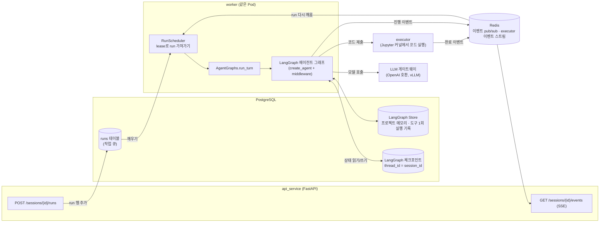
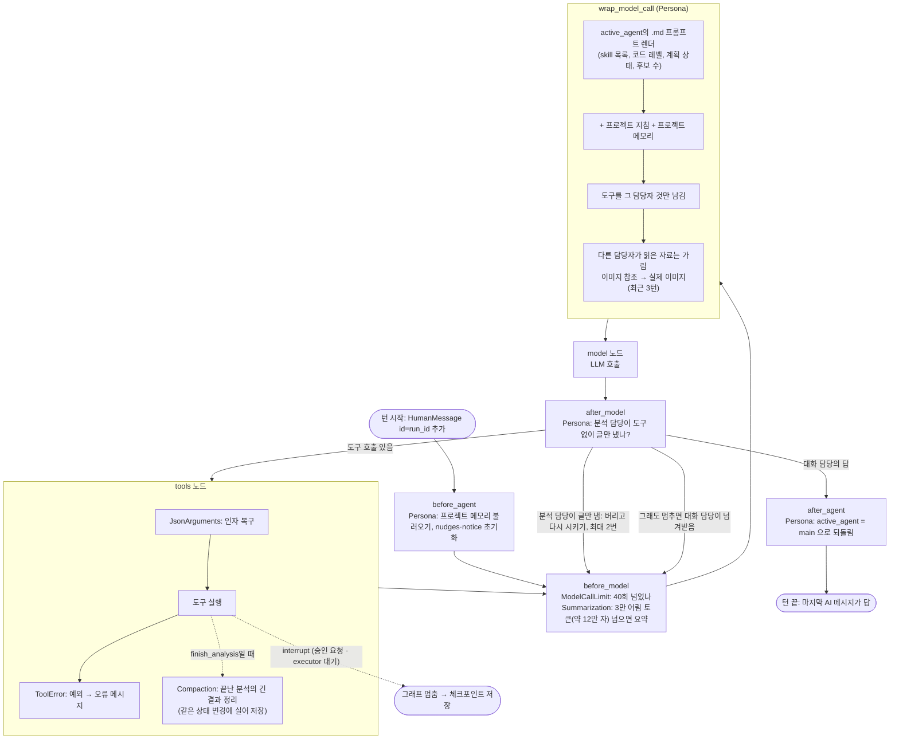
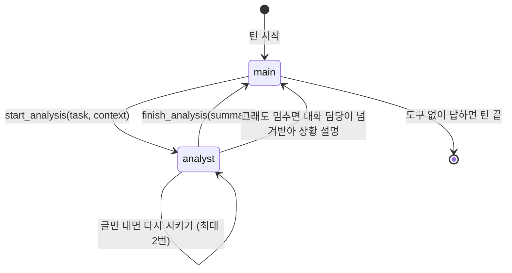
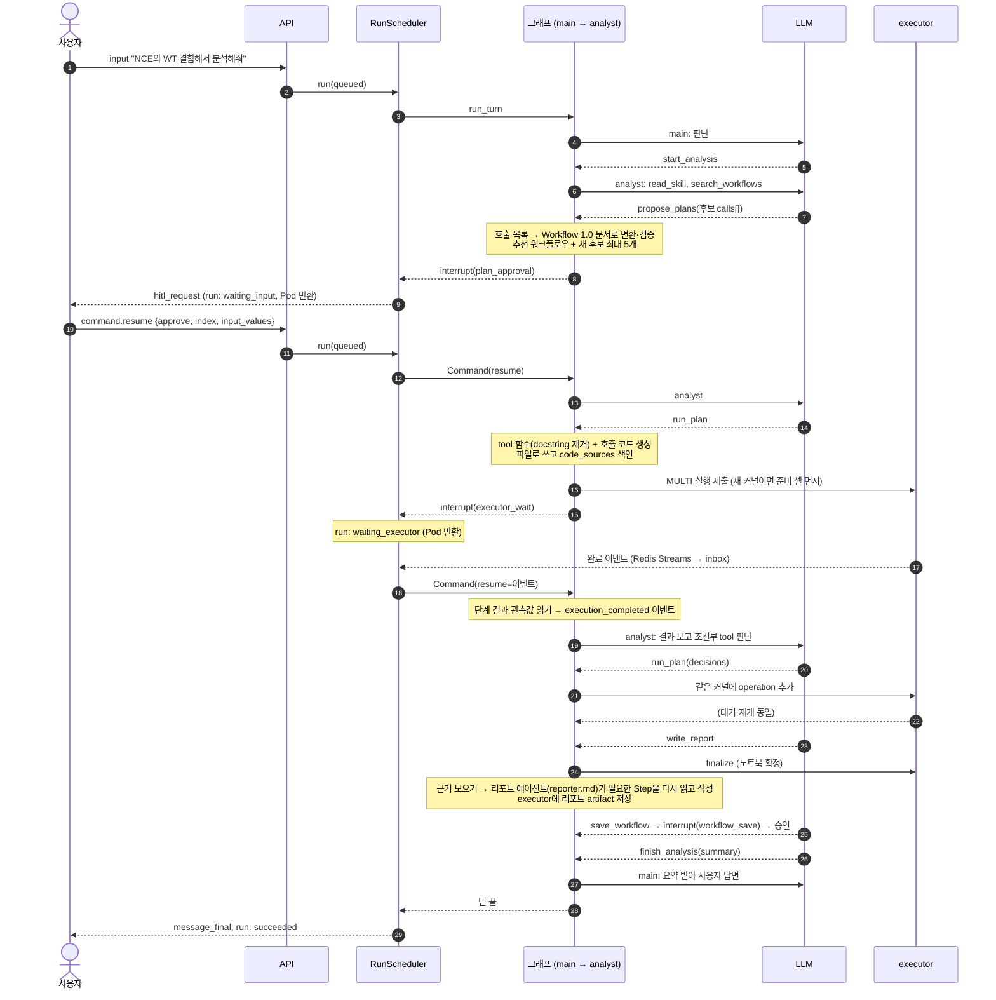
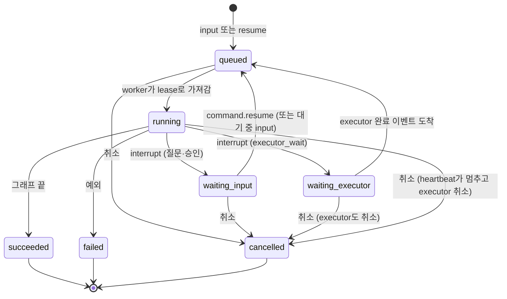

# 에이전트 구조 (현재 구현)

기준: `main` 2026-10-14. 에이전트 쪽(`src/agent/`)과, 그것을 돌리는 worker(`src/worker/scheduler.py`)만 다룹니다.

## 1. 한눈에 보기



- **사용자 턴 하나 = run 하나.** API는 `runs`에 행을 넣고 끝납니다. 실제 실행은 worker가 합니다.
- **에이전트는 LangGraph 그래프 하나**입니다(`agent/graph.py`). 대화 상태는 세션별로 PostgreSQL 체크포인트에 저장되고, 멀티턴은 이 상태를 이어 붙여서 됩니다.
- **사람 확인(HITL)과 executor 대기는 LangGraph `interrupt`**로 그래프를 멈춥니다. 기다리는 동안 Pod를 점유하지 않고, 답이나 결과가 오면 `Command(resume=…)`로 같은 지점부터 이어 갑니다.

## 2. LangGraph를 어떻게 썼나

`agent/graph.py`의 `AgentGraphs.get()`이 모델마다 그래프를 하나 만들어 캐시합니다.

```python
create_agent(
    model,                       # GatewayChatOpenAI (agent/llm.py)
    tools=TOOLS,                 # 두 담당자의 도구 전부 (17개)
    middleware=[
        PersonaMiddleware,       # 담당자 전환, 프롬프트·도구 고르기, 메모리 주입, 이미지 주입, 멈춤 방지
        JsonArgumentsMiddleware, # 문자열로 온 JSON 인자 복구
        ToolErrorMiddleware,     # 도구 오류를 모델에게 메시지로 돌려줌
        ModelCallLimitMiddleware(run_limit=40),   # 한 턴 모델 호출 상한
        ToolResultCompactionMiddleware,  # 분석이 끝나면 그 분석의 긴 도구 결과를 줄임 (agent/middleware/compaction*.py)
        SummarizationMiddleware(trigger=3만 어림 토큰≈12만 자, keep=절반, prompts/summary.md(최대 6천 자), 입력 자르지 않음),
    ],
    state_schema=AnalysisState,  # messages + active_agent, plan, execution, reports, nudges, notice
    context_schema=RunContext,   # run마다 주입: services, run/session/project/user id, 모델, 코드 레벨, 프로젝트 지침
    checkpointer=AsyncPostgresSaver,
    store=AsyncPostgresStore,
)
```

- `create_agent`는 LangChain v1의 에이전트 그래프입니다. 내부는 **model 노드 ↔ tools 노드 루프**이고, 모델 응답에 도구 호출이 없으면 끝납니다.
- 그래프는 **하나**이고 담당자(대화 담당 `main`, 분석 담당 `analyst`)는 **상태값(`active_agent`)**입니다. 서브그래프나 별도 에이전트를 두지 않고, middleware가 모델을 부를 때마다 그 담당자의 프롬프트와 도구만 보이게 바꿉니다. deepagents가 쓰는 "middleware로 행동을 조립" 방식입니다.
- 실행은 `graph.astream(..., stream_mode=["messages", "updates"], durability="async")`입니다. `messages` 모드로 토큰을 받아 SSE로 흘리고(50ms 묶음), `updates` 모드로 도구 호출을 활동 기록으로 보냅니다. 체크포인트는 비동기로 저장합니다.

### 그래프 한 바퀴 (middleware 훅 순서)



## 3. 두 담당자 (persona)



| | 대화 담당 `main` | 분석 담당 `analyst` |
| --- | --- | --- |
| 프롬프트 | `prompts/main.md` | `prompts/analyst.md` |
| 읽는 skill | 도메인 지식(`assets/knowledge`) | 분석 skill(`assets/skills`) |
| 도구 | `ask_user`, `read_knowledge`, `save_memory`, `delete_memory`, `start_analysis` | `ask_user`, `read_skill`, `read_tool`, `search_tools`, `search_workflows`, `propose_plans`, `revise_call`, `run_plan`, `run_custom_code`(코드 레벨 2 이상), `write_report`, `save_workflow`, `finish_analysis` |
| 하는 일 | 대화, 도메인 질문 답변, 메모리 관리, 분석이 필요하면 넘기기 | 계획 세우기, 승인 받기, executor 실행, 결과 판단, 리포트, 워크플로우 저장 |

- 두 담당자는 **같은 메시지 기록**을 봅니다. 다만 상대가 읽은 자료(지식 skill, 분석 skill, tool 설명, 워크플로우 검색 결과)는 "(다른 담당자가 참고한 자료라 생략)"으로 가려서, 필요 없는 skill 내용을 끌고 다니지 않게 합니다.
- 전환은 도구가 상태를 바꾸는 것(`Command(update={"active_agent": …})`)이라, 다음 모델 호출부터 다른 프롬프트와 도구로 바뀝니다.
- 프롬프트는 모두 `.md` 파일이고, 고치면 다음 모델 호출부터 반영됩니다(재시작 불필요).

## 4. 분석 한 턴의 흐름



### 주요 도구가 하는 일

| 도구 | 내용 |
| --- | --- |
| `propose_plans` | 모델은 평평한 호출 목록(`{"skill","tool","args"}`, `"$input"`, `"@0.data"`)만 쓰고, 서버가 Workflow 1.0 문서로 바꾸고 검증합니다(`plan_format.py`, `core/workflows/spec.py`). 추천 템플릿은 그대로 후보에 넣습니다. 사용자에게 `plan_approval` interrupt. |
| `run_plan` | 승인된 계획에서 아직 안 한 호출을 조건부 호출 앞까지 묶어(segment) executor에 한 operation으로 보냅니다. 조건부 호출은 모델이 `decisions`로 실행 여부를 정해 다시 부릅니다. |
| `run_custom_code` | 코드 레벨이 허락하면 모델이 쓴 코드를 `code_approval` interrupt로 승인받고 실행합니다. |
| `revise_call` | 실행 중 실패한 호출의 인자만 고칩니다. |
| `write_report` | 노트북 확정(finalize) → 근거 수집(`reporter.collect_evidence`, 최대 4만 자 개요) → 리포트 에이전트(`agent/report_agent.py`, `prompts/reporter.md`)가 잘렸거나 정확한 수치가 필요한 Step을 `read_step`으로 다시 읽고 `submit_report`로 제출(모델 호출 최대 `REPORT_MODEL_CALL_LIMIT` 8번) → executor에 리포트 artifact 저장. 배치 리포트도 같은 에이전트를 `prompts/batch_analyst.md`로 씁니다. 작성 중 `read_step` 호출은 채팅에 `tool_call`("Step N 결과 확인")로 보이고, 에이전트의 글은 채팅에 흐르지 않습니다(리포트는 `artifact`로 전달) |
| `save_workflow` | 승인된 계획을 워크플로우 후보로 저장 제안(`workflow_save` interrupt) |
| `ask_user` | 모호하거나 빠진 정보를 묻습니다(`question` interrupt). |
| `save_memory`, `delete_memory` | 프로젝트 메모리(LangGraph Store) 주제(topic id)의 한 줄을 더하거나 바꾸거나 지움. 사용자가 "기억해줘"처럼 명시적으로 요청한 때만. 대화에서 드러난 사실은 백그라운드 메모리 worker(`worker/memory.py`)가 정리 |

### 결과를 에이전트가 읽는 방법

executor에 보내는 코드는 `codegen.py`가 만듭니다. tool 셀은 "tool 함수 + 호출 + `_agentic_observe(변수)`"이고, `_agentic_observe`가 결과를 짧은 JSON으로 `AGENTIC_OBSERVATION …` 한 줄 출력합니다. 단계가 끝나면 그 줄만 골라(`parse_observations`) 모델에게 관측값으로 줍니다. 데이터 자체는 커널 변수로 남고, 모델에는 수 KB 요약만 갑니다.

## 5. run의 상태와 멈춤·재개



- **멈춤:** 도구 안에서 `interrupt(payload)`를 부르면 LangGraph가 그 시점의 상태를 체크포인트에 저장하고 그래프를 끝냅니다. 스케줄러가 payload 종류를 보고 `waiting_input` 또는 `waiting_executor`로 바꾼 뒤 lease를 놓습니다.
- **재개:** 답이 오면 run을 다시 `queued`로 두고, worker가 `Command(resume={interrupt_id: value})`로 같은 그래프를 다시 돌립니다. LangGraph는 멈췄던 도구를 처음부터 다시 실행하고, `interrupt()`가 이번에는 받은 값을 돌려줍니다.
- **다시 실행돼도 안전하게:** 도구가 재실행돼도 executor에 두 번 보내지 않도록 두 가지 장치가 있습니다.
  - `_once`가 도구 호출별 결과를 Store에 기록합니다.
  - 모든 executor 요청에 `run_id:tool_call_id`에서 만든 멱등 키를 씁니다.
  - 코드 파일도 같은 경로에 한 번만 씁니다.
- **장애:** Pod가 죽으면 lease가 만료되고, 다른 worker가 같은 run을 가져가 체크포인트부터 이어 갑니다.

## 6. 파일 지도

| 파일 | 역할 |
| --- | --- |
| `agent/graph.py` | 그래프 조립(`create_agent`), `run_turn`(시작·재개·이어 받기, 스트리밍) |
| `agent/middleware/persona.py` | `PersonaMiddleware`(담당자·프롬프트·도구·메모리·이미지·멈춤 방지), 담당자별 도구 표 |
| `agent/middleware/json_arguments.py` | `JsonArgumentsMiddleware`: 문자열로 온 JSON 인자 복구 |
| `agent/middleware/summarization.py` | LangChain 요약 미들웨어 + 진행 이벤트(`activity`, `context_summarized`) |
| `agent/middleware/compaction.py` | 범용 미들웨어: 구간(시작·끝 도구)이 끝나면 도구 결과를 규칙대로 줄이거나 지움 |
| `agent/middleware/compaction_rules.py` | 우리 규칙: 검색 결과·관측값 정리, skill·tool 문서는 최신본 유지, 리포트는 요약·주요 결과만, 호출 인자는 그대로 |
| `agent/activity.py` | 오래 걸리는 작업의 진행 이벤트(`ctx.activity(kind)`)와 문구 표 |
| `agent/context.py` | `RunContext`(run마다 주입), `AnalysisState`(체크포인트에 남는 상태) |
| `agent/tools/main.py`, `common.py`, `analysis.py` | 도구들 |
| `agent/plan_format.py` | 모델이 쓰는 호출 목록 ↔ Workflow 1.0 문서 |
| `agent/codegen.py` | executor로 보낼 코드(준비 셀, tool 셀, 사용자 코드), 관측값 파싱 |
| `agent/reporter.py` | 리포트 근거 수집, 분석 리포트 요청 조립 |
| `agent/report_agent.py` | 리포트 에이전트(분석·배치 공통, `read_step`·`submit_report`) |
| `agent/titles.py` | 첫 답변 뒤 세션 제목 생성 |
| `agent/llm.py` | 게이트웨이 클라이언트(모델 이름별 캐시) |
| `agent/prompts/*.md` | main, analyst, reporter, summary(대화 요약 틀) 프롬프트와 멈춤 방지 알림 |
| `worker/scheduler.py` | run 가져가기·heartbeat·interrupt 처리·완료 기록·제목·취소 |
