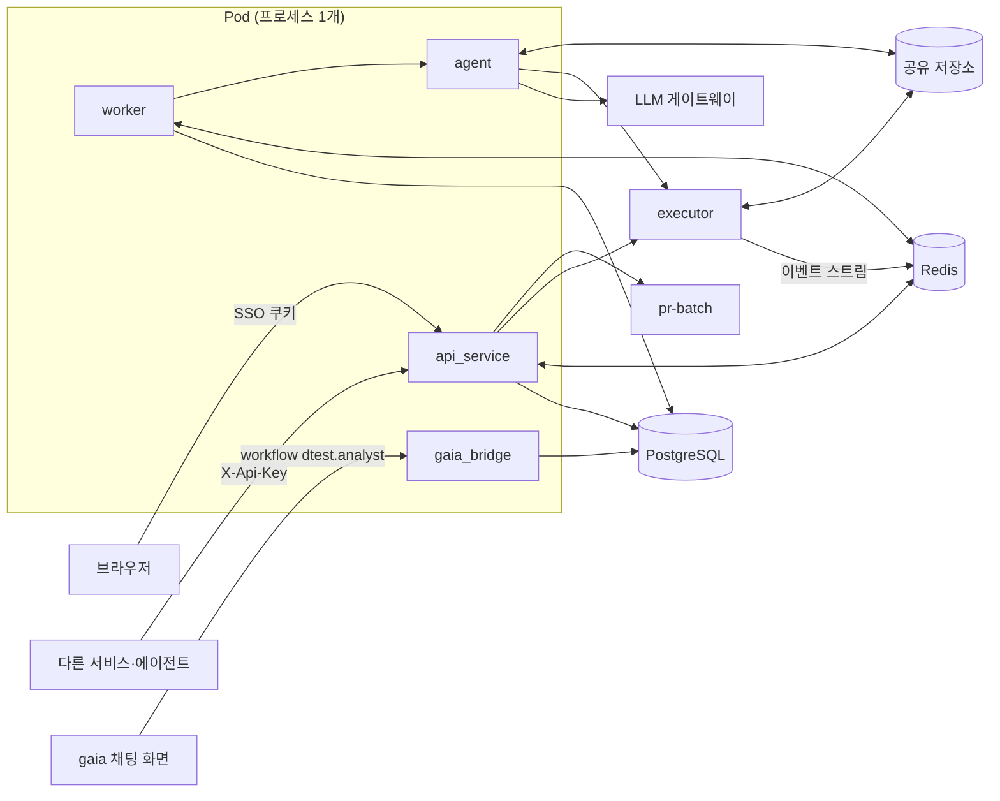

# 소스코드 설명서

기준: internal/gaia 브랜치, 2026-11-22. 경로는 내부망 레포 기준입니다. 서비스 코드는 모두 `src/dtest/` 아래에 있고 import는 `src.dtest.`로 시작합니다.

## 1. 시스템 개요

pr-agentic-service는 사내 데이터 분석 Agent 서비스입니다. 사용자, 프로젝트, 세션 계층을 가진 채팅 API이고, 세션 안에서 사용자가 보낸 메시지를 Agent가 처리합니다. Agent는 LangGraph와 LangChain으로 만들었고, 분석 코드는 직접 실행하지 않고 executor 서비스에 보내 실행합니다.



핵심 동작 원리는 네 가지입니다.

- **사용자 턴 하나가 run 하나입니다.** API는 `runs` 테이블에 행을 넣고 바로 응답합니다. 실제 실행은 worker가 그 행을 가져가서 합니다. PostgreSQL 테이블이 작업 큐입니다.
- **기다리는 동안 자원을 잡지 않습니다.** 사용자 확인이 필요하거나 executor가 코드를 실행하는 동안에는 LangGraph의 `interrupt`로 그래프를 멈추고 상태를 체크포인트에 저장합니다. 답이나 결과가 오면 같은 지점부터 이어 갑니다.
- **어느 Pod든 이어 갈 수 있습니다.** 실행 권한은 lease(기본 60초)로 잡습니다. Pod가 죽으면 lease가 만료되고 다른 Pod가 체크포인트에서 이어 갑니다.
- **화면에는 이벤트로 알립니다.** 진행 상황은 Redis 발행/구독으로 각 Pod에 퍼지고, 브라우저는 SSE로 받습니다. 저장이 필요한 이벤트는 `run_events`에도 남겨, 끊겼다 다시 붙으면 이어 받습니다.

## 2. 레포 구조

```text
app.py                     gaia 템플릿의 진입점. GaiaService()와 main() 사이에 attach() 한 줄
config.yml                 모든 환경 공통 설정
config.{dev,stg,prd}.yml   환경별 설정
config.example.yml         설정 키 설명(서비스가 읽지 않음)
logger.yml                 로깅 설정
Dockerfile, docker-compose.yml
deploy/kubernetes/         배포 매니페스트 예시
docs/                      문서
locust/                    부하 테스트
scripts/                   운영·개발 스크립트
tests/                     pytest
src/
  workflows/dtest/analyst.py   gaia workflow로 내보내는 graph (두 줄)
  dtest/                       이 서비스의 코드 전부
    entry.py                   attach(): 라우트 연결, 시작·종료 처리
    local.py                   gaia 없이 띄우는 진입점(사외)
    idp_login.py               SSO 연결(로그인 주소, userinfo, 필드 대응)
    tracing_phoenix.py         Phoenix 추적(선택)
    winloop.py                 Windows 이벤트 루프 보정
    api_service/               FastAPI 라우터, 인증, 요청·응답 스키마
    agent/                     LangGraph 그래프, middleware, 도구, 프롬프트
    worker/                    백그라운드 작업
    core/                      설정, DB, 이벤트, executor 클라이언트, 공용 서비스
    gaia_bridge/               gaia 채팅과 우리 run을 잇는 다리
    assets/                    기본 skill, tool, knowledge
    catalogs/                  확장 카탈로그(테스트용 분석 카탈로그)
    migrations/                Alembic 마이그레이션
    web/dev/                   테스트 콘솔(/dev/)
    alembic.ini
```

gaia 템플릿의 파일(`src/server.py`, `src/config.py`, `src/gaia/`, `src/common/`, `src/lib/`, `src/routers/`)은 건드리지 않습니다.

### 2.1 의존 방향

```text
api_service → core
worker → agent → core
gaia_bridge → api_service.services, core
```

- `api_service`는 `agent`를 import하지 않습니다. API는 run을 만들기만 하고 Agent를 직접 부르지 않기 때문입니다.
- `core`는 다른 패키지를 import하지 않습니다.
- API, agent, worker는 `gaia_bridge`를 모릅니다.

이 방향이 지켜져야 `RUN_MODE`로 API와 worker를 따로 띄울 수 있습니다.

## 3. 기동과 종료

### 3.1 기동 순서

1. `app.py`가 `GaiaService()`로 FastAPI 앱을 만들고 `attach(gaia_service.app)`을 부른 뒤 `gaia_service.main()`으로 서버를 띄웁니다.
2. `attach()`(`src/dtest/entry.py`)가 하는 일:
   - Windows이면 이벤트 루프를 Selector로 바꿉니다(psycopg 비동기가 요구).
   - 로그에 요청 ID 칸을 붙입니다.
   - 설정을 읽습니다(`get_settings()`). 여기서 설정 검사가 실패하면 기동이 멈춥니다.
   - Phoenix 추적을 켭니다(설정이 있을 때).
   - `mount_api()`로 우리 라우터와 미들웨어를 붙입니다.
   - `DOCS_ENABLED`가 false이면 문서 경로를 내립니다.
   - `/api/v1/healthz`를 붙입니다.
   - `DtestLifespan` 미들웨어를 가장 바깥에 붙입니다.
3. uvicorn이 lifespan startup을 보내면 `DtestLifespan._start()`가:
   - `build_services()`로 DB 풀, Redis, 체크포인트 풀, executor 클라이언트, 카탈로그 로더 등을 만듭니다(`core/bootstrap.py`).
   - `AUTO_MIGRATE`가 true이면 마이그레이션을 실행합니다.
   - API를 시작합니다(이벤트 구독 등).
   - `Worker`를 만들어 백그라운드 루프를 띄웁니다.
   - `app.state.ready = True`

gaia의 `main()`은 앱의 lifespan을 자기 것으로 바꾸기 때문에 FastAPI의 lifespan이나 startup 훅을 쓸 수 없습니다. 그래서 ASGI 미들웨어(`DtestLifespan`)가 lifespan 메시지를 먼저 받아 처리하고 gaia로 넘깁니다. 우리 시작이 실패하면 `lifespan.startup.failed`를 보내 프로세스를 끝냅니다. 예외만 던지면 uvicorn이 "lifespan 미지원"으로 보고 서비스 없이 떠 버립니다.

### 3.2 `RUN_MODE`

| 값 | API | worker |
| --- | --- | --- |
| `all` (기본) | 켬 | 켬 |
| `api` | 켬 | 끔 |
| `worker` | 끔 | 켬 |

현재 배포는 `all`입니다. worker를 별도 Deployment로 옮길 때 코드 변경 없이 이 값만 바꾸면 됩니다.

### 3.3 종료 순서

lifespan shutdown을 받으면 만든 순서의 반대로 정리합니다. worker는 새 run을 받지 않고 진행 중인 턴을 최대 20초 마무리한 뒤, 남은 run의 lease를 반납합니다. 그다음 API, 이벤트 구독, executor 클라이언트, Redis, 체크포인트 풀, DB 풀을 닫습니다.

### 3.4 사외 실행

gaia 템플릿 없이 띄울 때는 `src/dtest/local.py`가 일반 FastAPI 앱에 같은 `attach()`를 붙입니다. `/api/admin/appReady`도 흉내 냅니다.

```
uv run python -m src.dtest.local        # 포트 8080 또는 PORT
docker compose up -d --build            # shared-infra(postgres, redis)와 executor compose가 떠 있어야 함
```

## 4. 요청 한 건의 흐름

### 4.1 일반 대화

1. 브라우저가 `GET /api/v1/sessions/{id}/events`로 SSE를 열어 둡니다.
2. 브라우저가 `POST /api/v1/sessions/{id}/runs`에 메시지를 보냅니다.
3. `api_service/services/runs.py`의 `create_run`이 세션 행을 잠그고, 진행 중인 run이 없는지 확인한 뒤 `runs`에 `queued` 행을 넣고 사용자 메시지를 `messages`에 저장합니다. `Idempotency-Key`가 있으면 `run_requests`에 기록합니다. Redis로 깨우기 신호를 보냅니다.
4. 어느 Pod의 `RunScheduler`(`worker/scheduler.py`)가 그 run을 `FOR UPDATE SKIP LOCKED`로 가져가 `running`으로 바꾸고 lease를 잡습니다.
5. `AgentGraphs.run_turn`(`agent/graph.py`)이 그래프를 실행합니다. 모델이 내는 토큰은 50ms 단위로 묶어 이벤트로 발행합니다.
6. 그래프가 끝나면 스케줄러가 최종 답변을 `messages`와 `run_events`에 저장하고 run을 `succeeded`로 바꿉니다.
7. 브라우저는 SSE로 `message_final`을 받습니다.

### 4.2 분석

1. 대화 담당(main)이 분석이 필요하다고 판단하면 `start_analysis` 도구로 분석 담당(analyst)에게 넘깁니다.
2. 분석 담당이 skill을 읽고, 저장된 워크플로우를 검색하고, `propose_plans`로 계획 후보를 냅니다.
3. 계획 승인이 필요하면 `interrupt`로 멈춥니다. 스케줄러가 run을 `waiting_input`으로 바꾸고 lease를 놓습니다. 화면에는 계획 카드가 뜹니다.
4. 사용자가 승인하면 API가 run을 다시 `queued`로 바꾸고, worker가 `Command(resume=...)`로 같은 지점부터 이어 갑니다.
5. `run_plan`이 tool 코드와 호출 코드를 만들어 공유 저장소에 파일로 쓰고(`code_sources` 기록), executor에 실행을 제출한 뒤 다시 `interrupt`로 멈춥니다. run은 `waiting_executor`가 됩니다.
6. executor가 끝나면 Redis 스트림에 이벤트를 씁니다. `ExecutorEventConsumer`(`worker/executor_events.py`)가 받아 executor에 다시 조회해 확인한 뒤 `executor_inbox`에 넣고, 기다리던 run을 `queued`로 바꿉니다.
7. worker가 이어 가서 결과(관측값)를 모델에게 줍니다. 조건부 단계가 있으면 모델이 판단해 같은 커널에 이어 실행합니다.
8. `write_report`가 노트북을 확정하고, 근거를 모아 리포트 Agent가 리포트를 쓰고, executor에 Artifact로 저장합니다.
9. `finish_analysis`로 대화 담당에게 돌아가 사용자에게 답합니다.

도구가 다시 실행되어도 executor에 두 번 보내지 않도록, 도구 호출별 결과를 store에 기록하고 모든 executor 요청에 `run_id:tool_call_id`로 만든 멱등 키를 씁니다.

## 5. `api_service`: API 계층

### 5.1 파일

| 파일 | 역할 |
| --- | --- |
| `app.py` | `mount_api()`: 라우터와 미들웨어 조립. 요청 크기 제한(`BodyLimit`), 감사 로그, CORS, 요청 ID |
| `paths.py` | 우리 경로(`/api/v1/`, `/view/`, `/dev/`) 판별. `OwnPaths`로 미들웨어를 우리 경로에만 적용, gaia 접근 키 검사 건너뛰기 |
| `deps.py` | 인증 의존성(`current_user`), 관리자 확인, 사용자·키 캐시 |
| `errors.py` | 오류 응답 형식(`code`, `message`, 오류 ID) |
| `sse.py` | SSE 스트림. 저장된 이벤트 재생 후 실시간 이벤트 전달, 15초마다 유지 신호 |
| `pagination.py` | 목록 페이지네이션 |
| `rate_limit.py` | SSO 로그인 경로의 분당 요청 제한 |
| `users.py` | 사용자 조회와 생성 공통 함수 |
| `auth/` | SSO: `service.py`(로그인 흐름), `adapters.py`(idp, dev), `sdk.py`(SDK 연결), `store.py`(Redis 세션) |
| `services/` | `runs.py`(run 생성·취소), `hitl.py`(사용자 확인 응답 검증), `access.py`(프로젝트·세션 접근 권한), `api_clients.py`(API 키) |
| `schemas/` | 요청·응답 Pydantic 모델 |
| `routers/` | 아래 표 |
| `templates/`, `static/vendor/` | 결과물 보기 화면과 그 라이브러리(폐쇄망이라 CDN 없이 직접 제공) |

### 5.2 라우터

경로는 모두 `/api/v1` 아래입니다(표시한 것 제외).

| 라우터 | 주요 경로 | 기능 |
| --- | --- | --- |
| `auth.py` | `/auth/login/sso`, `/auth/login/sso/callback/{flow_id}`, `/auth/session`, `/auth/logout` | SSO 로그인, 세션 확인, 로그아웃 |
| `users.py` | `/users/me`, `/users/lookup`, `/admin/users` | 내 정보, 사용자 조회, 관리자용 사용자 관리 |
| `api_clients.py` | `/admin/api-clients` | API 키 발급, 재발급, 폐기 |
| `models.py` | `/models` | 선택 가능한 모델 목록 |
| `projects.py` | `/projects`, `/projects/{id}/memory...` | 프로젝트, 프로젝트 메모리와 이력 |
| `sessions.py` | `/projects/{id}/sessions`, `/sessions/{id}`, `/sessions/{id}/messages`, `/sessions/{id}/runs`, `/runs/{id}`, `/runs/{id}/cancel`, `/sessions/{id}/events`, `/sessions/{id}/outputs` | 세션, 메시지, run 생성과 취소, SSE, 결과물 목록 |
| `images.py` | `/images/{id}` | 첨부 이미지 |
| `workflows.py` | `/workflows`, `/workflows/validate`, `/workflows/search`, `/workflows/{id}/promote`, `/workflows/{id}/reindex` | 워크플로우 등록, 검증, 검색, 승격, 재색인 |
| `catalog.py` | `/catalog/skills`, `/catalog/tools` | skill과 tool 목록 |
| `executor.py` | `/executor/...` | executor 게이트웨이(실행, 결과, Artifact 중계) |
| `batch.py` | `/batch/...`, `/admin/users/{id}/batches` | pr-batch 게이트웨이(배치 중계) |
| `batch_reports.py` | `/batch-reports`, `/batch-reports/{id}/stream` | 배치 리포트 목록, 상세, 진행 스트림 |
| `artifacts.py` | `/artifacts/{id}`, `/artifacts/{id}/content`, `/view/artifacts/{id}` (접두어 없음) | 결과물 조회와 보기 화면 |

### 5.3 인증

`deps.py`의 `current_user`가 다음 순서로 판정합니다.

1. SSO 쿠키가 있으면 SSO 세션으로만 판정합니다. 쿠키가 무효면 401이고 키 경로로 넘어가지 않습니다. CSRF 검사는 이 경로에만 적용합니다.
2. 쿠키가 없고 `X-Api-Key`가 있으면 등록된 키인지 확인합니다. 모르거나 폐기된 키는 401입니다.
3. `X-User-Id`를 검사합니다. 없거나 형식이 틀리면 400, 우리 DB에 없거나 비활성이면 403입니다. 사용자를 자동으로 만들지 않습니다.
4. 둘 다 없으면 401입니다.

권한 규칙은 다음과 같습니다.

- 관리자 API는 키로 부를 수 없습니다(403).
- 프로젝트와 세션은 경로 값이 기준이고, 멤버가 아니거나 남의 세션이면 404입니다.
- executor·배치 게이트웨이는 프로젝트 없이 부를 수 있습니다. 활성 사용자만 확인하고, 남의 실행은 executor가 404로 막습니다.
- 사용자 정보는 30초, API 키 검증은 60초 동안 프로세스에 캐시합니다.

### 5.4 gaia와 앱을 함께 쓰는 부분

같은 FastAPI 앱에 gaia의 경로(`/workflows`, `/{workflow}/gaia/completion`, `/{workflow}/api/completion`, `/api/common/...`, `/api/admin/appReady`)와 우리 경로가 함께 있습니다. 서로 영향을 주지 않도록 아래처럼 나눴습니다.

- 요청 ID, 요청 크기 제한, CORS, 감사 로그 미들웨어는 `OwnPaths`로 감싸 우리 경로에만 적용합니다.
- 오류 응답 형식도 우리 경로에만 씁니다.
- gaia의 접근 키 검사(`AuthMiddleware`, `accesskey` 헤더)는 우리 경로만 건너뜁니다. 브라우저는 그 키를 보낼 수 없기 때문입니다. 적용되면 기동 로그에 `gaia_auth_skipped_on_own_paths`가 찍힙니다.
- 예외는 하나입니다. `DOCS_ENABLED`가 false이면 gaia의 `/docs`, `/redoc`, `/openapi.json`도 내립니다.

## 6. `agent`: Agent

### 6.1 그래프

`agent/graph.py`의 `AgentGraphs`가 모델마다 LangChain `create_agent` 그래프를 하나 만들어 캐시합니다. 그래프 내부는 model 노드와 tools 노드의 반복이고, 모델 응답에 도구 호출이 없으면 끝납니다. 그래프는 하나이고, 행동은 middleware를 조립해 만듭니다(deepagents의 방식).

middleware는 아래 순서로 붙습니다.

| middleware | 파일 | 역할 |
| --- | --- | --- |
| `PersonaMiddleware` | `middleware/persona.py` | 담당자 전환, 담당자별 프롬프트와 도구 고르기, 프로젝트 메모리와 이미지 주입, 분석 담당이 도구 없이 글만 내고 멈추는 것 방지 |
| `JsonArgumentsMiddleware` | `middleware/json_arguments.py` | 문자열로 온 JSON 인자를 복구 |
| `ToolCallDedupMiddleware` | `middleware/tool_call_dedup.py` | 같은 도구 호출의 중복 제거 |
| `ToolFailureLimitMiddleware` | `middleware/tool_failures.py` | 같은 도구가 연속 3회(`AGENT_TOOL_FAILURE_LIMIT`), 어떤 도구든 연속 5회(`AGENT_TOOL_FAILURE_ANY_LIMIT`) 실패하면 멈춤 |
| `ToolErrorMiddleware` | LangChain 제공, 오류 문구는 `tool_errors.py` | 도구 예외를 모델에게 메시지로 돌려줌 |
| `TurnModelCallLimitMiddleware` | `middleware/turn_limit.py` | 한 턴의 모델 호출을 40회(`AGENT_MODEL_CALL_LIMIT`)로 제한. executor 대기로 끊겼다 이어져도 누적 |
| 끝난 분석 정리 | `middleware/compaction.py`, `compaction_rules.py` | 분석이 끝나면 그 분석의 긴 도구 결과를 줄임(`AGENT_COMPACT_FINISHED_ANALYSIS`) |
| `ReportingSummarizationMiddleware` | `middleware/summarization.py` | 대화가 길어지면(`AGENT_SUMMARY_TRIGGER_TOKENS`, 3만 토큰 어림) 앞부분을 요약 |

### 6.2 두 담당자

담당자는 별도 Agent가 아니라 상태값(`active_agent`)입니다. `PersonaMiddleware`가 모델을 부를 때마다 그 담당자의 프롬프트와 도구만 보이게 바꿉니다.

| | 대화 담당 `main` | 분석 담당 `analyst` |
| --- | --- | --- |
| 프롬프트 | `prompts/main.md` | `prompts/analyst.md` |
| 도구 | `ask_user`, `read_knowledge`, `save_memory`, `delete_memory`, `start_analysis` | `ask_user`, `read_knowledge`, `read_skill`, `read_tool`, `search_tools`, `search_workflows`, `propose_plans`, `revise_call`, `run_plan`, `run_custom_code`, `write_report`, `save_workflow`, `finish_analysis` |
| 하는 일 | 대화, 도메인 질문, 메모리 관리, 분석 넘기기 | 계획, 승인 받기, executor 실행, 결과 판단, 리포트, 워크플로우 저장 |

`start_analysis`로 분석 담당으로, `finish_analysis`로 대화 담당으로 넘어갑니다. 두 담당자는 같은 메시지 기록을 보지만, 상대가 읽은 자료(분석 skill, tool 설명, 워크플로우 검색 결과)는 가려서 불필요한 내용을 끌고 다니지 않습니다.

### 6.3 코드 생성 레벨

Agent가 코드를 어디까지 쓸 수 있는지 정하는 값입니다. 세션 설정이고 프로젝트 기본값을 따르며, 시스템 기본값은 3(`DEFAULT_CODE_LEVEL`)입니다.

| 레벨 | 이름 | Agent가 할 수 있는 것 |
| --- | --- | --- |
| 1 | tools_only | 등록된 tool 선택과 인자 결정만 |
| 2 | tools_with_glue | 1 + tool 사이 짧은 연결 코드 |
| 3 | tools_first | 2 + 맞는 tool이 없거나 실패를 메울 때 새 함수 작성 |
| 4 | free_code | tool은 참고만 하고 전체 코드를 Agent가 작성 |

Agent가 쓴 코드는 레벨과 무관하게 승인 화면에 전문을 보여 줍니다.

### 6.4 파일

| 파일 | 역할 |
| --- | --- |
| `graph.py` | 그래프 조립, `run_turn`(시작, 재개, 스트리밍) |
| `context.py` | `RunContext`(run마다 주입하는 값), `AnalysisState`(체크포인트에 남는 상태) |
| `llm.py` | LLM 게이트웨이 클라이언트(모델 이름별 캐시) |
| `tools/main.py` | 대화 담당의 도구 |
| `tools/analysis.py` | 분석 담당의 도구. 가장 큰 파일(약 1,600줄) |
| `tools/common.py` | 두 담당자 공통 도구(`ask_user`) |
| `tools/batch.py` | 배치 리포트 Agent의 도구 |
| `plan_format.py` | 모델이 쓰는 호출 목록과 Workflow 1.0 문서 사이의 변환 |
| `codegen.py` | executor로 보낼 코드 생성(준비 셀, tool 셀, 사용자 코드), 관측값 파싱 |
| `reporter.py` | 리포트 근거 수집 |
| `report_agent.py` | 리포트 Agent(분석과 배치 공통) |
| `batch.py` | 배치 리포트 Agent 실행 |
| `titles.py` | 첫 답변 뒤 세션 제목 생성 |
| `activity.py` | 오래 걸리는 작업의 진행 이벤트와 문구 |
| `tool_errors.py`, `tool_labels.py` | 도구 오류 문구, 화면에 보일 도구 이름 |
| `prompts/*.md` | `main`, `analyst`, `analyst_continue`, `main_fallback`, `reporter`, `batch_analyst`, `memory_worker`, `summary` |

### 6.5 결과를 Agent가 읽는 방법

executor에 보내는 tool 셀은 "tool 함수 + 호출 + `_agentic_observe(변수)`" 형태입니다. `_agentic_observe`가 결과를 짧은 JSON으로 `AGENTIC_OBSERVATION ...` 한 줄 출력하고, 단계가 끝나면 그 줄만 골라 모델에게 관측값으로 줍니다. 데이터 자체는 커널 변수로 남고 모델에는 수 KB 요약만 갑니다.

## 7. `worker`: 백그라운드 작업

`worker/runtime.py`의 `Worker`가 아래 루프를 asyncio 태스크로 띄웁니다. 하나라도 스스로 끝나면 `/api/v1/healthz`가 503이 되어 Pod가 재시작됩니다.

| 루프 이름 | 클래스 (파일) | 역할 |
| --- | --- | --- |
| `run-scheduler` | `RunScheduler` (`scheduler.py`) | run을 가져와 Agent 실행. lease 갱신, interrupt 처리, 완료 기록, 취소, 세션 제목 |
| `executor-events` | `ExecutorEventConsumer` (`executor_events.py`) | executor 이벤트 스트림 소비, inbox 저장, 기다리는 run 깨우기, 배치 완료 시 리포트 작업 등록 |
| `missed-executor-events` | `MissedEventRecovery` (`executor_events.py`) | 스트림으로 못 받은 이벤트를 executor에 직접 물어 복구 |
| `batch-reports-N` | `BatchReportWorker` (`batch_reports.py`) | 배치 리포트 작성. `BATCH_REPORT_CONCURRENCY`만큼 띄움 |
| `batch-report-recovery` | `BatchReportRecovery` (`batch_reports.py`) | 리포트 작업이 빠진 배치 실행을 찾아 등록 |
| `retention` | `Retention` (`maintenance.py`) | 보존 기간 지난 이벤트, 이미지, 코드 파일, 체크포인트 정리 |
| `batch-disable-retry` | `BatchDisableRetry` (`user_deactivation.py`) | 비활성 사용자와 폐기된 tenant의 배치 끄기 재시도 |
| `executor-cancel-retry` | `ExecutionCancelRetry` (`core/executor/cancels.py`) | executor 실행 취소 재시도 |
| `memory-worker` | `MemoryWorker` (`memory.py`) | 대화가 잠잠해지면 프로젝트 메모리 정리 |

### 7.1 `RunScheduler`의 동작

- **가져가기(`_claim`)**: `queued`이거나 lease가 만료된 `running` run을 오래된 순서로 `FOR UPDATE SKIP LOCKED`로 잡습니다. 사용자당 동시 실행 수(`RUN_USER_CONCURRENCY`)를 넘는 run은 건너뜁니다.
- **깨우기**: Redis 채널로 신호를 받으면 바로 가져가고, 신호를 놓쳐도 5초(`RUN_POLL_SECONDS`)마다 확인합니다.
- **lease 갱신(`_heartbeat`)**: lease의 1/3(20초)마다 갱신합니다. 갱신이 lease의 2/3(40초) 동안 실패하면 턴을 스스로 멈춥니다. 다른 Pod가 곧 가져갈 것이므로 두 번 실행되지 않게 하는 것입니다. 갱신하면서 취소 요청도 확인합니다.
- **반복 실패 방지**: 멈춤 없이 연속 `RUN_MAX_ATTEMPTS`(5)번 가져갔는데 결과가 없으면 `failed`로 끝냅니다.
- **종료(`drain`)**: 새 run을 받지 않고 진행 중인 턴을 기다린 뒤, 남은 run을 `queued`로 돌립니다. 종료는 실패한 시도로 세지 않습니다.

### 7.2 executor 이벤트 처리

- executor는 `executor.events.{tenant}` 스트림에 이벤트를 씁니다. 우리는 소비자 그룹으로 읽습니다.
- Redis에는 접근 제어가 없어 누구나 스트림에 쓸 수 있습니다. 그래서 스트림 내용을 믿지 않고, 이벤트 id로 executor에 다시 조회해 확인한 내용을 씁니다.
- 처리하다 죽은 Pod가 남긴 이벤트는 `XAUTOCLAIM`으로 다른 Pod가 가져갑니다(Redis 6.2 이상 필요).
- 소비자 그룹이 사라지면(Redis가 비워짐) 다음 읽기 때 다시 만듭니다.

## 8. `core`: 공용 기반

| 파일 | 역할 |
| --- | --- |
| `config.py` | `Settings`: 모든 설정 키와 기본값, 기동 검사. 설정 파일 읽는 순서 |
| `bootstrap.py` | `build_services()`: 프로세스 단위 객체 생성. `migrate()`: 스키마 적용 |
| `services.py` | `Services`: 위 객체들을 담는 묶음. 거의 모든 코드가 이것을 받아 씀 |
| `db.py` | SQLAlchemy 엔진과 세션, 공통 컬럼, 풀 이름 |
| `models.py` | 테이블 모델 전부 |
| `checkpoints.py` | `PooledPostgresSaver`: 체크포인트 저장이 한 줄로 서지 않게 한 saver |
| `events.py` | `EventBus`: 이벤트 저장과 발행, Pod 내 SSE 분배, run 깨우기 신호 |
| `redis_client.py` | Redis 연결(standalone, sentinel), 시간 제한과 재연결 |
| `assets.py` | skill, tool, knowledge 파일 읽기와 검증. 5초 간격 변경 확인 |
| `embeddings.py` | 임베딩 클라이언트 |
| `images.py` | 첨부 이미지 저장과 크기 검사 |
| `figures.py` | executor 결과의 그림 읽기 |
| `failures.py` | 실패 원인 분류와 사용자용 문구 |
| `notebook_links.py` | JupyterLab 링크 생성 |
| `request_context.py` | 요청 ID |
| `service_headers.py` | executor와 pr-batch 호출에 붙이는 공통 헤더 |
| `batch_admin.py` | pr-batch 관리 호출(배치 끄기 등) |
| `logging_setup.py` | 로깅 설정(HCP가 있으면 HCP, 없으면 `logger.yml`) |
| `contracts/` | 이벤트, HITL, 첨부의 형식 정의. API와 worker가 함께 쓰는 약속 |
| `executor/` | `client.py`(executor HTTP 클라이언트), `storage.py`(공유 저장소), `sources.py`(코드 파일 기록), `cancels.py`(취소 재시도), `testmode/`(공유 저장소 없이 테스트하는 모드) |
| `memory/service.py` | 프로젝트 메모리(주제, 본문, 이력) |
| `workflows/` | `service.py`(등록, 검색, 색인), `spec.py`(Workflow 1.0 검증), `pick.py`(추천 고르기), `view.py`(화면용 변환) |

## 9. `gaia_bridge`: gaia 채팅 연동

`src/workflows/dtest/analyst.py`가 gaia workflow `dtest.analyst`입니다. 파일은 두 줄이고 구현은 `src/dtest/gaia_bridge/`에 있습니다.

| 파일 | 역할 |
| --- | --- |
| `graph.py` | gaia에 내보낼 LangGraph graph |
| `turn.py` | gaia 메시지 하나를 우리 run 하나로 실행하고 결과를 돌려줌 |
| `identity.py` | gaia `user_id`(사번)로 우리 사용자 찾기, 없으면 생성 |
| `models.py` | `gaia_sessions` 테이블 |
| `auto_replies.py` | 사용자 확인 질문에 대한 자동 응답 규칙 |
| `runtime.py` | 서비스 객체 주입 |

동작은 다음과 같습니다.

- gaia 메시지 하나가 우리 채팅의 한 턴입니다. API와 같은 `create_run`으로 run을 만들고 worker가 실행합니다. 다리는 세션 이벤트를 따라가다 run이 끝나면 답을 돌려줍니다.
- gaia `session_id`마다 사용자의 기본 프로젝트에 우리 세션 하나가 만들어집니다. 같은 대화가 우리 화면에도 보입니다.
- gaia의 HITL은 쓰지 않습니다. 계획 승인은 첫 후보로 자동 승인하고(필수 입력값이 비면 그 값을 물음), 코드 승인은 승인, 메모리 변경과 워크플로우 저장 제안은 거절합니다. Agent의 질문은 그 질문을 답으로 보내 턴을 끝내고, 다음 gaia 메시지가 그 답이 됩니다.
- 결과물(리포트, 노트북)은 `urls`로 보냅니다.
- gaia 연결이 끊겨도 run은 worker에서 끝까지 돕니다.

## 10. 외부 연동

### 10.1 executor

- 클라이언트는 `core/executor/client.py`입니다. 모든 호출에 우리 키(`EXECUTOR_API_KEY`), tenant, 사용자 id, 요청 ID 헤더를 붙입니다.
- 코드는 공유 저장소에 파일로 쓰고 경로를 보냅니다. executor는 제출 시점에 그 파일의 사본을 뜹니다.
- 결과는 executor가 준 상대 경로를 `EXECUTOR_RESULT_ROOT`에 붙여 공유 저장소에서 읽습니다.
- 완료는 Redis 스트림 이벤트로 받습니다.
- 다른 서비스가 executor를 쓸 때는 우리 게이트웨이(`/api/v1/executor/...`)를 거칩니다. 우리 서비스가 호출자의 키와 사용자를 확인한 뒤 우리 키로 executor를 부릅니다.

### 10.2 pr-batch

- 배치 등록과 조회는 우리 게이트웨이(`/api/v1/batch/...`)가 pr-batch로 중계합니다(`routers/batch.py`).
- 배치 실행은 pr-batch가 executor에 직접 제출합니다. 실행이 성공하면 executor 이벤트를 우리가 받아 배치 리포트 작업을 만듭니다.
- 사용자를 비활성화하거나 tenant의 키를 모두 폐기하면 pr-batch에 그 배치들을 끄라고 요청합니다.

### 10.3 LLM과 임베딩

- OpenAI 호환 게이트웨이입니다. `MODELS`에 적힌 모델만 씁니다. 모델별 `params`는 그 모델 요청에만 붙습니다.
- 임베딩은 워크플로우 검색에만 씁니다. `EMBEDDING_PROVIDER`가 `none`이면 검색 추천이 꺼집니다.

### 10.4 SSO

- `src/dtest/idp_login.py`에 로그인 페이지 주소, userinfo 주소, 응답 필드 대응(`FIELDS`)이 있습니다. 환경이 바뀌면 이 파일을 고칩니다.
- 방식은 `userinfo`입니다. 브라우저의 SSO 쿠키를 userinfo 주소로 보내 응답 JSON에서 사번과 이름을 읽습니다.
- 로그인 세션은 Redis에 저장하고 브라우저에는 `agentic_session` 쿠키를 줍니다.

## 11. assets: skill, tool, knowledge

| 종류 | 위치 | 형식 | 쓰는 곳 |
| --- | --- | --- | --- |
| skill | `src/dtest/assets/skills/<분류>/<이름>.md` | Markdown | 분석 담당이 읽고 계획을 세움 |
| tool | `src/dtest/assets/tools/<분류>/<이름>.py` | Python | executor에서 실행되는 분석 함수 |
| knowledge | `src/dtest/assets/knowledge/<이름>.md` | Markdown | 두 담당자가 읽는 도메인 지식 |

- 위치는 `SKILLS_ROOT`, `TOOLS_ROOT`, `KNOWLEDGE_ROOT`로 바꿀 수 있고, `CATALOG_EXTENSIONS`로 카탈로그 폴더를 더 붙일 수 있습니다(`src/dtest/catalogs/analysis_test`가 그 예).
- 파일이 바뀌면 다음 run부터 반영됩니다(5초 간격 확인).
- 현재 `assets/`의 내용은 예시 수준입니다. 실제 분석 tool은 별도 담당이 관리합니다.

tool 파일 규칙은 다음과 같습니다.

- 파일 이름과 같은 이름의 최상위 함수 하나가 tool입니다. 같은 파일에 보조 함수, 클래스, 상수를 둘 수 있습니다.
- tool 호출 하나가 노트북 셀 하나가 됩니다. 셀에는 import, 함수와 클래스 정의, 상수 대입이 들어가고, docstring과 함수 밖 주석, `if __name__ == "__main__":` 블록은 빠집니다.
- 그 밖의 최상위 문장(`print`, 함수 호출, `if`, `for`)이 있으면 로드 오류입니다.
- tool 함수의 docstring 첫 줄과 `Args:`가 Agent에게 보이는 tool 설명입니다. 결과 dict의 키는 `return {...}` 리터럴에서 읽으므로 tool 함수가 결과 dict를 직접 반환해야 합니다.
- 셀은 한 커널을 공유하므로 보조 함수 이름이 다른 tool 이름과 같거나, 다른 파일에 같은 이름이 다른 내용으로 있으면 로드 오류입니다. 보조 함수와 상수 이름 앞에 `_`를 붙이는 것을 권장합니다.
- 여러 tool이 쓰는 함수는 `<TOOLS_ROOT>/_lib/<모듈>.py`에 두고 `from _lib.모듈 import 함수`로 가져옵니다. 셀을 만들 때 쓰는 함수만 tool 코드 앞에 펼쳐 넣습니다. 별칭(`as`), `*`, `import _lib.x`는 쓸 수 없습니다.
- 읽지 못한 tool은 그 파일만 건너뛰고 `tool_load_failed` 경고를 남깁니다.

## 12. 테스트와 개발 도구

| 명령 | 용도 |
| --- | --- |
| `uv sync` | 의존성 설치 |
| `uv run pytest` | 단위 테스트(`tests/`, 약 80개 파일) |
| `uv run ruff format`, `uv run ruff check` | 포맷, 린트(줄 길이 79) |
| `uv run ty check` | 타입 검사 |
| `uv run python scripts/smoke_e2e.py` | 종단 점검 |
| `uv run python scripts/loadtest.py --users 100 --turns 3` | 로컬 부하 측정 |

- 테스트 콘솔은 `/dev/`입니다(`src/dtest/web/dev/index.html`). 로컬과 dev에서 기본으로 켜지고 `WEB_CONSOLE_ENABLED`로 바꿉니다.
- LLM 없이 테스트하려면 `scripts/mock_llm.py`를 띄우고 `LLM_BASE_URL`을 그쪽으로 둡니다.
- 구조를 지키는 테스트가 있습니다. 실패하면 구조가 깨진 것입니다.

| 테스트 | 지키는 것 |
| --- | --- |
| `tests/test_entry.py` | 모든 import가 `src.dtest.`로 시작하는지(main에서 가져온 파일의 누락 확인) |
| `tests/test_config_files.py` | `Settings`의 모든 키가 `config.yml`과 `config.example.yml`에 있는지, 환경별 파일에는 환경별 키만 있는지 |
| `tests/test_checkpoint_saver.py` | LangGraph saver의 락 위치가 바뀌지 않았는지(버전 고정의 이유) |
| `tests/test_own_paths.py`, `tests/test_gaia_auth_skip.py` | 우리 미들웨어와 gaia 키 검사 건너뛰기가 우리 경로에만 적용되는지 |
| `tests/test_winloop.py` | Windows 이벤트 루프 보정 |

## 13. main 브랜치와의 차이

같은 코드가 두 구조로 유지됩니다. `main`은 사외 개발용, `internal/gaia`는 내부망용입니다.

| 항목 | main | internal/gaia |
| --- | --- | --- |
| 코드 위치 | `src/` 바로 아래 (`src/agent`, `src/core` ...) | `src/dtest/` 아래 |
| import | `from core.config import ...` | `from src.dtest.core.config import ...` |
| 진입점 | `src/main.py` (자체 FastAPI 앱) | `app.py` + `src/dtest/entry.py` (gaia 앱에 붙음) |
| assets, catalogs, migrations, web | 레포 루트 | `src/dtest/` 아래 |
| Python | 3.12 | 3.11 |
| 헬스체크 | `/healthz`, `/readyz` | `/api/v1/healthz`, `/api/admin/appReady`(gaia) |
| gaia 연동 | 없음 | `gaia_bridge/`, `src/workflows/dtest/analyst.py`, `gaia_sessions` 테이블 |
| 추가 파일 | | `winloop.py`, `local.py`, `api_service/paths.py` |

두 브랜치를 같이 유지하는 방법은 다음과 같습니다.

- 기능 작업은 어느 쪽에서 해도 됩니다. `main`의 변경은 `git merge main`으로 `internal/gaia`에 가져옵니다. 파일을 `git mv`로 옮겨 두어 git이 이동을 따라가므로 대부분 충돌 없이 `src/dtest/` 아래로 들어옵니다.
- `main`에 새 파일을 만들면 병합 뒤 `src/dtest/` 아래로 옮기고 import를 고쳐야 합니다. `tests/test_entry.py`가 빠진 곳을 알려 줍니다.
- `main`에서 Python 3.12 전용 문법(`def f[T]()` 같은)을 쓰면 병합할 때 고쳐야 합니다.
- 마이그레이션 번호는 두 브랜치가 같아야 합니다.

## 14. 자주 하는 변경

### 14.1 API 경로 추가

1. `src/dtest/api_service/schemas/`에 요청·응답 모델을 만듭니다.
2. `src/dtest/api_service/routers/`의 맞는 파일에 경로를 추가합니다. 인증은 `current_user` 의존성, 접근 권한은 `services/access.py`의 함수를 씁니다.
3. 새 라우터 파일이면 `app.py`의 `mount_api()` 목록에 추가합니다.
4. `tests/`에 테스트를 추가합니다.

### 14.2 설정 키 추가

1. `src/dtest/core/config.py`의 `Settings`에 필드와 기본값을 추가합니다.
2. `config.yml`에 같은 키를 추가합니다. 환경마다 다른 값이면 `config.{dev,stg,prd}.yml`에 둡니다.
3. `config.example.yml`에 의미와 예시를 주석과 함께 추가합니다.
4. `tests/test_config_files.py`가 통과하는지 확인합니다.

### 14.3 테이블이나 컬럼 추가

1. `src/dtest/core/models.py`를 고칩니다.
2. `src/dtest/migrations/versions/`에 다음 번호의 마이그레이션을 만듭니다. 이전 버전 코드가 계속 동작하도록 컬럼은 NULL 허용이거나 DB 기본값을 둡니다.
3. 빈 DB와 직전 버전 DB 양쪽에서 올려 봅니다.
4. main에도 같은 번호로 넣습니다.

### 14.4 Agent 도구 추가

1. `src/dtest/agent/tools/`에 `@tool` 함수를 만듭니다.
2. `src/dtest/agent/middleware/persona.py`의 담당자별 도구 표에 추가합니다.
3. 해당 담당자의 프롬프트(`prompts/main.md` 또는 `analyst.md`)에 언제 쓰는지 적습니다.
4. 화면에 보일 이름을 `tool_labels.py`에 추가합니다.
5. 사용자 확인이 필요한 도구면 `core/contracts/hitl.py`에 형식을 추가하고 `api_service/services/hitl.py`의 응답 검증에 넣습니다.

### 14.5 middleware 추가

1. `src/dtest/agent/middleware/`에 `AgentMiddleware`를 상속해 만듭니다.
2. `agent/graph.py`의 middleware 목록에 순서를 고려해 넣습니다. 앞에 있을수록 바깥에서 감쌉니다.
3. 상태가 필요하면 `agent/context.py`의 `AnalysisState`에 필드를 추가합니다. 체크포인트에 저장되므로 이미 진행 중인 세션에는 그 필드가 없을 수 있다는 점을 처리합니다.

### 14.6 분석 skill이나 tool 추가

`src/dtest/assets/` 아래에 파일을 넣으면 됩니다(11장). 코드 변경은 필요 없습니다.

### 14.7 프롬프트 수정

`src/dtest/agent/prompts/*.md`를 고칩니다. 수정 뒤에는 `scripts/run_scenarios.py`로 분석 시나리오를 돌려 계획과 결과가 나빠지지 않았는지 확인합니다. 프롬프트 변경은 단위 테스트로 잡히지 않습니다.
